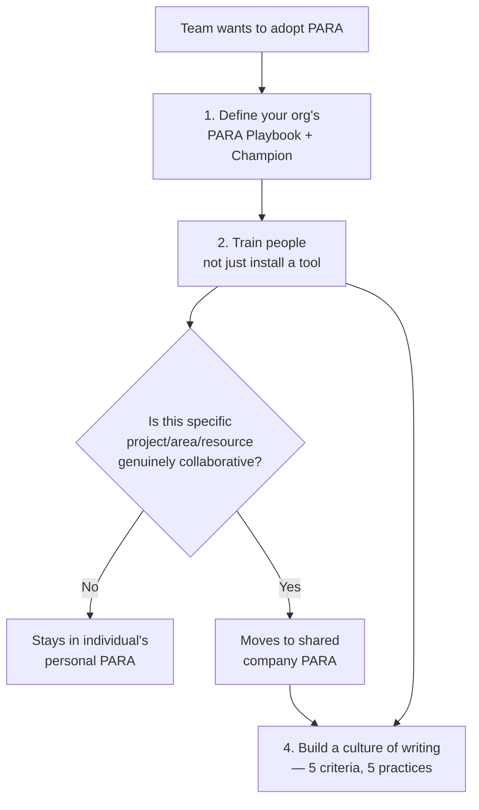
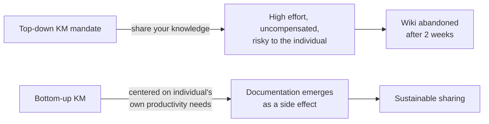

# Chapter 10 — Using PARA with a Team

> [!cite] Book reference
> *The PARA Method: Simplify, Organize, and Master Your Digital Life* — Tiago Forte. Chapter 10: "Using PARA with a Team." Source: user's uploaded EPUB.

> [!summary] One-line takeaway
> PARA scales to teams, but only as a bottom-up, trained, deliberately-scoped system — a "PARA Playbook" plus real training plus keeping only genuinely shared work on shared platforms plus a culture of writing, not a top-down mandate to "share your knowledge" into a wiki nobody will use.

## Why this chapter matters
Chapter 9 established that information inside PARA has to keep flowing between categories as one person's priorities shift; this chapter is the social version of that same problem — knowledge also has to flow *between people*, and that's a fundamentally harder problem because, unlike a single person's own folders, a team has no single person who can unilaterally decide "where does this go." This is the last chapter in Part II's "across platforms and people" arc before the book moves into Part III's individual productivity systems built on top of PARA (Projects lists, habits, etc. in Chapters 11+).

## Direct quotes from the book
> [!quote] On why top-down Knowledge Management fails
> "I distinctly remember the time an executive at a company where I once worked decided to 'implement' Knowledge Management one day out of the blue. A wiki (or knowledge base) was created, and we were told to 'share our knowledge' by inputting what we were learning into it. After the first couple of weeks, no one ever looked at it again."

> [!quote] The reframe Knowledge Management needs
> "It can't be about 'extracting' knowledge from your people, as if it was a natural resource that could be stockpiled in a warehouse. Knowledge Management has to be centered on the needs of the individual, designed primarily to enhance their personal productivity and effectiveness."

> [!quote] On training, not installation
> "The biggest pitfall I see managers fall into is the idea that they can 'install' PARA without having to teach anyone anything. Nothing could be further from the truth."

> [!quote] On why not everything should be shared
> "You absolutely do not want everyone to have access to everything all the time... it takes a tremendous amount of cognitive effort to effectively communicate a piece of knowledge."

> [!quote] On documents as communication across time
> "A document, note, or other digital item is a message being sent through time to a future recipient. Like any message, the quality of that communication determines whether it is likely to be received and understood on the other end."

## The chapter in full (so you never need to re-read it)

### The premise: knowledge wants to be shared, and PARA scales
Forte opens by noting that our digital worlds constantly overlap with other people's — and PARA, despite being introduced as a personal system, "works just as well for teams, companies, and other organizations as it does for individuals." He grounds this in his own consulting experience training "hundreds of people from various industries," citing organizations across the spectrum: the World Bank (multibillion-dollar financial institution), Genentech (biotech), and Sunrun (startup). His framing for why this matters now specifically: "we all operate in a knowledge-based economy," so the ability to document and access what an organization's people know is "crucial not only for growth, but for survival."

### A bottom-up approach to Knowledge Management
PARA sits inside a decades-old discipline called **Knowledge Management (KM)** — the field concerned with helping people share knowledge to advance organizational goals. Forte illustrates the standard failure mode with a personal story: an executive at a company he once worked for decided to "implement" KM by creating a wiki and instructing staff to "share their knowledge" into it. Within a couple of weeks, no one looked at it again.

He diagnoses several structural reasons top-down KM fails:
- Articulating knowledge in a form others can understand takes real time and effort, and most staff are neither compensated nor evaluated for doing it, so it falls by the wayside.
- There are real risks to openly sharing ideas — fear of criticism, of being misinterpreted, or even the fear that documenting what you know makes you easier to replace.

His conclusion, after watching the top-down approach fail "countless times": KM has to be **bottom-up**. It can't treat knowledge as a resource to be "extracted" from employees like a natural resource stockpiled in a warehouse. Instead, Knowledge Management has to be centered on the needs of the *individual* — designed first to enhance personal productivity and effectiveness, so that documentation emerges as a side effect of people being empowered to do their best work, not as a separate extraction mandate.

### The four recommendations for team PARA
Forte gives four specific recommendations for implementing PARA within a team:

**1. Get clear on your organization's flavor of PARA.**
Even if a team follows Forte's advice to the letter, there's always some culturally-specific "flavor" that needs defining explicitly. He recommends creating a **"PARA Playbook"** that documents decisions such as:
- What is your organization's definition of "project," "area of responsibility," "resource," and "archive"?
- What has to happen for a new project to be considered officially "active"?
- What has to happen for a project to be considered "inactive" (completed, on hold, or canceled)?
- What platforms are officially supported for using PARA?
- What rules, guidelines, and norms govern how people use PARA?
- Who is the **"PARA Champion"** responsible for overseeing implementation and enforcing the guidelines?

**2. Train people in how to use PARA.**
Forte frames PARA-for-teams as "primarily a training challenge, not a technical one." The biggest pitfall he sees managers fall into: believing they can "install" PARA the way you'd install software, without teaching anyone anything. He's blunt that this never works. Using the Playbook from Recommendation #1, he suggests presentations, demonstrations, and workshops — because even a system this simple requires people to *unlearn* existing habits and assumptions, specifically:
- the belief that there's a single "right way" to organize
- the belief that there's only one correct place a given piece of information belongs
- the assumption that formal order and precise structure are inherently better

**3. Keep only shared projects on shared platforms.**
Forte flags a common mistake teams make when building a shared PARA system: moving every single digital asset into the shared system all at once, under the logic "if this content is valuable, shouldn't everyone have access?" His answer is a flat **no** — you don't want everyone to have access to everything all the time, because effectively communicating a piece of knowledge is cognitively expensive.

His illustrative example: he once had free-form, messy personal notes on a book about project management techniques — perfectly usable by him alone, but to share them usefully with his team he'd have needed to add real structure (defining key terms, adding headings/sections, a table of contents, background context, explaining his thinking) — real, non-free work. His recommendation: keep all personal notes, files, and documents in each person's *individual* PARA system by default. Only move a Project, Area, or Resource into the shared, company-wide PARA system once it genuinely becomes **collaborative**, with multiple people actually involved. This ensures everyone has access only to what they actually need for their job, and no more.

**4. Encourage a culture of writing.**
Forte connects this back to an idea from his earlier book, *Building a Second Brain*: a document, note, or digital item is "a message being sent through time to a future recipient," and the quality of a message determines whether it's actually received and understood. He gives five criteria for high-quality written communication:
- Is it interesting and attention-grabbing?
- Is it precise and clear?
- Is it empathetic (written from the reader's point of view)?
- Does it help people solve a problem?
- Does it inspire people to take action?

His conclusion: effective Knowledge Management ultimately comes down to how well people write. He offers five concrete practices for building a writing culture:
1. **Set an example** — senior leadership and managers regularly share their most important ideas and decisions in writing
2. **Offer incentives** — reward and praise staff at all levels for taking the time to express their thinking in writing
3. **Provide feedback** — give direct reports private feedback on writing drafts before they're shared more widely
4. **Set aside time for reading** — start meetings with "reading time" to reinforce that context is best absorbed in written form, not explained verbally on the spot
5. **Standardize** — adopt a standard term for internal writing (memo, proposal, one-pager, article) and a standard template (e.g. a Google Doc or Notion page) for producing it

His closing claim: the more encouragement and incentive offered, the more likely colleagues are to actually write down their thinking — and that habit compounds into higher-quality thinking, better decisions and discussions, and ultimately more effective Knowledge Management overall.

## Core concepts (quick-scan version)

| Recommendation | Core idea | Key artifact/role |
|---|---|---|
| 1. Define your flavor of PARA | Culture-specific decisions must be made explicit, not assumed | "PARA Playbook" + a "PARA Champion" |
| 2. Train people | Treat rollout as a training challenge, not a technical install | Presentations, demos, workshops |
| 3. Shared platforms for shared work only | Don't move everything to shared folders by default | Personal PARA stays personal until genuinely collaborative |
| 4. Culture of writing | KM = communication quality, and communication = writing quality | 5 criteria for quality writing + 5 practices to build the habit |

**Why top-down KM fails (the diagnosis behind all four recommendations):** articulating knowledge for others is real, uncompensated work; sharing carries personal risk (criticism, replaceability); and "extracting" knowledge like a raw resource misunderstands what actually motivates people to document what they know.

## First-principles breakdown
Forte's central claim: knowledge management succeeds only when it's individually-motivated first and collectively-beneficial second — never the reverse. Decomposed:

1. **The core incentive problem is a real, general one: public goods are underproduced when individual cost exceeds individual benefit.** Writing up knowledge for a team wiki costs the writer real time and exposes them to real risk (criticism, replaceability) while the benefit accrues diffusely to others. This is a textbook collective-action problem, not specific to PARA or KM — Forte's "bottom-up" fix (make documentation a side effect of *personal* productivity tools, so the individual benefits first) is a genuinely sound incentive-alignment move, independent of PARA as a specific framework.
2. **"Keep only shared projects on shared platforms" is a direct, correct application of a basic communication-cost principle.** Any message requires encoding effort proportional to how much shared context the reader lacks — his own "messy personal notes" anecdote demonstrates this concretely (the information was identical; only the required encoding effort changed based on audience). This is consistent with established ideas in communication theory (e.g., the cost of context-establishing versus content delivery), even though Forte doesn't cite any formal theory — the mechanism he describes is real.
3. **The five writing-quality criteria are prescriptive and intuitively reasonable, but asserted rather than derived or tested.** They read as good practical advice consistent with general writing/communication pedagogy, not as a validated instrument — treat them as a checklist, not a scientifically grounded taxonomy.
4. **Training-over-installation reflects a genuine truth about organizational change**: new shared conventions only work if they're common knowledge (in the game-theoretic sense — everyone needs to know that everyone else knows the convention) , which can only be established through explicit, synchronized communication (training, workshops), not through passive availability of a tool. This is consistent with broader organizational-change literature, even though this chapter doesn't cite it directly.
5. **Hidden assumption / boundary condition**: the whole chapter assumes a team small enough, and stable enough, for a single "Playbook" and "PARA Champion" to meaningfully govern it. In very large or fast-changing organizations, the Playbook itself becomes something that needs the same "keep information flowing" maintenance from Chapter 9 — the book doesn't address what happens when the Playbook itself goes stale, or who re-trains people as team composition turns over. It also assumes psychological safety already exists enough for the "culture of writing" to take hold — in a team with real trust or political problems, none of these four recommendations will fix the underlying risk Forte himself names (fear of criticism, fear of replaceability) as a root cause of top-down KM failure in the first place.

## Visual representation

## Worked example — built directly in your vault
Important framing up front, as instructed: your vault is currently a **single-person, local-only Obsidian setup** — there is no team, no shared platform, and no multi-user PARA in scope today. This chapter's recommendations don't map onto anything that currently exists in `/Users/kiran4.s/ObsidianVault/SecondBrain/`, so rather than inventing a fictional team scenario, here's what genuinely *would* apply if that changed, and where this chapter's logic already shows up in miniature even for a team of one:

- **Recommendation 1 (Playbook), scaled down to "a team of one"**: you effectively already have an informal personal Playbook — the `[[Where Does This Go - Quick Reference]]` note is functionally your own PARA decision-tree/Playbook, and the consistent frontmatter (`tags`, `status`) across your chapter notes is functionally your own naming/structure convention. If Gloss Local ever gained a second contributor (even a single collaborator helping with the Windows client, say), this chapter says: write down your "flavor" of PARA explicitly — what counts as an active vs. archived Gloss Local sub-task, which platform is authoritative — rather than assuming shared understanding by default.
- **Recommendation 3 (shared platforms for shared work only) is the most directly relevant if Gloss Local ever gets a collaborator.** Per this chapter's explicit advice, you would *not* want to dump your entire personal vault or all of Gloss Local's internal notes into a shared space — only the genuinely collaborative subset (e.g., a shared architecture doc, a shared bug tracker) should move to wherever that collaborator also has access, while your personal reasoning, drafts, and unrelated Areas/Resources stay in your own private vault.
- **Recommendation 4 (culture of writing) already applies today, even solo** — this very book-notes project is, in effect, practicing exactly the discipline Forte describes: converting raw reading/thinking into structured, precise, usefully-templated written notes (this chapter's own five criteria are a reasonable rubric to hold these very notes to). Worth noting as a nice internal consistency: the project of writing *these notes* is itself an instance of the chapter's argument that knowledge sharing is fundamentally a writing-quality problem — in this case, writing to a future version of yourself, since Chapter 9's "message sent through time" framing applies even without a second person on the receiving end.

## What the book doesn't tell you — community perspective
- Forte has written a dedicated follow-up piece, "Team Knowledge Management: How to Use PARA in Your Organization," expanding on this exact chapter's four recommendations with more organizational detail than the book itself provides — useful if a real team scenario ever materializes ([Forte Labs](https://fortelabs.com/blog/team-knowledge-management-how-to-use-para-in-your-organization/)).
- A practitioner summary of team PARA adoption makes a sharper, more specific claim than the book does about **permissions as the actual mechanism**: "PARA method for teams works once each folder decides who can see it" — i.e., the real unlock isn't the four-category taxonomy itself but deciding, folder by folder, explicit visibility rules, which the book's Recommendation 3 gestures at but doesn't operationalize as concretely ([Baalda](https://baalda.com/blog/para-method-for-teams)).
- Broader Knowledge Management literature (not PARA-specific) independently confirms the chapter's top-down-failure diagnosis: common, well-documented KM failure causes include lack of leadership/cultural buy-in, absence of credible content owners and adoption metrics, and content going stale from day one — all of which rhyme closely with Forte's own "nobody looked at the wiki after two weeks" story, suggesting this is a general organizational pattern, not something unique to PARA ([Bloomfire, "8 Reasons Why Knowledge Management Fails"](https://bloomfire.com/blog/why-knowledge-management-fails/)).
- At least one commentator pushes back on how much rigidity transfers well to teams at all: "having a strict organizational style works well when it's just you, but when team members need to work with the method too, strictness becomes an impediment to adoption" — a caution against over-indexing on Recommendation 1's Playbook formality at the expense of the flexibility that makes PARA work for individuals in the first place.

## Deeper commentary — how this applies to your setup specifically
Since [[Gloss Local]] and this book-notes project are both currently solo efforts, this chapter is the one in this batch with the least direct, present-tense applicability to your vault — which is worth stating plainly rather than stretching the analogy. The genuinely useful takeaway to bank for later, if Gloss Local ever gains a contributor or user base large enough to need shared documentation (e.g., a setup guide for other people wanting to run their own instance): decide the "flavor" (Recommendation 1) and the shared/private boundary (Recommendation 3) *before* a second person is actually waiting on an answer, exactly the same "decide the transition trigger in advance" principle already flagged in the Chapter 1 and Chapter 6 notes for Gloss Local's Project → Area move. The writing-quality criteria (Recommendation 4) are worth holding onto regardless of team size — they're a genuinely portable checklist for any note meant to be read later, by anyone, including a future you.

## Practical / actionable takeaways
- [ ] No action needed today — this chapter's recommendations don't apply until/unless a second person is collaborating on Gloss Local or the vault
- [ ] If Gloss Local ever gains a contributor, write a minimal "flavor" decision list before onboarding them (what counts as active/inactive, which platform is authoritative) rather than assuming shared understanding
- [ ] If/when any Gloss Local documentation becomes genuinely public-facing (e.g., a setup guide for others), apply the five writing-quality criteria from Recommendation 4 as a review checklist before publishing
- [ ] Optionally: hold these very book notes to the same five writing-quality criteria as a sanity check, since they are themselves "a message sent through time" per the book's own framing

## Questions / things to decide for your own vault
- If Gloss Local ever gets a second contributor, do you want a genuinely separate shared PARA space (e.g., a shared repo/wiki), or a curated subset of your existing vault made visible to them?
- Is there any part of your current solo vault that's secretly already "written for an audience" (i.e., could be shared as-is) versus genuinely personal/private — worth auditing against Recommendation 3's shared/private boundary even without an actual team yet?

## Video
> [!info] Video
> "Tiago Forte | The PARA Method: Simplify, Organize, and Master Your Digital Life | Talks at Google" is a full talk on the book covering its broader framework, including organizational/team applications of PARA discussed in the Q&A portions of Forte's talks generally. https://www.youtube.com/watch?v=UrmUYWOOyFg

## Sources (external, beyond the book)
- [Team Knowledge Management: How to Use PARA in Your Organization — Forte Labs](https://fortelabs.com/blog/team-knowledge-management-how-to-use-para-in-your-organization/)
- [PARA method for teams works once each folder decides who can see it — Baalda](https://baalda.com/blog/para-method-for-teams)
- [8 Reasons Why Knowledge Management Fails — Bloomfire](https://bloomfire.com/blog/why-knowledge-management-fails/)
- [Tiago Forte | The PARA Method: Simplify, Organize, and Master Your Digital Life | Talks at Google — YouTube](https://www.youtube.com/watch?v=UrmUYWOOyFg)

## Footnotes
This chapter's extracted text contains no numbered endnotes (no trailing `[li]` footnote-style items were present in the raw extraction for Chapter 10) — noting this explicitly rather than fabricating a citation.

## Claude's pick — what I'd flag as most important
1. **"Centered on the needs of the individual" is the single idea that makes team KM actually work** — every one of the four recommendations is really just this principle applied in a different direction (Playbook = shared clarity that still respects individual workflows; training = investing in individuals' understanding; shared-platforms-only-when-collaborative = protecting individual privacy/autonomy by default; writing culture = individual communication skill as the real bottleneck).
2. **"Keep only shared projects on shared platforms" is the most immediately actionable rule**, and the one most teams skip in the excitement of "let's share everything" — worth remembering even at the scale of "me plus one collaborator."
3. **This chapter is honest about its own limits** (Forte openly describes a KM rollout he watched fail), which is more useful than a chapter that only described success stories — the failure mode he names (top-down mandate, no training, no individual incentive) is a good diagnostic checklist to run against any future team effort before it's attempted, not just after it fails.

## Related
- Previous: [[Chapter 9 - Keep Information Flowing]]
- Next: [[Chapter 11 - Creating a Project List]]
- MOC: [[The PARA Method - MOC]]
- Related project: [[Gloss Local]]
