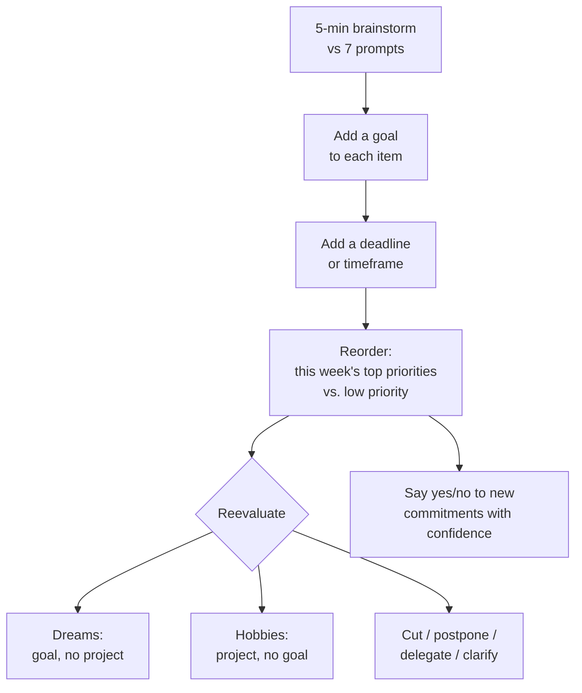

# Chapter 11 — Creating a Project List

> [!cite] Book reference
> *The PARA Method: Simplify, Organize, and Master Your Digital Life* — Tiago Forte. Chapter 11: "Creating a Project List." Source: user's uploaded EPUB.

> [!summary] One-line takeaway
> A Project List — a single, maintained inventory of every outcome you're currently committed to, each with a goal and a timeframe — is the practical cornerstone that makes the rest of PARA (and the book) actually work, because you can't organize "for action" without first knowing, honestly, what your actions are for.

## Why this chapter matters
Part II and Part III of the book spent ten chapters explaining how to sort and maintain information once you know what your Projects are — this chapter is where Forte finally makes you produce that list for real, in five concrete steps, rather than leaving "define your projects" as an abstract instruction. It sets up Chapter 12's "Organize According to Outcomes" habit directly: you can't organize according to outcomes until this chapter's exercise has told you, specifically, what those outcomes are.

## Direct quotes from the book
> [!quote] What the list actually is
> "Your Project List is a list of the outcomes you are currently committed to achieving, all in one place. It is an inventory of all the things you're trying to produce, create, accomplish, or resolve."

> [!quote] How it compares to other lists you already keep
> "It's like a to-do list, but on a bigger scale and longer time horizon so you can tell where you're headed. It's like a list of goals, but more practical and rooted in the here and now."

> [!quote] The definition of a project, precisely
> "Remember that a project is any endeavor that has: A goal. A deadline (or other timeframe)."

> [!quote] The real payoff of doing the exercise
> "Often, my coaching clients' takeaway from performing this exercise is that they are trying to do too much. Seeing the range of their existing commitments all in one place, they realize that they don't need another productivity app or technique—they need to say no to things that don't matter."

## The chapter in full (so you never need to re-read it)

Forte frames this chapter as exactly what he'd do first if hired as a productivity coach — before any other PARA work, the first few sessions would go into formulating a Project List, because "that list is the lynchpin of your productive life, and we can't do much else without it." He notes the whole exercise typically takes five to ten minutes and produces ten to twenty projects, which is precisely why it belongs in software rather than memory — "we want to use a software program to keep track of them—not our brains!"

**Step #1 — List Your Current Projects.** Set a timer for five minutes (enough for a first pass) and write down anything that comes to mind in response to a specific set of prompts, work or personal:
- What's currently worrying you?
- What problem is taking more mental bandwidth than it deserves?
- What needs to happen that you're not making consistent progress on?
- What actions are you already taking that are part of a bigger project you've not yet identified?
- What would you like to learn, develop, build, express, pursue, start, explore, or play with?
- Which skills would you like to learn and which hobbies would you like to start?
- What kind of project could advance your career or make your life more fun or interesting?

**Step #2 — Add a Goal for Each Project.** A project, by definition, has a goal and a deadline (or other timeframe). Spend a minute adding a goal in parentheses next to each item, e.g.:
- *Visit the doctor about back pain (Goal: Back pain is resolved and I can sleep through the night without discomfort)*
- *Plan off-site agenda for staff retreat (Goal: Team is clear about what needs to be accomplished and next steps are assigned)*
- *Develop sales campaign with Linda (Goal: Sales campaign is approved by exec team and budget is allocated)*

**Step #3 — Add Deadlines or Timeframes.** Go through the list again and append a completion date using "by…" — and Forte is explicit that it doesn't need to be a hard deadline, just the date you'd prefer it done by:
- *…by Friday, Feb. 24*
- *…by end of Q3*
- *…by next executive meeting*

**Step #4 — Prioritize Your List.** The key insight here: you won't make progress on every project in a given week, or even most of them, so prioritize **only for the upcoming week**. Which projects should take up most of your mental bandwidth next week? Those go to the top. Which should get little or none? Those go to the bottom. "Your only goal in a given week is to make progress on a handful of projects near the top of that list" — this is a weekly re-sort, not a permanent ranking.

**Step #5 — Reevaluate Your Project List.** With a full, honest inventory in front of you, Forte has you ask three deliberately uncomfortable questions:
- Which goals or priorities you say are important don't have any projects associated with them? These are **"dreams"** — not likely to happen in the near term, since nothing is actually in motion to produce them.
- Which projects you're spending a lot of time on don't have any goal attached? These are **"hobbies"** — without a goal in mind, they're likely just for fun.
- Which projects can you cancel, postpone, reduce in scope, delegate, outsource, or clarify?

Forte is careful to say there's nothing wrong with dreams or hobbies — they're just as important and necessary a part of life — but conflating them with actual committed projects or areas is where the drift happens. "All we're doing is aligning where your time and energy are going with what is truly important to you." He warns that in the bustle of daily life it's easy to let this drift, until "we're neglecting everything we claim matters most to us, while pouring our precious time into things we know aren't important at all."

The chapter closes by noting these five steps can become a recurring **weekly review** ritual — walked through once a week, or any time you feel overwhelmed or stretched thin — promising you'll "emerge in minutes with a newfound sense of clarity and purpose."

### Saying Yes and No with Integrity
A short closing section ties the exercise to decision-making: an accurate Project List gives you the confidence to say yes or no to new commitments, because once you actually know your capacity, filling it can be intentional rather than reactive. Forte reports that his coaching clients most often conclude from this exercise that they're trying to do too much — the fix isn't another app or technique, it's saying no to things that don't matter. "When you take the steps needed to clarify what you're most committed to, you can start to make calm, considered decisions about what stays and what needs to go. And every time you say no to something that is less important, all the time and energy that it was taking up gets freed up for the things that are more important."

## Core concepts (quick-scan version)

| Step | Action | Output |
|---|---|---|
| 1 | 5-minute brainstorm against 7 prompt questions | Raw list of current projects |
| 2 | Add a goal in parentheses to each item | Projects now have a defined "done" state |
| 3 | Add "by…" deadline or target timeframe to each item | Projects now have a time horizon |
| 4 | Re-sort for *this week only* — top = most bandwidth, bottom = least | A weekly priority order, not a permanent one |
| 5 | Ask: what are my dreams (goal, no project)? my hobbies (project, no goal)? what can I cut? | Honest alignment check |

**Definition of a project (exact, load-bearing):** a goal + a deadline or timeframe. Missing either one means it's not really a project yet — it's a dream (no project attached) or a hobby (no goal attached).

**Typical healthy list size:** ~10-20 items, built in 5-10 minutes.

## First-principles breakdown
Forte's underlying claim: most people's stated priorities and their actual time/energy allocation silently diverge, and the only way to catch the divergence is to force every commitment into one visible, comparable format at the same time.

Decomposed into more basic truths:
1. **You cannot prioritize what you cannot see all at once.** This is a working-memory argument, not a motivational one — human working memory holds a handful of items; a list scattered across your head, inbox, sticky notes, and calendar can't be compared item-to-item the way a single visible list can.
2. **A commitment without a defined end state is not a plan, it's a mood.** Requiring both a goal and a deadline is what turns a vague intention ("get healthier") into something that can be tracked, finished, and removed from the list — the open-endedness is precisely what the "dream"/"hobby" labels are catching.
3. **Weekly re-prioritization works because attention is a weekly-scale resource, not a static allocation.** The chapter explicitly avoids asking you to rank the list permanently — it asks what deserves this week's bandwidth, which matches how attention and energy actually fluctuate, rather than pretending you have a fixed, universal priority order that never changes.

**What's empirically grounded vs. asserted:** the working-memory limitation (point 1) is well-established; the specific "10-20 items, 5-10 minutes" numbers are Forte's own coaching-derived heuristic, not a measured finding — useful as a sanity check, not a hard law. The "dreams vs. hobbies vs. projects" framing is a clean conceptual device but is Forte's own vocabulary, not a validated psychological taxonomy.

**A hidden boundary condition the book doesn't flag:** the exercise assumes you're honest with yourself in Step 1 and Step 5 — if you list what you wish you were doing rather than what you're actually doing, the whole diagnostic value of Step 5 evaporates, because the gap it's designed to expose (stated priority vs. actual commitment) only shows up if the list reflects reality rather than aspiration. This is exactly the same warning Chapter 15 makes explicit later ("set up PARA to resemble the life you actually have"), suggesting Forte himself treats this as a known failure mode worth repeating at the very end of the book.

## Visual representation

## Worked example — built directly in your vault
This chapter is the one in the book that most directly calls for a new, real artifact — so one was built: **[[01-Projects/Project List]]**, a small standalone note at the root of `01-Projects/`.

Running the actual five-step exercise against the vault's two live Projects:

1. **List:** `01-Projects/` currently holds exactly two folders — **Gloss Local** and **Second Brain Build-Out** — found by listing the folder directly.
2. **Goals:** both already had goals stated in their own `Project Overview.md` files, which made this step trivial — Gloss Local's is "a stable, no-subscription local fork of Nutlope/gloss running across all your devices"; Second Brain Build-Out's is "chapter notes + a practical setup + a use-case guide, all finished."
3. **Deadlines:** neither Project Overview currently states a hard date — only "once stable and running" / "once all chapters are done." Per this chapter, that's fine — Forte explicitly says not to get hung up on whether it's a strict deadline vs. a preferred-by date; a target condition counts.
4. **Prioritize:** left as an open fill-in field in the new note, since "what's top-of-mind this week" is something only you can say right now, not something to infer in a one-time pass.
5. **Reevaluate:** with only two Projects on the list, this is a useful cross-check against Chapter 1's community research (a healthy range is ~5-12 to ~10-20, depending on source) — two is low but not a red flag, since both represent real, substantial, ongoing work rather than a drained-out list hiding unacknowledged Areas.

The new `Project List.md` includes a **review log** table so future weekly reviews leave a trail, rather than silently overwriting the previous week's snapshot — a small addition beyond the book's own instructions, done because this vault already favors dated logs elsewhere (daily notes, periodic notes).

## What the book doesn't tell you — community perspective
- **Forte's own stricter rule of thumb, stated elsewhere, is tighter than this chapter's "10-20":** in follow-up content he's publicly pushed a "10-to-15 rule" and has said "a project list of 30 is a list of lies" — most people, once they're honest, actually have 5-15 real active projects, not the 10-20 this chapter's exercise produces on a first pass ([Forte Labs / LinkedIn — "The 10-to-15 rule (PARA Method)"](https://www.linkedin.com/posts/tiagoforte_the-10-to-15-rule-para-method-part-2-activity-7087854061445644289-Vvzj)).
- **GTD practitioners note the weekly review — the exact ritual this chapter recommends — is the single hardest habit to sustain.** David Allen himself calls the Weekly Review the "Master Key to GTD" and also its most commonly skipped step; multiple sources report that even dedicated practitioners struggle with the cadence, and skipped reviews cause the list to go stale and break trust in the system ([Plan With AI — The Complete Guide to Weekly Review Systems](https://planwith.ai/blog/complete-guide-weekly-review-systems)).
- **A documented adherence problem specific to the review habit:** a Twitter poll cited in productivity-system retrospectives found only about 38% of a productivity-obsessed audience regularly completed their weekly review, and most people who try one abandon it within roughly three weeks — often because the ritual becomes too long, too vague ("reflect on the week" with no concrete output), or turns into a self-grading exercise rather than a practical check-in ([Freym — "The Weekly Review Dilemma"](https://freymwork.substack.com/p/the-weekly-review-dilemma-what-nobody)).
- **Habit-formation research offers a partial counter:** Lally et al.'s widely-cited UCL study found it takes an average of 66 days for a daily behavior to become automatic — meaning someone who quits a weekly review habit at the three-week mark has only attempted about 3 repetitions, nowhere near enough reps for it to become "cheap" to do, which reframes early drop-off as premature rather than proof the ritual doesn't work ([Calendar — "How to Build a Weekly Review Habit That Actually Sticks"](https://www.calendar.com/blog/weekly-review-habit-actually-sticks/)).
- **GTD-vs-PARA commentary converges on exactly this chapter's purpose:** Forte explicitly recommends pairing GTD (for task management) with PARA (for information organization) — the GTD Project List and the PARA Projects folder are meant to mirror each other, with the weekly maintenance ritual in PARA playing the same role the GTD Weekly Review plays for tasks ([Diana Oehrli — "Managing personal projects: From GTD to PARA"](https://dianaoehrli.substack.com/p/managing-personal-projects-from-gtd)).

## Deeper commentary — how this applies to your setup specifically
With only two live Projects (Gloss Local and Second Brain Build-Out), this vault sits comfortably under even the stricter "10-to-15" guidance from the community research above — there's no evidence here of an inflated, dishonest list. The more interesting open question this chapter raises for your setup is the deadline field: neither Project currently has a hard "by…" date, only a condition ("once stable," "once all chapters are done"). Forte explicitly allows this (a "preferred-by" date counts), but it's worth noticing that an open-ended condition is easier to let drift indefinitely than a calendar date is — something to watch for at your next weekly review, especially for Gloss Local, where "stable and running across devices" is a fuzzier finish line than "all chapters done," which at least has a countable remainder (how many chapters are left).

The weekly-review adherence research above is also directly relevant: this vault already has `06-Daily-Notes/` and `07-Periodic-Notes/` set up, which is exactly the kind of existing scaffolding the research suggests matters — a review habit is more likely to stick when it's attached to an existing ritual (a periodic note you already open) rather than a brand-new standalone habit you have to remember to start from scratch.

## Practical / actionable takeaways
- [ ] Open [[01-Projects/Project List]] at your next weekly review and fill in the "Prioritization for this week" section honestly, rather than leaving it as a one-time artifact
- [ ] Decide whether Gloss Local and Second Brain Build-Out need harder "by…" dates, or whether the condition-based finish lines are good enough for now
- [ ] Consider attaching the Project List review to an existing periodic note in `07-Periodic-Notes/` rather than treating it as a separate habit to remember
- [ ] Re-run Step 5's "dreams vs. hobbies" check the next time a new idea shows up that feels like it should go in `01-Projects/` — does it actually have both a goal and a timeframe yet?

## Questions / things to decide for your own vault
- Is two Projects genuinely the right number for you right now, or is something that should be a Project currently hiding inside `02-Areas/` or `00-Inbox/` unexamined?
- Do you want the weekly Project List review to be its own periodic-note template, or just a recurring checklist item inside your existing weekly note?

## Video
- [Too Many Projects? The 10-to-15 Rule Will Save You! — Tiago Forte (YouTube)](https://www.youtube.com/watch?v=anexySaCsgU) — Forte's own follow-up content specifically on keeping a Project List honest and appropriately sized, directly extending this chapter's Step 5.

## Sources (external, beyond the book)
- [The 10-to-15 rule (PARA Method) — Tiago Forte, LinkedIn](https://www.linkedin.com/posts/tiagoforte_the-10-to-15-rule-para-method-part-2-activity-7087854061445644289-Vvzj)
- [The Complete Guide to Weekly Review Systems (GTD, Bullet Journal, Agile & AI) — Plan With AI](https://planwith.ai/blog/complete-guide-weekly-review-systems)
- [The Weekly Review Dilemma: What Nobody Tells You About This Productivity Habit — Freym](https://freymwork.substack.com/p/the-weekly-review-dilemma-what-nobody)
- [How to Build a Weekly Review Habit That Actually Sticks — Calendar](https://www.calendar.com/blog/weekly-review-habit-actually-sticks/)
- [Managing personal projects: From GTD to PARA — Diana Oehrli](https://dianaoehrli.substack.com/p/managing-personal-projects-from-gtd)

## Footnotes
The chapter has exactly one endnote in the extraction:

[^13]: "The exercise in this chapter was adapted from David Allen's book *Getting Things Done*, which redefined 'personal productivity' and served as a launchpad for my own work." This is attached to the chapter's opening line about saving the reader the expense of hiring a coach — Forte is explicit that the five-step exercise itself is an adaptation of Allen's GTD project-list concept, not an original invention.

## Claude's pick — what I'd flag as most important
1. The definition that matters most in this whole chapter is the simplest one: **a project needs both a goal and a deadline/timeframe** — missing either one is the single fastest diagnostic for "this isn't actually a project yet," more useful day-to-day than any of the five steps around it.
2. Step 5's "dreams vs. hobbies" distinction is quietly the most emotionally honest moment in the book so far — it gives you permission to have unstructured interests without guilt, while still being clear-eyed about what's actually a commitment.
3. The community research is unusually consistent that the hard part isn't building the list once, it's returning to it weekly — which means the real success metric for this chapter isn't whether you can produce a Project List today, it's whether `01-Projects/Project List.md` still gets opened a month from now.

## Related
- Previous: [[Chapter 10 - Using PARA with a Team]]
- Next: [[Chapter 12 - The Three Core Habits of Organization]]
- MOC: [[The PARA Method - MOC]]
- New artifact: [[01-Projects/Project List]]
