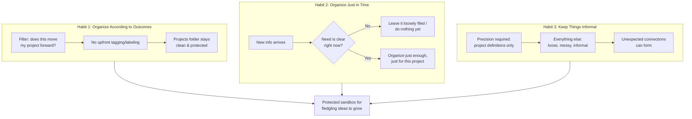

# Chapter 12 — The Three Core Habits of Organization

> [!cite] Book reference
> *The PARA Method: Simplify, Organize, and Master Your Digital Life* — Tiago Forte. Chapter 12: "The Three Core Habits of Organization." Source: user's uploaded EPUB.

> [!summary] One-line takeaway
> Because you'll forget almost everything else in this book within days, Forte distills the whole system into three durable habits — organize according to outcomes, organize just in time, and keep things informal — that are meant to outlast any specific app, folder structure, or piece of advice in the rest of the book.

## Why this chapter matters
This is explicitly a compression chapter: having spent ten chapters on specifics (Projects vs. Areas, team use, maintenance routines, the Project List exercise in Chapter 11), Forte steps back and asks what actually needs to survive in long-term memory once the details fade. It's the bridge between the practical "how" chapters before it and the more reflective "why" chapters after it (Chapter 13's focus/creativity/perspective, Chapter 15's closing argument about power) — the three habits are the thread that ties the whole book's practical advice back to first principles.

## Direct quotes from the book
> [!quote] The premise for the whole chapter
> "The only thing that will remain is the habits you adopt or change as a result of the advice I've given you."

> [!quote] Habit #1, the test behind it
> "Every decision is made through the lens of 'What will help me move this forward?'"

> [!quote] Habit #2, stated as a philosophy
> "My organizing philosophy is to organize as little as possible, as late as possible, and only as much as absolutely needed."

> [!quote] Habit #3, the counterintuitive claim
> "You heard that right: sometimes organizing information too much makes it less valuable."

> [!quote] On what PARA explicitly refuses to recommend
> "I don't recommend: Creating an internal structure inside folders. Using a standardized template for the contents of notes or documents. Creating a hierarchy of subfolders within subfolders many levels deep. Using databases or other formal methods for organizing personal information."

## The chapter in full (so you never need to re-read it)

Forte opens with a blunt premise: you will most likely forget almost everything you've read in this book very soon — which is precisely why we save things in the first place, outsourcing remembering to technology because we know our own memories are weak. Rather than pretend otherwise, he assumes the book itself will fade to "a faint memory" within hours or days, and that "the only thing that will remain is the habits you adopt or change." After watching how many people actually implement PARA, he's distilled it to three habits, each built on a timeless principle meant to outlast the underlying technology.

**Habit #1 — Organize According to Outcomes.** Forte names a common trap directly: treating organizing as an end in itself — there's something satisfying about a beautifully arranged workspace or Instagram-worthy notes, and there's nothing wrong with that if you enjoy it, but it's probably not why you picked up this book. He assumes instead that there's something you're actually committed to achieving. This is exactly what PARA is designed for, and he lists the guardrails this produces:
- Every decision is made through the lens of "What will help me move this forward?"
- All the up-front work of meticulous tagging, labeling, and titling is eliminated.
- There's no maintenance required, except getting your projects done.
- The most actionable category ("Projects") is closely guarded against distractions from information that seems interesting but isn't useful.

Each guardrail exists to help you eliminate anything that doesn't advance the goal you're working toward — whether reaching the finish line of a project or elevating your standard in an area of life, the instruction is to begin with the end in mind and work backward, deciding only which information you'll need to get there and pushing everything else aside.

**Habit #2 — Organize Just in Time.** Stated as a philosophy: "organize as little as possible, as late as possible, and only as much as absolutely needed." Forte acknowledges this sounds strange in a book about organizing, but his point is that organizing by itself doesn't add value — it has no inherent worth unless it puts you in a state of mind for taking effective action. This is why PARA is minimalistic: it favors small "nudges" that move items from place to place only as your needs actually change, making it a "bottom-up" method that responds organically to your life rather than imposing structure in advance. Instead of organizing information "just in case" you might need it someday, wait until the need becomes crystal clear, then organize "just in time" for the project you're actually working on right now — this is how you avoid a lot of up-front work of questionable value, and it saves your energy for the moment you actually know what you're trying to accomplish.

**Habit #3 — Keep Things Informal.** PARA demands precision in exactly one place: the definition of your projects. Everything else is not only allowed to stay somewhat messy — Forte says that's how it *should* be, because highly precise systems require a lot of effort to maintain, so most of your digital world should remain loose and informal by default. The chapter makes an explicitly counterintuitive claim here: imposing order on information doesn't always make it more valuable — "sometimes organizing information too much makes it less valuable." The reasoning: the greatest breakthroughs often come from unexpected connections between ideas, and an overly rigid, formal system prevents those connections from ever forming. Some deliberate messiness and randomness creates room for very different ideas to intermix.

This is the basis for Forte's explicit disagreement with a lot of mainstream organizing advice. He states plainly that he does *not* recommend:
- Creating an internal structure inside folders
- Using a standardized template for the contents of notes or documents
- Creating a hierarchy of subfolders within subfolders many levels deep
- Using databases or other formal methods for organizing personal information

He says he's tried all of these in the past and always found they consumed time better spent engaging with the ideas themselves — the advice is to resist the urge to build overly complex mechanisms where simple, straightforward ones suffice, because "your future self will thank you for saving them all the time-consuming effort such mechanisms always require."

### Protecting Your Ideas until They Have Time to Bloom
A short closing section reframes all three habits around a single metaphor: a new idea, when it's first forming, is highly vulnerable — like an infant, full of potential but needing protection from self-doubt, outside criticism, and your own fear that it isn't good enough. It can't survive on its own yet, which doesn't mean it's a bad idea; it just needs time and space to develop, the way humans do too.

Each of the three habits, Forte argues, helps build an environment where fledgling ideas can safely emerge:
- Organizing according to outcomes ensures you're actively testing ideas in the real world rather than just admiring them.
- Organizing just in time preserves your time and energy so you can pursue unexpected opportunities as they arise.
- Keeping things informal by default allows novel connections and patterns to form instead of being walled off by premature structure.

He closes with the chapter's defining image: think of PARA's folders as "a series of protected spaces for fledgling ideas to play in before they grow up" — each folder's "walls" contain a messy sandbox where loosely related ideas mix and play, until eventually they grow strong enough to venture out into the world on their own.

## Core concepts (quick-scan version)

| Habit | One-line principle | What it eliminates | What it protects |
|---|---|---|---|
| #1 — Organize According to Outcomes | Every filing decision passes through "what moves this forward?" | Up-front tagging/labeling/titling busywork | Focus on actual projects, not aesthetic organizing |
| #2 — Organize Just in Time | Organize as little, as late, and as minimally as possible | "Just in case" upfront organizing of questionable value | Energy, saved for the moment a real need appears |
| #3 — Keep Things Informal | Precision only for project definitions; everything else stays loose | Subfolder hierarchies, templates, internal folder structure, databases | Room for unexpected, valuable connections between ideas |

**What Forte explicitly rejects (listed directly in the text):** internal folder structure, standardized note/document templates, deep subfolder hierarchies, and databases/formal systems for personal information.

## First-principles breakdown
The chapter's central claim, stripped of branding: **a durable organizing system is one whose rules are cheap enough to follow automatically, under time pressure, without conscious willpower** — and the three habits are each, in different ways, a tax cut on the cost of staying organized.

Decomposed into more basic truths each habit depends on:
1. **Decision-making has a cost, and unnecessary decisions compound.** Habit #1's "closely guarded" Projects category and Habit #3's refusal of deep hierarchies both reduce the number of filing decisions you have to make — fewer forks in the road means fewer chances to procrastinate or abandon the system. This echoes decision-fatigue research broadly, though Forte doesn't cite any specific study for it here; it's asserted as his own observed pattern from coaching, not measured.
2. **Deferred work is cheaper than speculative work, provided retrieval stays fast.** Habit #2 only holds up if search/retrieval is good enough that "I'll organize this when I need it" doesn't turn into "I can't find this when I need it." This is the same load-bearing condition flagged in the *Building a Second Brain* Chapter 1 notes (capture is only valuable with retrievability) — Forte is implicitly betting the whole chapter on modern search being reliable, a bet made explicit a few chapters later in Chapter 14.
3. **Serendipity and combinatorial creativity require some disorder.** Habit #3's claim that over-organizing can reduce value draws on a real phenomenon — idea recombination and associative thinking are well-documented drivers of creative insight — but the specific claim that *rigid folder hierarchies* are what blocks this (as opposed to, say, how you *review* your notes) is Forte's own inference, not something this chapter cites external research for.
4. **A habit survives only if what it asks of you is smaller than what it replaces.** This is the "will I actually keep doing this" test, and it's the implicit reason this chapter exists at all — three short, memorable rules are more likely to survive contact with a busy life than the book's many specific recommendations.

**What's empirically grounded vs. asserted:** the general existence of decision fatigue and the value of associative/recombinant thinking for creativity are supported by a substantial research literature outside this book. The specific causal chain Forte draws — "rigid folders block creative connections," "templates waste more time than they save," "databases aren't worth it for personal information" — is his own practitioner judgment, generalized from what he's "tried...in the past," not a cited study. It's worth treating these as strong, experience-based heuristics rather than settled findings.

**A hidden boundary condition:** Habit #3's advice against templates, deep hierarchies, and databases is calibrated for *personal* information management by one person. It does not obviously generalize to team or shared systems — Chapter 10 ("Using PARA with a Team") almost certainly needs more shared convention than "keep things informal" allows for, precisely because informal systems rely on the single user's own memory of where things loosely are, which doesn't transfer to collaborators the way a documented structure would.

## Visual representation

## Worked example — built directly in your vault
This chapter is a strong fit for a sanity check against your existing `01-Projects/`, `02-Areas/`, `03-Resources/`, and `04-Archive/` structure, rather than a new artifact:

- **Habit #1 check:** both `01-Projects/Gloss Local/` and `01-Projects/Second Brain Build-Out/` currently hold exactly one file each (`Project Overview.md`) — no subfolders, no nested categories. That's a clean match for "closely guarded" Projects per this chapter; nothing has crept in that isn't directly moving either project forward.
- **Habit #2 check:** the new `01-Projects/Project List.md` built for Chapter 11 was created only once the book's exercise made the need concrete (a place to track goals/deadlines across projects) — not built speculatively in advance. That's the "just in time" pattern working as intended, in real time, while writing these notes.
- **Habit #3 check:** this is the one worth sitting with honestly. These book-notes files themselves use a fairly rigid template (frontmatter, fixed section headers, consistent structure across every chapter note) — which is precisely the kind of "standardized template for the contents of notes" this chapter says Forte does *not* recommend. That's not a contradiction to panic over: Forte's advice here is about personal, ad hoc information, not a deliberate documentation/reference project like a book-notes series, where consistency has its own value (making notes scannable and comparable). But it's worth noting explicitly, since this chapter is the most direct place in the whole book where its advice and this project's own format are in tension.

## What the book doesn't tell you — community perspective
- **PARA's "informal by default" approach is explicitly rejected by Zettelkasten-style practitioners**, who argue atomic, deliberately-linked notes benefit from *more* structure and intentional connection-making, not less — a Zettelkasten forum thread discussing Forte's ideas specifically frames PARA as well-suited to files and project assets, but structurally mismatched to a permanent, cross-linked knowledge base, where tags and backlinks (not folder placement) are what does the real work ([Zettelkasten Forum — "An Introduction of Tiago Forte, His Ideas, and Some Comments on Their Relations to Zettelkasten"](https://forum.zettelkasten.de/discussion/72/an-introduction-of-tiago-forte-his-ideas-and-some-comments-on-their-relations-to-zettelkasten)). This is the same critique already logged in the Chapter 1 note of this book and in *Obsidian Second Brain*'s Chapter 2 notes — it converges again here specifically on the "keep it informal" habit.
- **The "organize just in time" principle is explicitly described, in outside commentary on the book, as borrowing a lean/engineering idea** — avoid investing in structure before you actually know the requirements — summarized directly in a chapter-by-chapter outside summary of this book ([Thomas Frank — "The PARA Method by Tiago Forte: Summary and Book Notes"](https://thomasjfrank.com/productivity/books/the-para-method-by-tiago-forte-summary-and-book-notes/)). That source frames just-in-time organizing as conditional on decent search, not a given — worth remembering since the principle quietly depends on your notetaking app's search actually being good.
- **A separate book-summary source frames Habit #3 even more bluntly**: a strict, formal system is described as actively "detrimental because it makes it difficult to form connections" between ideas — restating Forte's claim rather than independently validating it, which is worth noting since no source found here provides direct evidence (vs. restated assertion) that folder rigidity specifically blocks creative connection-forming ([Eric Sandroni — "Book Summary: The PARA Method by Tiago Forte"](https://ericsandroni.com/book-summary-the-para-method-by-tiago-forte/)).

## Deeper commentary — how this applies to your setup specifically
The tension flagged above — this very book-notes project using a consistent template, which Habit #3 explicitly argues against — is worth sitting with rather than resolving hastily. The chapter's own logic actually supports the distinction: Habit #3 is about *personal* information you're filing for your own future retrieval, where rigid structure adds overhead without adding value. A deliberately-built reference resource (these chapter notes, meant to "replace re-reading the book") is a different kind of artifact — closer to a small publishing project than ad hoc personal filing — so a template genuinely earns its keep here in a way it might not for, say, how you jot down a stray thought in `00-Inbox/`.

For [[Gloss Local]] specifically, Habit #2 ("organize just in time") maps closely onto how software projects are actually built: you don't design a folder structure for features you haven't built yet, you organize the codebase as needs become concrete — which is presumably already how the Mac-hub/Windows-client/phone-client build is structured, rather than a speculative structure designed up front for devices or features not yet working.

## Practical / actionable takeaways
- [ ] Audit `00-Inbox/` next time it's non-empty: is anything being pre-sorted "just in case" rather than left until a real need appears (Habit #2)?
- [ ] When tempted to add subfolders inside `01-Projects/Gloss Local/` or `01-Projects/Second Brain Build-Out/`, pause and ask whether it's solving a real retrieval problem yet, or whether it's premature structure (Habit #3)
- [ ] Keep the book-notes template as-is for this project specifically — it's a reference resource, not ad hoc personal filing, so Habit #3's "no templates" advice doesn't straightforwardly apply here; revisit this judgment if the template ever starts costing more time than it saves
- [ ] Next time a new idea or resource arrives, run it through Habit #1's test explicitly: "what will help me move this forward?" — if nothing, it may belong in `03-Resources/` rather than `01-Projects/`

## Questions / things to decide for your own vault
- Is there a point at which a "reference resource" project (like this book-notes series) *should* loosen its template, per Habit #3's logic — or is the tension simply a difference in purpose between personal filing and a built resource, as reasoned above?
- Does Gloss Local currently have any "just in case" structure (folders, categories, config scaffolding) built before it was actually needed, worth revisiting under Habit #2?

## Sources (external, beyond the book)
- [An Introduction of Tiago Forte, His Ideas, and Some Comments on Their Relations to Zettelkasten — Zettelkasten Forum](https://forum.zettelkasten.de/discussion/72/an-introduction-of-tiago-forte-his-ideas-and-some-comments-on-their-relations-to-zettelkasten)
- [The PARA Method by Tiago Forte — Summary and Book Notes — Thomas Frank](https://thomasjfrank.com/productivity/books/the-para-method-by-tiago-forte-summary-and-book-notes/)
- [Book Summary: The PARA Method by Tiago Forte — Eric Sandroni](https://ericsandroni.com/book-summary-the-para-method-by-tiago-forte/)

## Footnotes
No numbered endnotes appear in the extracted text for this chapter — unlike Chapter 11 (which had endnote 13), Chapter 12 has no footnote markers or endnote list in the source extraction.

## Claude's pick — what I'd flag as most important
1. The three habits are genuinely the best compression of the entire book — if you remember nothing else from *The PARA Method*, "outcomes, just-in-time, informal" is a complete, portable summary of the system's philosophy.
2. Habit #3's claim that over-organizing can make information *less* valuable is the single most counterintuitive and most quietly important idea in the chapter — it's permission to stop feeling guilty about a messy Resources folder, which is advice most organizing content never gives.
3. The "protecting ideas until they bloom" metaphor is worth remembering specifically because it reframes the entire PARA system's purpose — it's not a filing cabinet, it's an incubator; that reframing matters more once you reach Chapter 15's argument that organizing is ultimately about personal growth.

## Related
- Previous: [[Chapter 11 - Creating a Project List]]
- Next: [[Chapter 13 - Using PARA to Enhance Focus, Creativity, and Perspective]]
- MOC: [[The PARA Method - MOC]]
