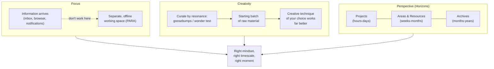

# Chapter 13 — Using PARA to Enhance Focus, Creativity, and Perspective

> [!cite] Book reference
> *The PARA Method: Simplify, Organize, and Master Your Digital Life* — Tiago Forte. Chapter 13: "Using PARA to Enhance Focus, Creativity, and Perspective." Source: user's uploaded EPUB.

> [!summary] One-line takeaway
> PARA's four categories double as three different mental tools at once — a secluded workspace for focus, a curated raw-material pile for creativity, and a set of time "horizons" that tell you which mindset to bring to which kind of information — making the system useful for how you *think*, not just where you *file*.

## Why this chapter matters
After Chapter 12 compressed the whole system into three habits, this chapter answers a different question: once you're organized, what do you actually get out of it? It's the chapter that connects PARA's mechanical filing rules back to the knowledge-worker benefits the book has been implicitly promising — focus, creativity, perspective — before Chapter 14 pulls back toward "don't overthink any of this" and Chapter 15 closes with the book's argument about power and growth.

## Direct quotes from the book
> [!quote] The chapter's opening claim
> "PARA can be used to cultivate three of the most desirable states of mind for knowledge workers: focus, creativity, and a sense of perspective."

> [!quote] On why focus is hard in a wired world
> "In order to focus, we need to step away from the incessant notifications of the Internet and withdraw to a private, secluded place... For the rest of us, that private place can be simply a different software program than the one we use to interface with the outside world."

> [!quote] On where creative value actually comes from
> "Collecting information is easy, and we've seen that filing it away isn't that hard either. But if you stop there, all this effort amounts to hoarding. Value doesn't come from the inputs; it comes from your outputs, bearing your signature and style."

> [!quote] What's worth saving, as a creative filter
> "What moves you? What makes the hair stand up on your arm, gives you goose bumps, makes your heart beat faster, or fills you with a sense of wonder? That is the stuff creativity is made of, and therefore worth saving."

> [!quote] The horizons framing
> "Your projects exist on a short-term horizon that will play out in the coming hours or days. Your areas of responsibility and resources play out on a medium-term horizon over weeks and months. Your archives are more likely to be useful on a long-term horizon of months or years."

## The chapter in full (so you never need to re-read it)

### How to Use PARA to Enhance Focus
Forte starts from a simple but demanding definition: the essence of focus is to "do one thing at a time," which is simple in theory but hard in practice. His diagnosis of why it's hard: people often try to focus in the very same environment where new information arrives. He gives two concrete examples — using an email inbox as a to-do list, then wondering why you're constantly distracted by incoming messages; or using a web browser to multitask, then ending the day with dozens of unread tabs. His prescription is to physically or digitally step away from "the incessant notifications of the Internet" into a private, secluded place — joking that if you have access to "a log cabin hidden deep in the woods," he's envious, but for everyone else, that secluded place can simply be a different software program than the one used to interface with the outside world.

He describes his own practice directly: when he needs to focus, he turns off the Wi-Fi. He knows he can't stay dedicated to one task with "an ocean of information" beckoning from the other side of a browser window — so each time he sits down to work, he chooses a task from his to-do list, turns on airplane mode across devices, and doesn't go back online until it's finished. He acknowledges this isn't new advice, but notes it's "almost impossible to follow until you have a trusted, comprehensive system for managing digital information" — if everything is stuck in the cloud with no organizing system underneath it, you'll never be able to pull away from the pull of the web to actually get things done. His framing: use PARA as your secluded log cabin in the woods — a place to shut out the world and work with your own ideas, theories, and creations before sharing them back out.

### How to Use PARA to Cultivate Creativity
Forte acknowledges creativity's importance to modern career success is well-worn advice, then draws a sharp distinction: collecting information is easy, and filing it away isn't that hard either — but stopping there just produces hoarding. "Value doesn't come from the inputs; it comes from your outputs, bearing your signature and style." He notes that *Building a Second Brain* goes much further into a full system for creativity in the digital age, but for this book's purposes, PARA's job is simpler: creating an environment in which creativity can emerge.

His central creative claim: "When you have a collection of interesting ideas, thoughtfully curated, all related to a single project or goal and collected in one central place, magical things begin to happen." Any other creative tool or technique works far better once you have that "starting batch" of material already assembled. To build that batch, his selection filter isn't topical relevance — it's emotional resonance: what moves you, what makes the hair stand up on your arm, gives you goosebumps, makes your heart beat faster, or fills you with wonder. That felt reaction, not subject-matter fit, is "the stuff creativity is made of, and therefore worth saving."

### How to Use PARA to Give You a Sense of Perspective
Forte reframes PARA's four categories as four different "horizons" of time:
- **Projects** sit on a short-term horizon — playing out over coming hours or days.
- **Areas and Resources** sit on a medium-term horizon — weeks to months.
- **Archives** sit on a long-term horizon — months to years.

The reason this segmentation matters: each timescale calls for a genuinely different mindset. Day to day, "in the trenches of getting things done," your attention should stay on active Projects — actions that need to happen and information that needs reviewing in the next few hours or days, since things change fast at this timescale and need to stay close at hand. Relevant questions at this horizon:
- Which projects are most active right now?
- Which tasks are most time-sensitive?
- What are the next steps you need to take to move them forward?
- What information do you need access to in order to do so?

Areas and Resources become relevant on the longer, weeks-to-months horizon — you may not need them during the thick of a normal workweek, but a weekly review is the right moment to elevate your perspective and reflect. Forte offers a distinct set of questions for Areas at this horizon:
- What is the standard (of quality or performance) I'm committed to in each of my areas of responsibility?
- Am I currently meeting that standard?
- If not, are there any new projects, habits, routines, or other practices I can start, stop, or change?
- Are there any resources that would enable me to do so?

And a parallel set for Resources specifically:
- Are there any new interests or passions I'd like to pursue more seriously?
- Are there any curiosities or questions I'd like to start exploring?
- Are there any hobbies or pursuits I've allowed to stagnate that I'd like to reboot?

The chapter closes by tying the whole idea together: by separating information according to *when* it will be needed, PARA gives you a sense of perspective appropriate to whichever time horizon is calling for your attention — letting you work simultaneously across different timescales to bring about the future you're trying to create.

## Core concepts (quick-scan version)

| Mental state | PARA mechanism | Forte's concrete tactic | Horizon (from the perspective section) |
|---|---|---|---|
| Focus | A "secluded" place apart from where information arrives | Turn off Wi-Fi/airplane mode while working a single to-do item | N/A (a practice, not a horizon) |
| Creativity | A curated, emotionally-resonant collection as "starting batch" | Save what resonates (goosebumps test), not what's topically relevant | N/A |
| Perspective — short-term | Projects | Daily/in-the-trenches questions: what's active, time-sensitive, next steps | Hours to days |
| Perspective — medium-term | Areas & Resources | Weekly-review questions: standards met? new resources needed? stagnant interests? | Weeks to months |
| Perspective — long-term | Archives | Occasional, as-needed look-back | Months to years |

## First-principles breakdown
The chapter's implicit central claim: **a single information-management system can serve three distinct cognitive needs (sustained single-task attention, generative recombination of ideas, and appropriately-scaled time horizons) because all three needs share the same underlying bottleneck — an undifferentiated, always-present stream of incoming information.**

Breaking that down into more basic truths:
1. **Attention is a shared, depletable resource, and open information channels compete for it continuously.** The focus section's core mechanism — don't work in the same channel information arrives through — is consistent with well-established attention-residue and task-switching research (see community section below): partial attention to an open channel measurably degrades performance on the task you're nominally doing.
2. **Creative output is a recombination process, and recombination needs raw material already gathered in one place to work on.** This matches combinatorial-creativity theories broadly (new ideas as new combinations of existing ones), and explains why Forte's advice is about curation *before* creative work starts, not a technique for the moment of creation itself.
3. **Different kinds of decisions genuinely require different time horizons, and conflating them produces bad decisions at both scales.** Daily execution-level decisions ("what's the next step") and reflective standard-setting decisions ("am I meeting my own bar in this area of life") use different cognitive modes — a fast, narrow, action-oriented mode versus a slower, broader, evaluative one. Segmenting information by horizon is a structural nudge toward using the right mode at the right time, rather than, say, trying to do deep reflective thinking while also triaging urgent tasks.

**What's empirically grounded vs. asserted:** the attention/task-switching cost described in the focus section is strongly supported by external cognitive-science research (see sources below) — this is the best-evidenced section of the chapter. The creativity section's "goosebumps" filter is a plausible, experience-based heuristic for what's worth curating, but it isn't validated against any measurement of actual creative output in the chapter — it's Forte's own practitioner intuition. The horizons framework is a clean organizing device but, like Chapter 11's "10-20 items," is asserted via coaching pattern-recognition rather than cited research.

**A boundary condition worth flagging:** the focus advice (turn off Wi-Fi, go fully offline) assumes your work doesn't require continuous connectivity — which is less true for collaborative, real-time, or support-oriented knowledge work than for solitary creation or writing. The chapter is implicitly written for someone with significant control over their own schedule and tools, a condition that doesn't hold for everyone equally (a point not acknowledged in the text itself).

## Visual representation

## Worked example — built directly in your vault
- **Focus:** the vault's `01-Projects/` structure already supports Forte's "secluded place" idea structurally — Obsidian itself, with Wi-Fi off, is a genuinely separate working surface from email/Slack/browser. Worth testing directly: the next deep work session on [[Gloss Local]] could literally follow this chapter's tactic — pick one task from [[01-Projects/Project List]], go offline, and don't reconnect until it's done.
- **Creativity:** `03-Resources/Obsidian and PKM` is the natural home for the "goosebumps test" — rather than saving every PKM article you come across, this chapter argues for a narrower filter: does this specific idea actually spark something, or is it just adjacent to the topic? Worth a light pass through that folder with this filter in mind next time it's reviewed.
- **Perspective:** mapping the vault's own folders onto Forte's horizons is a useful sanity check — `01-Projects/` = hours-to-days horizon (and indeed, that's the folder reviewed via [[01-Projects/Project List]] from Chapter 11); `02-Areas/Knowledge Management` and `03-Resources/` = weeks-to-months horizon, genuinely matching how infrequently they'd need a look-in compared to active projects; `04-Archive/` (currently empty) = the months-to-years horizon, which this chapter implies is fine to leave untouched entirely until Chapter 14's "start over" moment actually arrives.

## What the book doesn't tell you — community perspective
- **The core focus mechanism (interruption cost) is one of the better-evidenced claims in productivity writing generally.** Gloria Mark's research at UC Irvine, tracking real office workers since 2004, found it takes roughly 23 minutes on average to regain the same depth of focus after an interruption — direct support for Forte's instinct to physically separate the "input" channel from the "output" channel ([DeepZone — "The Science of Deep Work"](https://deepzone.app/blog/science-of-deep-work/)).
- **The mere presence of a phone measurably taxes working memory, even when it's off.** A widely-cited 2017 "Brain Drain" study found that a smartphone sitting face-down and powered off still reduces available working memory and fluid intelligence compared to leaving it in another room — relevant to Forte's specific advice to go into "airplane mode," which is a weaker intervention than this research would suggest is optimal (truly removing the device, not just silencing it, appears to matter) ([Asana — "What is Deep Work?"](https://asana.com/resources/what-is-deep-work)).
- **Not all distraction research agrees digital interruptions are the dominant problem.** Some comparative studies cited in deep-work literature found non-digital intrusions (people physically interrupting you) had a *bigger* productivity impact than digital ones, especially in remote-work contexts — complicating a Wi-Fi-off-only strategy if your actual interruptions are co-workers or family, not notifications ([DeepZone — "The Science of Deep Work"](https://deepzone.app/blog/science-of-deep-work/)).
- **Willpower/attention depletion research adds a mechanism Forte doesn't name explicitly.** Roy Baumeister's research at Florida State suggests willpower and sustained attention draw from the same limited pool, so merely resisting a visible distraction (an open tab, a phone on the desk) costs energy even when you successfully resist it — supporting Forte's "turn it off entirely" instinct over a "just don't look at it" approach ([DeepZone — "The Science of Deep Work"](https://deepzone.app/blog/science-of-deep-work/)).
- **Creative-process theory elsewhere supports the "divergence then convergence" framing Forte uses in other talks, though not explicitly in this chapter's text** — in a Big Think interview, Forte describes creative work as a pendulum between a divergent phase (open to diverse new input) and a convergent phase (shutting out distraction to drive toward a final outcome), which is a more fully worked-out version of this chapter's "curate first, then apply technique" structure ([Big Think — "Tiago Forte: How to think creatively on command"](https://bigthink.com/series/the-big-think-interview/tiago-forte/)).

## Deeper commentary — how this applies to your setup specifically
The "secluded place" framing is worth testing concretely with Gloss Local: because it's a local-first app (Ollama + SQLite, no cloud dependency for the core reading/annotation loop), it may already be unusually well-suited to genuinely offline deep-work sessions compared to a cloud-only tool — worth confirming whether the build/dev workflow itself (not just the reading experience) can run fully offline, since that would let you follow this chapter's Wi-Fi-off advice literally while still doing real engineering work on it.

For the book-notes project (this very file is part of it), the "creativity" section's resonance filter is an interesting lens on the book-notes process itself: these notes are being built to be exhaustive and complete, which is a different goal from Forte's "goosebumps" curation filter — worth being aware that thoroughness and resonance-based curation are different design goals, and this project has deliberately chosen the former for this specific deliverable.

## Practical / actionable takeaways
- [ ] Try one literal "airplane mode" deep-work session on a Gloss Local task, following Forte's exact practice from this chapter
- [ ] Next time `03-Resources/Obsidian and PKM` gets reviewed, apply the "goosebumps test" rather than keeping everything that's merely topically related
- [ ] At the next weekly review, explicitly separate the short-term questions (what's active, what's time-sensitive) from the medium-term ones (am I meeting my own standard in each Area?) rather than blending them into one undifferentiated review
- [ ] Confirm whether Gloss Local's dev workflow can run fully offline, to make the "secluded place" tactic literally usable for engineering work, not just reading

## Questions / things to decide for your own vault
- Is there a real difference, for you, between an Obsidian-only focus session and a genuinely offline one — or does simply closing the browser tab achieve most of the same benefit without going as far as airplane mode?
- Should `03-Resources/` have its own lighter-weight "does this spark something" filter distinct from the more systematic curation this book-notes project itself uses?

## Video
- [Tiago Forte: How to think creatively on command | Full Interview — Big Think (YouTube)](https://www.youtube.com/watch?v=uFP-MRgY7Ow) — Forte's own, more developed treatment of the divergence/convergence creative process this chapter gestures at, directly relevant to the "cultivate creativity" section above.

## Sources (external, beyond the book)
- [The Science of Deep Work: Why Your Brain Needs Uninterrupted Focus — DeepZone](https://deepzone.app/blog/science-of-deep-work/)
- [Deep Work: Meaning, Benefits, and 7 Ways to Focus Today — Asana](https://asana.com/resources/what-is-deep-work)
- [Tiago Forte | The Big Think Interview — Big Think](https://bigthink.com/series/the-big-think-interview/tiago-forte/)

## Footnotes
No numbered endnotes appear in the extracted text for this chapter — there are no footnote markers or endnote list in the source extraction for Chapter 13.

## Claude's pick — what I'd flag as most important
1. The focus section's core move — never try to focus in the same channel information arrives through — is the single most actionable, research-backed idea in the whole chapter, and arguably in the whole book's second half.
2. The "goosebumps test" for what to save is a genuinely useful corrective to over-broad, topic-based collecting — it's a much sharper filter than "is this related to my interests," and worth applying more deliberately than it probably currently is.
3. The horizons framing is the quiet payoff of the entire PARA structure: it's not just a filing system, it's a way of making sure you bring the right kind of thinking (fast/tactical vs. slow/reflective) to the right kind of information at the right time — that's arguably the chapter's real contribution, more than the three individual mental states it names.

## Related
- Previous: [[Chapter 12 - The Three Core Habits of Organization]]
- Next: [[Chapter 14 - When in Doubt, Start Over]]
- MOC: [[The PARA Method - MOC]]
