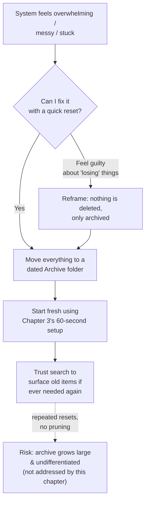

# Chapter 14 — When in Doubt, Start Over

> [!cite] Book reference
> *The PARA Method: Simplify, Organize, and Master Your Digital Life* — Tiago Forte. Chapter 14: "When in Doubt, Start Over." Source: user's uploaded EPUB.

> [!summary] One-line takeaway
> Because nothing in the digital world is ever truly lost, declaring "digital bankruptcy" — archiving everything and starting fresh — is a legitimate, consequence-free escape hatch whenever your system feels overwhelming, and every step in PARA (including the whole Project List and three-habits apparatus) is optional, not sacred.

## Why this chapter matters
This chapter is the book's pressure-release valve, arriving right after Chapter 12's three habits and Chapter 13's more aspirational framing (focus, creativity, perspective) — it exists specifically to prevent the rest of the book from being read as a rigid obligation. It also sets up Chapter 15's closing argument directly: you can only draw real power from your system once you've let go of the guilt and obligation this chapter is explicitly trying to dissolve.

## Direct quotes from the book
> [!quote] The core permission this chapter grants
> "If you ever get stuck or feel overwhelmed, simply archive everything and start over following the instructions I provided in chapter 3."

> [!quote] On the asymmetry with financial bankruptcy
> "When it comes to your finances, there are serious consequences to declaring bankruptcy. But not in the digital world. There is no downside to archiving everything because it will all remain available in the future."

> [!quote] On the system's resilience when you neglect it
> "PARA is highly resilient, and it will preserve everything just as you left it until the day arrives when you have time to reset, whether that's in seven days or seven months."

> [!quote] On why meticulous organizing may already be obsolete
> "The truth is, search technology is getting better every year, and the most likely way you'll access your files in the future is through increasingly advanced search algorithms... That's why any time you spend meticulously organizing your stuff is likely to be wasted."

> [!quote] The closing challenge
> "I'm inviting you to embrace a new identity—to become the kind of person who refuses to get bogged down in trivial details and instead embraces what's new and alive in your life right now. Will you accept my invitation?"

## The chapter in full (so you never need to re-read it)

Forte frames this as his final piece of advice in the book: if you ever get stuck or feel overwhelmed by your system, simply archive everything and start fresh, following the sixty-second setup instructions already given back in Chapter 3. He gives three concrete trigger scenarios:
- If your Documents folder becomes "a digital dumpster fire," move everything into a dated archive and start fresh.
- If digital notes have piled up unprocessed in your notetaking app's inbox, move them to a dated archive folder and be done with it.
- If your cloud storage drive is "a hot mess," move everything into a dated archive and reset for a new week, month, or year.

He names this explicitly as declaring **"digital bankruptcy"** — an escape hatch usable any time your digital world becomes too chaotic and suffocating. He says he's done it "countless times," and every time it produces a sense of relief and enthusiasm for what's next. The key asymmetry he draws out: financial bankruptcy has serious real consequences, but digital bankruptcy has none, because nothing is actually destroyed — everything archived "will all remain available in the future."

### Everything Is Optional
Forte pulls back from the entire rest of the book here, stating plainly that every step he's described — reviewing inboxes, titling things carefully, individually sorting items into the right PARA folders, keeping an updated Project List — is optional, not essential to getting value from organizing your digital world. He gives three personal examples of skipping his own process:
- Some weeks he's too busy to review inboxes and add titles, so he doesn't — he trusts search to find what he needs without manual effort.
- Some weeks he's too busy to individually sort inbox items into the right folders, so he just "select all" and dumps them anywhere — again relying on search rather than perfect classification.
- There are times he doesn't update his Project List for weeks at a stretch — he states plainly there's no catastrophe from a few inactive projects lingering on the list.

His conclusion: PARA is "highly resilient" and will preserve everything exactly as left until there's time to reset — whether that's in seven days or seven months. That resilience, he says, is the entire point of using a simple system: it withstands the passage of time until you're ready to return to it.

### Letting Go of Our Attachment to Information
The chapter's final section addresses the emotional, not mechanical, barrier to starting over. Forte observes that most people carry a learned sense of duty toward their digital possessions — a moral-feeling obligation, inherited from childhood lessons about caring for physical belongings, to meticulously maintain a digital environment the same way you'd tidy a physical space. He argues this attitude makes no sense in the digital world: trying to preserve every last byte of data is like a hoarder keeping every old trinket and empty pizza box, especially since most digital content "appeared without our consent" in the first place (unsolicited emails, auto-saved files, notification debris) — meaning it can be archived without guilt or attachment.

He acknowledges the emotional difficulty directly: archiving everything and starting over can feel scary, especially after years spent thinking about how to organize your files — and yes, he's telling you to dump all of that into the Archive anyway. His reassurance: you aren't losing anything. Anything genuinely needed later remains reachable in the Archive, and he predicts you'll reach for it "far less than you expect, if ever."

He closes with a forward-looking claim about search and AI: search technology keeps improving every year, and the most likely way you'll access old files in the future is through increasingly advanced search — with AI on the way meaning you'll likely just ask an assistant to search through old information and surface what you need. His conclusion from this: time spent meticulously organizing your stuff is "likely to be wasted." He frames the decision to start over as an act of drawing a line in the sand, asserting "digital independence" from clutter and mess that keeps you anchored to the past, and an invitation to a new identity — someone who refuses to get bogged down in trivial details and instead embraces what's new and alive right now. The chapter ends on a direct, rhetorical question to the reader: "Will you accept my invitation?"

## Core concepts (quick-scan version)

| Idea | What it says | What it's really arguing against |
|---|---|---|
| "Digital bankruptcy" | Archive everything, start fresh, any time you're overwhelmed | The belief that reorganizing requires careful, deliberate sorting |
| Trigger scenarios | Messy Documents folder, overflowing notes inbox, chaotic cloud drive | Waiting for the "right time" to reset |
| No real downside | Unlike financial bankruptcy, nothing is destroyed — just archived | Fear of permanently losing something by resetting |
| "Everything is optional" | Reviewing, titling, perfect sorting, even updating the Project List — all skippable | The idea that PARA requires strict discipline to "count" |
| System resilience | PARA tolerates total neglect for days, weeks, or months without breaking | Guilt over an imperfectly-maintained system |
| Letting go of attachment | Digital content isn't owed the same care as physical possessions; most of it arrived uninvited | A learned, misapplied sense of duty toward digital clutter |
| Bet on search/AI | Future retrieval will increasingly be driven by search and AI, not manual organization | The value of time spent on meticulous manual organizing |

## First-principles breakdown
The chapter's central claim, stripped of its "bankruptcy" branding: **the cost of under-organizing (a messy system) is temporary and fully recoverable, while the cost of over-investing in organizing (guilt-driven maintenance, perfectionism) is a real, ongoing drain on time and energy — so when those two risks are weighed against each other, erring toward "mess + reset later" is rational, provided retrieval stays reliable.**

Decomposed into more basic truths this depends on:
1. **Archiving is non-destructive, so the "cost" of a reset is purely the friction of doing it, not any permanent loss.** This is true by construction in most modern file systems and note apps — moving something to an archive folder doesn't delete it. The claim holds structurally, not just rhetorically.
2. **The entire argument is a bet on search/retrieval quality, explicitly acknowledged by Forte himself.** He states this directly ("search technology is getting better every year"), which means the chapter's advice is contingent, not absolute — if your search tooling is weak, or your archive becomes large and undifferentiated enough that search returns too many irrelevant results, "just dump it and search later" degrades in value. This is the same load-bearing assumption flagged in the Chapter 11 and Chapter 12 notes (capture/informality only pays off with good retrieval) — Chapter 14 is where Forte finally states the bet out loud instead of leaving it implicit.
3. **Psychological attachment to digital clutter is learned, not intrinsic, and can in principle be unlearned.** The "moral obligation" framing he describes (parents teaching physical tidiness, generalized inappropriately to digital objects) is a plausible account of why people feel guilty about messy drives, but it's an anecdotal/intuitive claim, not one grounded in cited psychological research within the chapter.
4. **A system's resilience under neglect is what actually determines long-term adoption, more than its ideal-case performance.** This is arguably the chapter's most defensible first-principles claim: a system that fails catastrophically when unmaintained will eventually be abandoned, regardless of how well it works when perfectly maintained — so designing for graceful degradation (as PARA's flat four-category structure allows) is a legitimate design goal, not a lowering of standards.

**What's empirically grounded vs. asserted:** the non-destructive nature of archiving is structurally true, not a matter of opinion. The forward-looking claim about search/AI improving (and therefore making manual organization less valuable over time) is a reasonable extrapolation from an observable trend, but it's a prediction, not a settled fact — and it's worth noting the chapter doesn't address what happens to retrieval quality if an archive becomes enormous and undifferentiated over many "bankruptcy" cycles, which is exactly the scenario the community research below identifies as the actual failure mode.

**A conclusion the book doesn't state outright:** the chapter's logic implies that "starting over" should get *harder to justify*, not easier, as your archive grows and your search tooling's relevance-ranking degrades with volume — meaning the "no downside" framing is really "low downside *now*, if you don't repeat this too many times without ever consolidating or pruning the archive." Forte never addresses the compounding-mess failure mode (see "47-page untagged Resources dump" in the Chapter 1 notes) applied specifically to repeated archive resets — which is the most obvious edge case this chapter's advice doesn't cover.

## Visual representation

## Worked example — built directly in your vault
This chapter is a low-stakes, reassuring check against the vault's current state rather than a prompt to build anything new:

- **`04-Archive/` is currently empty.** Per this chapter, that's completely fine — Forte is explicit that archiving happens as things finish or as resets are needed, never "up front." An empty Archive isn't a sign anything is missing; it's simply a vault that hasn't needed a reset yet.
- **The vault already has the exact mechanism this chapter assumes exists** (a dedicated `04-Archive/` folder, distinct from `00-Inbox/`, `01-Projects/`, `02-Areas/`, `03-Resources/`) — so if a genuine "digital bankruptcy" moment ever arrives (say, `00-Inbox/` piles up unprocessed for months), the instruction from this chapter is simple and already actionable: move everything into `04-Archive/` with today's date, rather than trying to sort it properly first.
- **The new `01-Projects/Project List.md` built for Chapter 11 is explicitly *not* meant to be a source of guilt** per this chapter — Forte says plainly that going weeks without updating a Project List causes no catastrophe. Worth remembering the next time that file feels stale: per this exact chapter, that's fine, not a failure.

## What the book doesn't tell you — community perspective
- **Forte has operationalized this exact idea as a repeatable reset ritual, not just a one-off book anecdote** — in a 2024 video and companion post, he walks through a 4-step digital reset (archive everything, clear inboxes, rebuild a project list, turn off notifications), suggesting "digital bankruptcy" is a standing practice in his own workflow, not a last-resort emergency measure ([Forte Labs — "How to Reset Your Digital Life in 4 Steps"](https://optin.fortelabs.co/posts/how-to-reset-your-digital-life-in-4-steps)).
- **Forte has run the same idea publicly as a social challenge specifically for reading lists** — the "Read Later Bankruptcy" challenge, inviting people to archive their entire Instapaper/Pocket reading queue on the premise that "your future doesn't depend on any one piece of information," suggesting he applies this logic well beyond files and notes ([Tiago Forte / Forte Labs, X/Twitter](https://twitter.com/fortelabs/status/1259322850835525633)).
- **A real counter-risk the book doesn't name: repeated archiving without ever pruning or consolidating can itself become a new form of clutter**, just deferred — a reviewer summary of the book notes this "reset" advice is one of its more "radical" ideas precisely because it trades the discomfort of a messy active system for an ever-growing, undifferentiated cold-storage pile, betting entirely on search quality to make that trade worthwhile over the long run ([Medium — "Taming the Digital Beast: Tiago Forte's PARA Method for the Modern Mind"](https://mr-oceanblue.medium.com/taming-the-digital-beast-tiago-fortes-para-method-for-the-modern-mind-e41882a3d523)).
- **This chapter's logic depends on a premise (search/AI retrieval will keep improving and make manual organization less valuable) that is itself contested outside this book** — broader PKM community discussion (already logged in this book's Chapter 1 notes) argues that organization still adds real value for *reasoning across* scattered information, not just *locating* a single remembered item — a task AI search assistants don't automatically solve just by getting better at keyword or semantic retrieval. This is a reasonable tension to hold alongside Forte's optimism, rather than a definitive rebuttal of it.

## Deeper commentary — how this applies to your setup specifically
Because `04-Archive/` is currently empty, this chapter is mostly forward-looking guidance rather than something to act on today — but it's worth deciding now, before a "hot mess" moment arrives, what the actual reset trigger should be for this vault specifically. Given the vault already separates `00-Inbox/` from the PARA folders proper, the most likely candidate for a future "digital bankruptcy" moment is an unprocessed backlog in `00-Inbox/`, not the PARA folders themselves (which currently hold only two clean Projects, one Area, and one Resource folder — nothing close to a dumpster fire yet).

For [[Gloss Local]] specifically, this chapter's "everything is optional" argument is worth weighing against software-engineering instincts, which often push the opposite direction (meticulous structure, consistent naming, documented decisions) — the book's advice here is explicitly about personal information management, not a codebase, so it shouldn't be read as license to let the actual Gloss Local repository get messy; the "start over" logic applies to notes and files about the project, not necessarily to its source code.

## Practical / actionable takeaways
- [ ] Pre-decide the actual trigger condition for a future vault-wide "digital bankruptcy" (e.g., `00-Inbox/` exceeding some rough size or staying unprocessed for a set number of weeks), so the decision doesn't have to be made under stress later
- [ ] Explicitly let go of any guilt about `01-Projects/Project List.md` going stale between reviews — per this chapter, that's by design, not a failure
- [ ] If a reset is ever actually needed, follow the chapter's own instruction literally: move everything into `04-Archive/` with today's date, rather than trying to sort it properly on the way in
- [ ] Revisit the "repeated resets without pruning" risk (flagged in the community research above) if `04-Archive/` ever grows large — consider an occasional light consolidation pass, since this chapter's own logic implies pruning becomes more valuable as archive size grows

## Questions / things to decide for your own vault
- What should the actual numeric or time-based trigger be for declaring a reset in this vault — is there a concrete threshold, or is "when it feels overwhelming" (Forte's own criterion) good enough?
- Given the community critique that repeated unpruned resets can become their own clutter, is an occasional archive consolidation pass worth scheduling, or does that reintroduce exactly the maintenance burden this chapter is arguing against?

## Video
- [Is Your Digital Life a Mess? Here's How to Reset It in 4 Steps — Tiago Forte (YouTube)](https://www.youtube.com/watch?v=8liy5_Z4zEs) — Forte's own video walkthrough of the reset ritual this chapter describes in text, including archiving everything, clearing inboxes, and rebuilding a project list.

## Sources (external, beyond the book)
- [How to Reset Your Digital Life in 4 Steps — Forte Labs](https://optin.fortelabs.co/posts/how-to-reset-your-digital-life-in-4-steps)
- [Tiago Forte — "Read Later Bankruptcy" challenge (X/Twitter)](https://twitter.com/fortelabs/status/1259322850835525633?lang=en)
- [Taming the Digital Beast: Tiago Forte's PARA Method for the Modern Mind — Ocean Blue, Medium](https://mr-oceanblue.medium.com/taming-the-digital-beast-tiago-fortes-para-method-for-the-modern-mind-e41882a3d523)

## Footnotes
No numbered endnotes appear in the extracted text for this chapter — there are no footnote markers or endnote list in the source extraction for Chapter 14.

## Claude's pick — what I'd flag as most important
1. The single most liberating idea in the chapter is the asymmetry claim: unlike financial bankruptcy, digital bankruptcy has no real downside, because nothing is actually destroyed — only archived. That reframing alone is worth more than most organizing advice in the book.
2. "Everything is optional" is a genuinely rare thing for a productivity book to say about its own system, and it's worth taking at face value — the Project List, the weekly review, careful titling, none of it is required for PARA to still work.
3. The one gap worth remembering independently of the book: this chapter's optimism about search and AI making manual organization obsolete is a bet, not a guarantee — and it's a bet that gets worse, not better, the more times you "reset" without ever consolidating what's piling up in the Archive.

## Related
- Previous: [[Chapter 13 - Using PARA to Enhance Focus, Creativity, and Perspective]]
- Next: [[Chapter 15 - Organizing as Personal Growth]]
- MOC: [[The PARA Method - MOC]]
