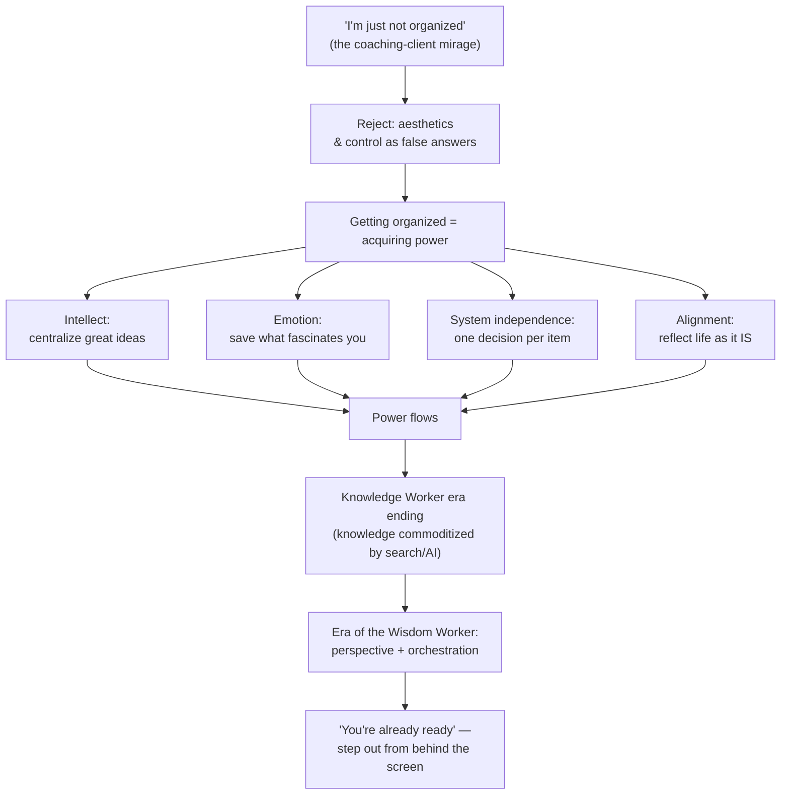

# Chapter 15 — Organizing as Personal Growth

> [!cite] Book reference
> *The PARA Method: Simplify, Organize, and Master Your Digital Life* — Tiago Forte. Chapter 15: "Organizing as Personal Growth" (the book's final chapter). Source: user's uploaded EPUB.

> [!summary] One-line takeaway
> Getting organized isn't about aesthetics or control — Forte's closing argument is that it's about acquiring real power, drawn from intellect, emotion, a system that doesn't depend on willpower, and above all radical honesty about the life you actually have, not the one you wish you had.

## Why this chapter matters
This is the book's final chapter, and it plays the same role *Building a Second Brain*'s closing material plays for that earlier book: it pulls back from mechanics entirely and states, in plain terms, what the whole system was actually for. Everything before this — the Project List exercise (Chapter 11), the three habits (Chapter 12), focus/creativity/perspective (Chapter 13), the permission to start over (Chapter 14) — was infrastructure. This chapter is where Forte finally says why any of it is worth building at all, and does so by redefining "getting organized" away from both aesthetics and control, toward something closer to self-honesty as a source of agency.

## Direct quotes from the book
> [!quote] What getting organized is not
> "Getting organized is not about aesthetics, or the way things look... Getting organized is not about control. Don't fall into the trap of trying to rigidly control your digital environment as an excuse to avoid facing the inherent uncertainty of life."

> [!quote] The chapter's central claim
> "Getting organized, in my opinion, is about acquiring power... 'Power' is a dirty word for many people... Wrong."

> [!quote] The one decision PARA asks you to make
> "Power comes from systems that don't depend on your energy levels, attention span, or self-discipline. That's why PARA asks you to make one decision for each piece of information, and one decision only: When will this be relevant next?"

> [!quote] On alignment and honesty
> "There is a common temptation to set up PARA to resemble the life you wish you had, instead of the life you actually have... You can't change anything until you're completely honest with yourself about what needs changing."

> [!quote] The book's closing argument
> "The promise of PARA is that it makes 'getting organized' a straightforward affair to get over with as quickly as possible. It is a way to step out from behind your computer screen and out into the world where all the possibilities reside."

## The chapter in full (so you never need to re-read it)

Forte opens from his coaching practice: clients frequently say some version of "I'm just not organized" — and strikingly, it tends to be his most competent, productive, and accomplished clients who say this. His observation: if they weren't already driven to achieve more, "not being organized" wouldn't register as a problem at all. There's a widespread, subconscious belief that "if I could just get organized, I could achieve anything," yet when he asks people what "getting organized" actually means, nobody has a clear answer — it functions as a mirage, always visible at a distance, never actually arrived at.

He offers his own definition, but first clears away two common misconceptions:
- **It's not about aesthetics.** A workspace of squared edges, clean lines, and minimalist whitespace doesn't magically grant clarity or peace of mind — that's a seductive but false promise.
- **It's not about control.** Rigidly controlling your digital environment can become an excuse to avoid facing the genuine uncertainty of life, rather than a real solution to it.

His actual definition: **getting organized is about acquiring power.** He anticipates the reader's discomfort with that word directly — "power" feels like something reserved for corrupt politicians and greedy capitalists, a shameful desire polite people aren't supposed to admit to — and rejects that framing outright ("Wrong"). His argument: everything you want depends on how much power you have — every career and family goal, every change you want in your field or community, every relationship you want to form or improve, everything you want to experience or possess. All of it depends on your ability to draw power from every source available and direct it toward the outcomes you want.

He names four specific sources of power PARA is designed to draw from:
1. **The strength of your intellect** — by consuming ideas from the world's best thinkers and saving the best of what you encounter in one centralized, always-accessible place.
2. **The force of your emotions** — by surrounding yourself with information that provokes genuine fascination, unlocking enthusiasm for learning and growth that would otherwise stay trapped and unused.
3. **Systems that don't depend on your energy levels, attention span, or self-discipline** — this is where he ties directly back to PARA's mechanics: the system only ever asks you to make one decision per piece of information — *when will this be relevant next?* — rather than requiring sustained willpower to maintain.
4. **Alignment** — the final and, implicitly, most important source. He names a specific, common temptation directly: setting up PARA to resemble the life you *wish* you had, rather than the life you actually have — building a bunch of aspirational projects and goals that are really just wishful thinking. His counter-instruction: have the courage to tell the truth about what's truly occupying your attention right now, and make PARA reflect *that*. "When you have the courage to tell the truth about what is truly occupying your attention right now, and make PARA reflect that, the power really begins to flow." His closing line on this point is blunt: "You can't change anything until you're completely honest with yourself about what needs changing."

### The Era of the Wisdom Worker
The chapter's second half pivots to a broader historical claim. For more than sixty years, Forte notes, we've called ourselves "knowledge workers," on the premise that knowledge itself was our primary asset. He argues that era is now ending: knowledge has been commoditized and made universally accessible, first through search engines and now through increasingly advanced AI — meaning there's no longer any inherent advantage to simply *knowing* a particular piece of information. In its place, he proposes, we're entering **the era of the Wisdom Worker**, where what matters is the ability to elevate your perspective above day-to-day noise, hold a place of calm perspective, and from that vantage point orchestrate the people, systems, tools, and flows of information around you.

He frames how reality actually arrives: as a chaotic, continuous stream of information, never pre-sorted into neat units labeled "projects" or "areas." You are the one who reaches into that stream and carves out the pieces that become yours — and you get to choose which pieces, specifically the ones that move you and make you feel alive, rather than being merely a passive recipient of whatever arrives.

He closes with an observation from his coaching practice and a direct challenge to the reader: people who start working seriously with PARA often discover they already have more than enough raw material — knowledge, experience, the experience of others — to pursue the goal they've been dreaming about. Seeing all that valuable material gathered in one place tends to produce a realization: you're already ready. He asks directly: what is that dream for you — the one you've been telling yourself you'll be ready for in a month, a year, three years, five years — that, if you're honest, you're actually ready for today? The book's final statement reframes the entire promise of PARA one last time: it's designed to make "getting organized" a fast, efficient affair to get over with as quickly as possible — not an end in itself, but a way to step out from behind the screen and into the world where the actual possibilities reside, tapping into every available source of power to fulfill the purpose you were put on this planet for.

## Core concepts (quick-scan version)

| What getting organized is NOT | What getting organized IS (Forte's definition) |
|---|---|
| Aesthetics (clean lines, whitespace) | Acquiring power |
| Rigid control over your environment | Alignment with reality, not a defense against uncertainty |

| Source of power | How PARA draws on it |
|---|---|
| Intellect | Centralize the best ideas you encounter, from the world's best thinkers |
| Emotion | Surround yourself with information that genuinely fascinates you |
| System independence | One decision per item — "when will this be relevant next?" — not willpower-dependent |
| Alignment | Build PARA to reflect the life you actually have, not the one you wish you had |

**The historical pivot named in this chapter:** Knowledge Worker (60+ years, knowledge as the asset) → **Wisdom Worker** (knowledge commoditized by search/AI; perspective and orchestration become the asset).

## First-principles breakdown
The chapter's central claim, stripped of the word "power" and its discomfort: **a reliable external system converts scattered potential (ideas you've consumed, feelings you've noticed, material you've gathered) into usable agency, because it removes the dependency on remembering, feeling motivated, or being disciplined at the exact moment you need to act.**

Decomposed into more basic truths it depends on:
1. **Agency requires retrievable raw material, not just past exposure to ideas.** Having once read something valuable doesn't help you if you can't locate it again when it's relevant — this is the same mechanism identified in the *Building a Second Brain* Chapter 1 notes (capture only pays off with retrievability), reappearing here as "intellect" being a *source* of power only once centralized and accessible.
2. **Motivation and self-discipline are unreliable, finite resources, so systems that don't depend on them are structurally more durable.** This is consistent with well-established self-regulation research (willpower/attention depletion, cited in the Chapter 13 notes) — Forte's "one decision, and one decision only" design is explicitly engineered around this limitation rather than assuming it away.
3. **Self-honesty is a precondition for any system to be useful, not an optional nicety.** A perfectly-organized system built around an aspirational, inaccurate picture of your life will faithfully organize the wrong information — this is a logical dependency, not just motivational advice: garbage alignment in, garbage alignment out, regardless of how well-executed the PARA mechanics are.
4. **The "wisdom worker" claim depends on a specific, debatable premise: that domain knowledge itself has lost its scarcity value.** This is the shakiest first-principles link in the chapter — it's a sweeping historical/economic claim (not unlike the Chapter 1 "human capital" argument in *Building a Second Brain*) asserted from observation of search/AI trends, not derived from labor-economics data within this book.

**What's empirically grounded vs. asserted:** the willpower/self-discipline limitation underlying point 2 has real research support (see Chapter 13 sources). The "knowledge worker era is ending" claim in point 4 is a contestable macro-level prediction — current 2025-2026 discourse (see community section below) is actively split on whether AI has actually eliminated the value of specialized knowledge, or whether it has simply shifted the premium toward judgment, synthesis, and relationship-building, which Forte's "wisdom worker" framing arguably gestures at but doesn't fully distinguish from "knowledge" itself. Forte himself, in later interviews, has admitted the "wisdom worker" idea was not fully fleshed out when he wrote it — a piece of context this chapter's confident framing doesn't convey.

**A conclusion this chapter implies but doesn't state outright:** if power genuinely comes from alignment (point 4 of Forte's four sources) more than from any of the other three, then the entire PARA apparatus — folders, habits, Project Lists — is instrumentally worthless without an honest starting inventory. That means the single highest-leverage moment in this whole book isn't a chapter about folders at all — it's Chapter 11's Project List exercise, specifically Step 5's "dreams vs. hobbies vs. real commitments" check, which is the only place in the book where alignment is actually operationalized into something you do, rather than just urged.

## Visual representation

## Worked example — built directly in your vault
Running Forte's four power sources against this vault's actual state, as a closing sanity check for the whole book-notes project:

- **Intellect:** this entire `Claude Notes/Books/` effort — including this chapter-by-chapter series for both *The PARA Method* and *Building a Second Brain* — is a direct, literal instance of "consuming ideas from the world's best thinkers and saving the best ones in a centralized place." That's not incidental; it's the explicit mechanism this chapter names.
- **Emotion:** the "resonance" filter from Chapter 13 (the goosebumps test) is the emotional-power source operating inside this same vault — worth re-checking that `03-Resources/` genuinely reflects fascination, not just topical completeness, now that the book's full arc has been read.
- **System independence:** `01-Projects/Project List.md` (built for Chapter 11) is the vault's own working instance of "one decision, and one decision only" — each item there only needs a goal and a timeframe, nothing more elaborate.
- **Alignment — the genuinely hard one:** this is where the chapter's challenge lands most directly. Both live Projects (Gloss Local, Second Brain Build-Out) are real, currently-occupying-attention commitments, not aspirational wishful thinking — which is a good sign per this chapter's own test. The more honest question this chapter forces is about `02-Areas/Knowledge Management` and `03-Resources/Obsidian and PKM`: are these genuinely reflecting an active standard being maintained (per Chapter 13's Area questions — "am I meeting the standard I'm committed to here?"), or are they quietly aspirational placeholders? That's a real open question this chapter doesn't let you dodge, and it's not one this note can answer on your behalf — only you can.

## What the book doesn't tell you — community perspective
- **The "wisdom worker" claim is one Forte himself has since called unfinished.** In a 2023 podcast appearance discussing this exact idea, Forte admitted "I haven't fleshed out that idea to be honest... I think what I was hinting at is where I'm at currently, which is really that I find almost every problem... is a personal growth problem" — useful context that softens the chapter's confident framing ([The Unmistakable Creative Podcast — "Tiago Forte | Exploring PARA"](https://podcast.unmistakablecreative.com/tiago-forte-organized-thinking/)).
- **2025-2026 discourse on whether the "knowledge worker" era is actually ending is genuinely split, not settled.** Some commentary argues AI is commoditizing codified knowledge specifically, while judgment, relationship-building, and multi-stakeholder synthesis remain distinctly human and now command the premium — a more precise version of Forte's claim, since it distinguishes *information* from *knowledge* and *wisdom* more carefully than this chapter does ([Campbell Robertson — "The Knowledge Worker is dead! Say hello to the Judgement Worker"](https://campbellrobertson.substack.com/p/the-knowledge-worker-is-dead-say)). Separately, cognitive-degradation research (MIT Media Lab) found heavy LLM use correlated with weaker neural connectivity and poor recall of content users had just written themselves — a real counterpoint to any assumption that outsourcing more cognitive work to AI is unambiguously good for a "wisdom worker's" actual thinking capacity ([Forbes — "AI, Knowledge Work, And Magnificent Humans"](https://www.forbes.com/sites/devpatnaik/2026/06/03/ai-knowledge-work-and-magnificent-humans/)).
- **The "organizing = power/personal growth" framing itself draws direct pushback.** A published critique argues empowerment can come from spontaneity or creative chaos just as validly as from organization, that enhancing self-awareness at a deep level may need professional psychological support rather than a filing system, and that the premise "all distraction is negative" is overstated, since some distraction produces genuine creative insight ([Shortform — "The PARA Method Book Summary"](https://www.shortform.com/summary/the-para-method-summary-tiago-forte)).
- **A structural critique specific to the folder model resurfaces at the very end of the book too.** Even reviewers broadly sympathetic to PARA note that a rigid folder structure, with no native way to classify or relate items across categories, can cause silent "siloing" that actually works against the kind of cross-domain synthesis the "wisdom worker" concept claims to value — the same tension flagged in this book's Chapter 1 and Chapter 12 notes, now relevant again because this chapter's "orchestration" language implies connecting across domains, which a strict folder hierarchy doesn't naturally support ([Medium — "A No-Nonsense Guide to the PARA Method"](https://medium.com/practice-in-public/mastering-the-para-method-and-how-to-take-it-to-new-heights-d48afa1d13b0)).

## Deeper commentary — how this applies to your setup specifically
This closing chapter's "alignment" test is worth applying honestly to the two live Projects one more time, now that the whole book has been read: Gloss Local has a concrete, currently-true motivation (you want a local-first, no-subscription reading tool, and you're actually building it) — that's alignment, not aspiration, by this chapter's own test. The Second Brain Build-Out project is slightly more self-referential (it's a project about building a system for organizing projects), which isn't a problem per this chapter, but it is worth periodically re-asking whether it's still serving the alignment test or has quietly become its own form of productive procrastination — a risk this chapter implicitly warns about when it distinguishes real commitments from "wishful thinking" dressed up as a project.

The "wisdom worker" argument also connects directly to the premise behind [[Gloss Local]] itself: if raw information/knowledge is increasingly commoditized (searchable, AI-accessible), then a personal, local, owned reading-and-annotation tool is arguably betting on the more durable half of Forte's distinction — not on hoarding information, but on building your own capacity to engage with and synthesize what you read, which is closer to the "wisdom worker" skill than to information-collection for its own sake. That's a genuinely good alignment between this chapter's closing argument and the project's own stated goal — worth noticing explicitly rather than assuming.

## Practical / actionable takeaways
- [ ] Run Forte's alignment test explicitly on `02-Areas/Knowledge Management` and `03-Resources/Obsidian and PKM`: are they reflecting an actively-maintained standard, or quietly aspirational placeholders?
- [ ] At the next full vault review, ask the chapter's closing question directly: what have you been telling yourself you'll be "ready for" in a year or five years that, honestly, you're ready for today — and does anything in `01-Projects/` need to change as a result?
- [ ] Keep the "wisdom worker" framing as a useful lens, not a settled fact — Forte's own acknowledgment that the idea is unfinished is worth remembering before treating it as this book's load-bearing conclusion
- [ ] Periodically sanity-check Second Brain Build-Out against this chapter's alignment test specifically, since it's the more self-referential of the two live Projects

## Questions / things to decide for your own vault
- Does this vault's current `02-Areas/` and `03-Resources/` content genuinely pass the alignment test, or has it drifted toward "life you wish you had" territory anywhere?
- Is there a concrete "dream" (per Chapter 11's terminology) currently sitting without a project attached, that this chapter's closing question ("are you actually ready today?") suggests deserves to become a real Project?

## Sources (external, beyond the book)
- [Tiago Forte | Exploring PARA: The Psychology, Evolution, and Future of Organized Thinking — The Unmistakable Creative Podcast](https://podcast.unmistakablecreative.com/tiago-forte-organized-thinking/)
- [The Knowledge Worker is dead! Say hello to the Judgement Worker: So What? and Who Cares? — Campbell Robertson](https://campbellrobertson.substack.com/p/the-knowledge-worker-is-dead-say)
- [AI, Knowledge Work, And Magnificent Humans — Forbes](https://www.forbes.com/sites/devpatnaik/2026/06/03/ai-knowledge-work-and-magnificent-humans/)
- [The PARA Method Book Summary — Shortform](https://www.shortform.com/summary/the-para-method-summary-tiago-forte)
- [A No-Nonsense Guide to the PARA Method — Owen Robert McGregor, Medium](https://medium.com/practice-in-public/mastering-the-para-method-and-how-to-take-it-to-new-heights-d48afa1d13b0)

## Footnotes
No numbered endnotes appear in the extracted text for this chapter — there are no footnote markers or endnote list in the source extraction for Chapter 15. This matches the pattern across Chapters 12-15: only Chapter 11 (endnote 13, the GTD attribution) carries a numbered footnote in this section of the book.

## Claude's pick — what I'd flag as most important (closing synthesis of the whole book)
1. **The book's real argument was never about folders.** Four categories, three habits, a Project List exercise, permission to start over — all of it was scaffolding for this chapter's actual claim: organizing is how you convert scattered potential into usable agency, and the mechanism that makes it work is radical honesty about the life you actually have, not elaborate taxonomy. If you strip away every folder-naming debate from this whole book, that claim is the one thing worth keeping.
2. **The most load-bearing moment in the entire book, in hindsight, is Chapter 11's "dreams vs. hobbies vs. real commitments" check** — not the four-category definition in Chapter 1, and not this chapter's "power" language, however memorable. Alignment (this chapter's fourth power source) is the one PARA mechanics can't manufacture for you; Chapter 11 is the only chapter that actually operationalizes it into something you sit down and do.
3. **Treat the "Wisdom Worker" framing as an evocative, half-finished idea, not this book's settled conclusion** — Forte has said as much himself since writing it. The genuinely durable insight underneath it, better supported by the community research across every chapter in this series, is narrower and more useful than the sweeping "knowledge worker era is ending" claim: a system that survives contact with real life (Chapter 14's resilience, Chapter 12's informal-by-default habit) will always outperform a theoretically perfect one that depends on discipline you won't reliably have. That, more than any single framework name, is what *The PARA Method* actually teaches.

## Related
- Previous: [[Chapter 14 - When in Doubt, Start Over]]
- Next: none — this is the book's final chapter. The book's remaining back-matter section, "Bonus: PARA Frequently Asked Questions," is just a pointer to buildingasecondbrain.com/para rather than real FAQ content, so no separate note was created for it (handled separately, per project scope).
- MOC: [[The PARA Method - MOC]]
- Cross-reference (origin book's closing chapter, same register): [[Chapter 1 - Where It All Started]] (*Building a Second Brain*)
