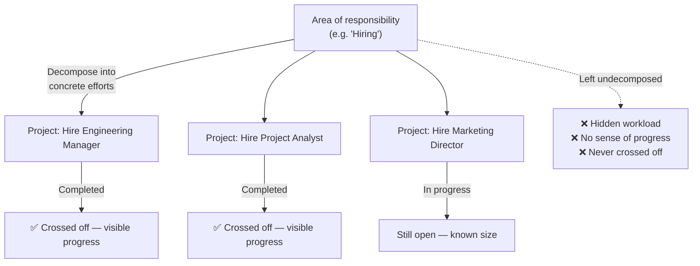

# Chapter 2 — The Power of Organizing by Project

> [!cite] Book reference
> *The PARA Method: Simplify, Organize, and Master Your Digital Life* — Tiago Forte. Chapter 2: "The Power of Organizing by Project." Source: user's uploaded EPUB.

> [!summary] One-line takeaway
> If your "project list" contains things that never end, it isn't a project list at all — it's a list of Areas in disguise, and that disguise is quietly costing you both clarity about your workload and motivation about your progress.

## Why this chapter matters
Chapter 1 established the four categories in the abstract; this chapter makes the case for why **Projects specifically** deserve top billing — it's the category Forte returns to insist people get right first, because getting it wrong (confusing Areas for Projects) is the single most common PARA mistake, as flagged already in the Chapter 1 notes' community research. This sets up Chapter 3's "sixty-second setup guide," which opens by building the Projects folder before anything else.

## Direct quotes from the book
> [!quote] The diagnostic question
> "When working with a client as a productivity coach, one of the first things I always ask them is to show me their project list."

> [!quote] The core definition test
> "Projects are 'short-term efforts,' which means they need a clear end date. Does 'strategic planning' ever end for good? Is there ever a time when you can permanently cross off 'vacations' from your list? Hopefully not!"

> [!quote] Obstacle #1 — hidden workload
> "As long as you view your work through the lens of areas, you'll never quite know just how much is on your plate... that uncertainty will manifest itself as every area feeling more burdensome than it really is."

> [!quote] Obstacle #2 — motivation
> "Without a list of individual projects, you can't connect your current efforts to your long-term goals... I couldn't design a better way to kill motivation if I tried."

> [!quote] On what organizing is actually for
> "So much of what we call 'organizing' is essentially procrastination in disguise... PARA cuts through this facade, giving us a method for organizing anything that is so radically simple, there is no excuse and nothing left to do except the next essential step."

## The chapter in full (so you never need to re-read it)

### The coaching-session opening story
Forte frames the whole chapter around a real anecdote from his time as a productivity coach in the San Francisco Bay Area during the tech boom. He describes coaching a senior director at a biotech firm — someone in charge of developing lifesaving pharmaceuticals — and opening the session with his standard first question: "Do you have a project list?" The director said "Sure!" and, after jotting one down from memory (Forte flags this as "the first red flag" — a real project list should already exist, not be reconstructed on the spot), produced this list:
- Hiring/staffing
- Events
- Direct reports
- Strategic planning
- Research
- Vacations
- Professional development
- Productivity

Forte's punchline: **not a single item on this list is actually a project.** Every one of them is an Area of responsibility — something that continues indefinitely, with no end date. "Strategic planning" never finishes. You never permanently cross off "vacations." This isn't pedantry, he argues — it's a structural failure with two concrete, costly consequences.

### Obstacle #1: You can't truly know the extent of your commitments
When everything lives at the Area level, there's no way to gauge true workload. Forte uses "Hiring" as the example: at a glance, "Hiring" could mean one part-time hire every six months, or fifty full-time positions this quarter — there's no way to tell, and that ambiguity itself becomes a source of stress ("every area feeling more burdensome than it really is"). The fix is breaking the Area down into its actual constituent Projects, each with a visible, countable shape:
- Hire for "Engineering Manager" position
- Hire for "Project Analyst" position
- Hire for "Marketing Director" position
- Hire for "Field Researcher" position
- Hire for "Financial Manager" position

Once broken down this way, you can see at a glance exactly how much is on your plate and what to do next — the uncertainty evaporates.

### Obstacle #2: You can't connect your current efforts to your long-term goals
Forte's second argument is psychological rather than logistical. Knowledge work runs on creativity, and creativity can't be sustained without motivation — and motivation depends heavily on **making consistent, visible progress**. Waking up to the exact same list of never-ending responsibilities week after week, month after month, year after year is, in his words, close to the best possible design for killing motivation, because "no matter how hard you work, the endless horizon never seems to get any closer."

Breaking responsibilities into bite-size Projects fixes this by creating **turnover**: a project list that actually shrinks and refreshes, giving you a steady cadence of completions to celebrate. His example: breaking the broad Area "Events" down into:
- Quarterly staff retreat
- Annual stakeholder conference
- Workshop on research methods
- End-of-year hiring fair
- Executive summer retreat

Each of these has a finish line you can actually cross — which an Area called "Events" never will.

### The universal claim
Forte closes the diagnostic section with a flat assertion: no matter how wide-ranging your responsibilities are, you can *always* decompose them into smaller, concrete Projects — and he adds that you *must* do this if you want any real signal on whether you're making progress toward your goals.

### "Getting Organized for the Life You Want to Lead" (closing section)
The chapter's final section reframes the stakes of PARA beyond mere tidiness. Using PARA, Forte argues, "is not just about creating a bunch of folders to put things in" — it's about identifying the actual structure of your work and life: what you're committed to, what you want to change, where you want to go. Organizing, done right, "supports and calls into being the future life you want to lead."

He then names a trap directly: much of what people call "organizing" is procrastination wearing a disguise — "getting ready" or "doing research" that feels like progress but is really avoidance of the task you're actually dreading. PARA's antidote is radical simplicity: a method so minimal there's "no excuse and nothing left to do except the next essential step." It adds just enough order to produce clarity to move forward — and no more. The chapter ends by teeing up the next two chapters, which will show what it actually looks like to apply this to a real digital life.

## Core concepts (quick-scan version)

| Concept | What it means |
|---|---|
| The project-list test | If an item on your "project list" never ends, it's an Area, not a Project |
| Obstacle #1 | Area-level thinking hides your true workload (can't size "Hiring" at a glance) |
| Obstacle #2 | Area-level thinking kills motivation (no sense of a shrinking, winnable list) |
| The fix | Break every Area into its concrete, nameable, end-able sub-projects |
| Universal claim | Any responsibility, however broad, can be decomposed into Projects |
| Organizing ≠ procrastination | PARA should minimize organizing-as-avoidance, not become a new form of it |
| The real goal | Clarity to take the next essential step — not a perfectly tidy system for its own sake |

## First-principles breakdown
Forte's central claim is: **naming your responsibilities at the Area level (rather than the Project level) actively degrades both your situational awareness and your motivation.** Decomposed into more basic truths:

1. **Working memory and estimation are bad at unbounded categories.** Human estimation of effort relies on concrete, countable units — "five open hiring requisitions" is estimable, "Hiring" is not. This is well-grounded in cognitive-load research (chunking, the difficulty of estimating diffuse/unbounded tasks) rather than specific to PARA.
2. **Motivation is substantially fueled by perceived progress**, not just effort (this tracks established self-determination and goal-progress literature, e.g., the "progress principle" from Amabile & Kramer's research on workplace motivation — Forte doesn't cite this explicitly, but his claim rests on the same mechanism). A list that never shrinks removes the visible-progress signal entirely, which is a real psychological cost, not just a rhetorical flourish.
3. **What's asserted rather than proven**: the specific coaching anecdote (the biotech director) is a single illustrative case, not data — Forte doesn't claim it's representative, though he implies (and outside research on task-list design tends to agree) that "non-project project lists" are a very common failure mode.
4. **Hidden assumption**: this chapter assumes you *can* cleanly decompose every Area into discrete Projects. That's mostly true for execution-style work (hiring, events) but breaks down for genuinely open-ended responsibilities with no natural end state — e.g., "be a good parent" or "maintain physical health" don't fully decompose into a finite project list no matter how granular you get; some residual, non-project Area always remains. The chapter doesn't address this boundary condition, but it's implicitly handled by PARA's broader structure: Areas are allowed to exist permanently *alongside* Projects — the point isn't to eliminate Areas, only to stop mistaking them for Projects.

Rebuilt in plain language: **give yourself a list of things that can actually be finished, update it as things finish, and don't let your sense of workload live entirely in words for things that structurally never end.**

## Visual representation

## Worked example — built directly in your vault
Your vault's `01-Projects/` folder already models the correct pattern this chapter is arguing for — it's worth checking it against the exact diagnostic Forte gives:

- **Gloss Local** passes the test cleanly: it has a concrete, nameable finish line (stable local fork, Ollama + SQLite + Drive backups, running across Mac hub and Windows/phone clients). It isn't "Software Maintenance" (an Area) — it's a specific build with an end state.
- **Second Brain Build-Out** also passes, with the same caveat flagged in the Chapter 1 notes: its "certain goal" is all chapters + guides for this book-notes effort finished, which is concrete enough to count, though it borders on the "topic I'm interested in" shape a Resource would have.
- Applying Forte's exact biotech-director test to your own setup: if you ever found yourself writing something like "Vault Maintenance" or "Reading" as an item in `01-Projects/`, that would be the same red flag he's describing — those are Areas (`02-Areas/Knowledge Management` already correctly holds the ongoing vault-maintenance responsibility). The fact that your Projects folder currently holds exactly two concrete, end-able efforts and your Areas folder holds the indefinite "Knowledge Management" responsibility is a good sign — it already matches the chapter's prescription rather than violating it.
- One new artifact this chapter's content clearly calls for: a small checklist file, e.g. `01-Projects/Second Brain Build-Out/project-decomposition-check.md`, where at your next review you apply Forte's test explicitly ("does this sub-task have a clear end date?") to anything that creeps into that project folder — cheap insurance against the exact failure mode this chapter is about.

## What the book doesn't tell you — community perspective
- **The "5–12 rotating items" diagnostic has become a widely-repeated community rule of thumb**: if your Projects list never gets shorter, or you've had the same ~20 "projects" for six months, most of them are actually Areas or goals in disguise — essentially a crowdsourced restatement of this exact chapter's warning ([A Pragmatic Mind](https://www.apragmaticmind.com/blog/para-method); [iwoszapar.com guide](https://www.iwoszapar.com/p/para-method)).
- **Even Forte's own examples get contested.** On the Mac Power Users forum, PARA adopters have openly debated what actually belongs in "Areas" inside a task manager, separate from Projects — a sign that the Projects/Areas line is genuinely harder to hold in practice than the chapter's clean biotech-director example suggests ([MPU Talk thread](https://talk.macpowerusers.com/t/those-using-fortes-para-method-what-do-you-put-in-areas-in-your-task-manager/32158)).
- **A practical pushback worth knowing:** some practitioners argue that enforcing the Projects/Areas boundary *too* strictly backfires in digital tools — moving an item between the two categories can break links, confuse collaborators, and create busywork, so if you find yourself constantly reclassifying, it may be worth merging the categories for that particular tool rather than chasing taxonomic purity.
- **Ambiguous cases resist Forte's clean test.** "Learn Spanish" is the most commonly cited example: it could be a multi-year Area (ongoing language maintenance) or a bounded Project (reach conversational fluency by a date) — PARA doesn't resolve this for you, it just asks you to pick one framing and stay consistent with it.

## Deeper commentary — how this applies to your setup specifically
Both of your live Projects — [[Gloss Local]] (no-subscription local-first reading app: Ollama + SQLite + Drive backups, Mac hub + Windows/phone clients) and this very book-notes effort — currently pass Forte's test, but it's worth stress-testing them the way the chapter's diagnostic intends rather than assuming they'll stay that way. Gloss Local in particular has the exact shape Forte warns underlies Obstacle #1: it's genuinely composed of several sub-efforts (Ollama integration, SQLite schema, Drive backup wiring, Windows client, phone client) that could each be broken out the way "Hiring" was broken into five named hires. An open question worth flagging rather than deciding here: should Gloss Local's sub-components get their own tracked checklist inside the project folder (mirroring the "Hire for Engineering Manager position" style of decomposition), or is that over-engineering for a project with one active builder? The chapter's own answer leans toward "yes, decompose it" — but only once you notice the vague feeling of "there's a lot left to do" that this chapter identifies as the actual symptom.

## Practical / actionable takeaways
- [ ] Re-run Forte's exact test on everything currently inside `01-Projects/`: does each item have a clear end date and a specific goal, or could you imagine it existing unchanged a year from now?
- [ ] If Gloss Local ever starts to feel like "there's always more to do" without a sense of shrinking scope, decompose it into named sub-projects the way "Hiring" was decomposed into five named hires
- [ ] Create `project-decomposition-check.md` inside `01-Projects/Second Brain Build-Out/` as a lightweight recurring check against this chapter's diagnostic
- [ ] Watch for any new item that sounds like an Area wearing a Project's clothes (e.g. "Productivity," "Research," "Professional Development") before filing it in `01-Projects/`

## Questions / things to decide for your own vault
- Is "Second Brain Build-Out" itself at risk of quietly becoming an Area (an ongoing "keep improving my notes" habit) rather than a Project that actually finishes? Worth revisiting once all 15 chapters + guides exist.
- Do you want a numeric cap (Forte's community implies 5–12) on live items inside `01-Projects/`, or is a looser "does it still have a visible end date" check sufficient for a two-project vault?

## Video
No Tiago Forte video specifically about this chapter's "project list diagnostic" story was verified as existing — his general PARA talks cover the four-category framework broadly rather than this specific coaching anecdote, so no video link is included here to avoid forcing an imprecise match.

## Sources (external, beyond the book)
- [The PARA Method: A Pragmatic Guide to Organizing What You Know — A Pragmatic Mind](https://www.apragmaticmind.com/blog/para-method)
- [The PARA Method: A Complete Guide (2026) — iwoszapar.com](https://www.iwoszapar.com/p/para-method)
- [Those using Forte's PARA Method — what do you put in Areas in your Task Manager? — Mac Power Users Talk](https://talk.macpowerusers.com/t/those-using-fortes-para-method-what-do-you-put-in-areas-in-your-task-manager/32158)
- [The PARA Method: A Universal System for Organizing Digital Information — Hacker News discussion](https://news.ycombinator.com/item?id=30916260)

## Footnotes
This chapter has no numbered endnotes in the extracted text — Chapter 2's raw extraction contains no trailing numbered `[li]` footnote items, unlike Chapters 3 and 4.

## Claude's pick — what I'd flag as most important
1. **The biotech-director anecdote is the single most useful diagnostic tool in the whole book so far**: literally write down your project list and ask "does each item have a clear end date?" — if the answer is mostly no, you don't have a project list, you have an area list.
2. **The motivation argument (Obstacle #2) is easy to underrate** — it's not just a workload-visibility trick, it's an argument that mis-categorizing your work can quietly demoralize you over months and years, which is a much higher-stakes claim than it first appears.
3. Don't let the "organizing can be procrastination" warning at the end of this chapter get lost — it's a check on PARA itself: if you're spending more time perfecting your project folders than finishing projects, you've recreated the exact problem PARA exists to solve.

## Related
- Previous: [[Chapter 1 - Introducing PARA]]
- Next: [[Chapter 3 - The Sixty-Second PARA Setup Guide]]
- MOC: [[The PARA Method - MOC]]
- Cross-reference (same system, shorter treatment): [[Chapter 2 - PARA Folder System]] (*Obsidian Second Brain*)
- Decision tree: [[Where Does This Go - Quick Reference]]
