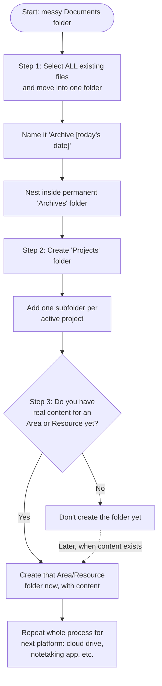

# Chapter 3 — The Sixty-Second PARA Setup Guide

> [!cite] Book reference
> *The PARA Method: Simplify, Organize, and Master Your Digital Life* — Tiago Forte. Chapter 3: "The Sixty-Second PARA Setup Guide." Source: user's uploaded EPUB.

> [!summary] One-line takeaway
> Before you build anything new, archive everything old in one decisive move — PARA's real starting point isn't meticulous filing, it's a deliberate, fast "clean slate" followed by creating only the one folder you actually need right now (Projects).

## Why this chapter matters
Chapter 2 made the case that Projects deserve priority; this chapter turns that into a literal sequence of actions — and its biggest surprise is that step one isn't "set up all four folders," it's "archive everything you already have." This directly sets up Chapter 4's five tips (Inbox, numbering, naming convention, offline mode, backups), which assume this three-step skeleton is already in place.

## Direct quotes from the book
> [!quote] The counter-intuitive opening move
> "Before you can create anything new, you have to clear out the old."

> [!quote] On why digital clutter still costs you something
> "The digital world is different. Digital objects don't take up any physical space... This may seem like a blessing, but in fact it's a curse. The problem with keeping everything is that it quickly starts to consume a resource even more scarce than physical space: your attention."

> [!quote] What the Archive actually is
> "That place is the Archives. Think of it like 'cold storage' for your digital life. By placing something there, it gets 'frozen' in time in exactly the state you left it."

> [!quote] The empty-folder rule, born from failure
> "This experience led me to form a new rule: never create an empty folder (or tag, or directory, or other container) before you have something to put in it."

> [!quote] On why Areas and Resources can wait
> "These two categories are less actionable, and therefore less important, so it's not critical that you have them completely fleshed out from day one."

## The chapter in full (so you never need to re-read it)

### The three-step sequence
Forte opens by debunking the intuitive approach — meticulously creating every folder across all four PARA categories and individually sorting every existing file into them. Through trial and error with clients, he found this is "exactly the wrong way to start." The actual sequence he recommends, applied to one platform at a time (he suggests starting with your Documents folder, since it's typically the oldest and largest repository most people have):

1. **Step 1: Archive existing files**
2. **Step 2: Create project folders**
3. **Step 3: Create additional folders as needed**

### Step 1: Archive Existing Files
Forte's argument starts from a physical-vs-digital contrast: in the physical world, every object takes up space, forcing a decision about each item (even if that decision is "throw it away"). Digital space is effectively unlimited, so "you never really have to throw anything away. You can keep it all." But he frames this as a curse, not a blessing — the real scarce resource isn't storage, it's **attention**. Every stray file glimpsed on a desktop or in a cluttered folder quietly drains mental energy; a part of your brain keeps "worrying about the chaotic state of your digital environment" even when you try to ignore it, because your brain treats your information environment with the same vigilance as your physical one.

The resolution isn't to delete anything — it's to put everything somewhere "out of sight, out of mind" but still safely retrievable: the Archive, described as "cold storage" that freezes material exactly as you left it.

**The concrete instruction**: select *all* existing files, documents, and folders in your Documents folder (could be hundreds or thousands of items) and move them, all at once, into a new folder named **"Archive [Today's date]"** — a literal time capsule marking everything that existed before today versus everything saved from today forward. Then nest that dated folder inside a larger, permanent folder simply titled **"Archives,"** which becomes the lasting home for all future archives. That's the entirety of step one — a single bulk move, not item-by-item triage.

### Step 2: Create Project Folders
With the Documents folder now cleared to a blank slate, Forte has you create exactly one new folder: **"Projects."** Inside it, create one subfolder per currently active project, named after each project. He explains the prioritization logic: Projects are what you're actively working on *right now*, so they're the most timely and pressing — which is why they get built first, ahead of Areas or Resources. You don't need to move everything into project folders immediately or all at once; you populate them gradually as you actively work with documents.

His worked example — a bathroom renovation project — would plausibly contain:
- Measurements of the bathroom's dimensions
- Photos of tile patterns and colors under consideration
- Quotes from several contractors
- Details of the winning bid and signed contract
- A budget spreadsheet to track spending

He notes that even for a project executed by someone else (a contractor, in this case) there's still substantial information worth tracking in a project folder — projects you're not personally doing the physical work on still generate project material.

### Step 3: Create Additional Folders as Needed
This step is framed almost entirely as a correction of Forte's own past advice. He used to tell clients to also pre-create folders for every Area and Resource they imagined they'd eventually want — reasoning it would be more convenient to have them ready. He now calls this an error, illustrated by a specific client story:

**The Silicon Valley software firm story**: Forte was hired to organize a software development firm's shared cloud storage drive. The team brainstormed every PARA folder they might conceivably want and built the entire system in a single day — it felt great in the moment. But in the following weeks and months, engineers kept running into "a perfectly titled folder that seemed to promise exactly what they were seeking, only to double-click on it and find it empty" — repeatedly. Forte's phrase for the result: "a labyrinth of tantalizing doorways leading to empty rooms," producing recurring frustration and disappointment.

This became his rule: **never create an empty folder (or tag, directory, or other container) before you have something to put in it.** For Areas and Resources specifically — which he calls "less actionable, and therefore less important" — he recommends holding off on any "speculative" folder creation until you actually have content that needs a home. Creating a folder only takes a moment, so there's no efficiency gained by front-loading it.

### Extending to other platforms, and the closing reflection
Once this three-step process is done for one platform, Forte says to repeat it for your cloud storage drive, notetaking app, and anywhere else you store information — at which point "your digital world will become a para dise (get it?) of simplicity and efficiency," with a footnote pointing to Chapter 8 for guidance on extending PARA across multiple platforms specifically.

He closes with a reflective note rather than another instruction: this reorganization is a chance to also reset your **attitude** toward information going forward, not just your folder structure. The warning: don't dump new material "willy-nilly" into the new PARA folders, or the system reverts to the original chaos. He poses three questions worth sitting with as you refile things: What is truly unique or useful? What do you need in front of you when focusing on a project or area? Which resources are genuinely valuable versus easily re-findable with a Google search? The chapter ends on an open, almost philosophical note: "What will you do with all the time and attention that get freed up as a result?"

## Core concepts (quick-scan version)

| Step | Action | Why first/last |
|---|---|---|
| 1 | Archive *everything* existing into `Archive [date]` inside `Archives` | Clears the slate; nothing is deleted, just frozen and set aside |
| 2 | Create `Projects` folder + one subfolder per active project | Projects are most timely/pressing — build structure for them first |
| 3 | Create Area/Resource folders only when you have content for them | Prevents the "labyrinth of empty folders" failure mode |
| — | Repeat per platform (Documents → cloud drive → notes app → etc.) | Each platform needs its own archive + project folders |
| — | Reset your *attitude*, not just your folders | A reorganized system still decays if you refile mindlessly afterward |

> [!tip] The counter-intuitive ordering, restated
> Most people assume PARA setup = build all 4 folders → sort everything. Forte's actual order is: archive all → build Projects only → add Areas/Resources lazily, on demand.

## First-principles breakdown
Forte's core claim is: **a bulk, undiscriminating archive move is better than item-by-item sorting as a starting point.** The more basic truths this depends on:

1. **Decision fatigue is real and front-loaded sorting maximizes it.** Asking "where does this go?" for hundreds or thousands of legacy files, one at a time, up front, before you even have a working system, is exactly the kind of high-volume micro-decision-making that depletes willpower and guarantees abandonment partway through — well supported by decision-fatigue research generally, even though Forte doesn't cite it directly.
2. **Attention, not storage, is the actual constraint being managed.** This is an empirically reasonable but somewhat asserted claim — there isn't a citation in the chapter for "clutter you can't see still drains attention," though it rhymes with findings on background cognitive load from visual clutter and open loops (akin to the psychology behind the "Zeigarnik effect," where incomplete/unresolved items occupy mental bandwidth even when not being actively thought about).
3. **The empty-folder rule is the most empirically-grounded claim in the chapter**, because it's backed by Forte's own documented field failure (the Silicon Valley firm), not just a design principle — a real natural experiment, albeit an anecdote of one, not a study.
4. **Hidden assumption**: this approach assumes your legacy files are mostly *retrievable by search* rather than needing active re-filing — which is reasonable for modern search-indexed digital tools, but would not work the same way for, say, physical paper archives or systems without reliable full-text search. The chapter implicitly depends on your platform having decent search; it doesn't flag this as a precondition, but it's the thing that makes "just dump it all in Archive and move on" safe rather than reckless.
5. **A boundary condition the book doesn't name**: the "archive everything in one move" approach works well for a personal Documents folder, but for *shared/team* drives, bulk-archiving active collaborative material risks breaking other people's workflows and links — which is really the same empty-folder lesson in reverse: the failure mode wasn't the archiving model being wrong, it's that any big-bang reorganization of a system other people depend on carries social/coordination risk the chapter doesn't address because its examples are personal-use cases (your own Documents folder) rather than shared ones.

Rebuilt in plain language: **stop trying to decide where two thousand old files go one at a time — freeze them all in a single dated box, build only the one folder you're using today, and let every other folder earn its existence by having something that actually needs it.**

## Visual representation

## Worked example — built directly in your vault
Your `SecondBrain/` vault already demonstrates most of this chapter's prescription, since the PARA skeleton was built during the *Obsidian Second Brain* project rather than from a single big-bang reorganization — worth sanity-checking it against this chapter's exact sequencing:

- `04-Archive/` exists and is **intentionally empty** per the Chapter 1 notes — which is actually the correct state per *this* chapter's Step 3 rule (don't pre-populate speculative structure), even though it inverts the letter of Step 1 (archive existing material first). The spirit still holds: nothing fake or placeholder lives in there.
- `01-Projects/` holds exactly two real, active subfolders — **Gloss Local** and **Second Brain Build-Out** — matching Step 2's "one subfolder per active project you're actually working on," not a speculative list of projects you might someday start.
- `02-Areas/Knowledge Management` and `03-Resources/Obsidian and PKM` both exist with real content already in them, which is consistent with Step 3's rule that these folders should only exist once they have something to hold — they weren't created speculatively ahead of need.
- One genuine gap worth flagging against this chapter specifically: you have never actually run "Step 1" literally — there's no `Archive [today's date]` time-capsule folder from a single big reorganization moment, because your vault was built incrementally. That's fine (the chapter's goal — attention relief from old clutter — was never a problem you had), but if you ever import a large pre-existing folder of old files from elsewhere (e.g. consolidating an old notes app or Downloads folder into this vault), this chapter's exact Step 1 technique — one bulk dated-Archive move, not item-by-item triage — is the right tool to reach for rather than re-litigating each file's PARA category by hand.

## What the book doesn't tell you — community perspective
- **"Declaring information bankruptcy" is the community's own name for Step 1**, and it's widely repeated as *the* standard fast PARA setup across many independent guides — put everything into Archives and start clean, letting you stay nimble without literally deleting anything ([A Pragmatic Mind](https://www.apragmaticmind.com/blog/para-method); [iwoszapar.com](https://www.iwoszapar.com/p/para-method)).
- **Several practitioners push back on doing the big-bang move at all**, recommending a gradualist alternative instead: apply PARA only to *new* information going forward and let old files sit untouched until you naturally need them, rather than forcing a disruptive one-time purge — a direct, reasonable alternative to this chapter's literal instruction ([Framezone Learn](https://framezone.app/learn/knowledge-systems/para-method-organizing-digital-life)).
- **The empty-folder rule gets cited back to Forte almost verbatim across the PKM community** and is treated as one of the book's most quotable, most-agreed-upon pieces of advice — Forte himself posted the rule on social media ahead of this book's launch, and it's repeated in multiple independent summaries and reading-note posts, suggesting it resonated unusually strongly compared to other chapter content ([Tiago Forte on X](https://x.com/fortelabs/status/1683421331184918529); [Thomas Frank's book notes](https://thomasjfrank.com/productivity/books/the-para-method-by-tiago-forte-summary-and-book-notes/)).
- **A real caution for digital environments specifically (not raised in the chapter)**: moving folders around after the fact can break shared links and file paths in collaborative or cloud-synced setups — a friction source the chapter doesn't anticipate because its running example (a personal Documents folder) is single-user.

## Deeper commentary — how this applies to your setup specifically
Because your two live Projects — [[Gloss Local]] and the Second Brain Build-Out — were both deliberately started inside an already-existing PARA structure, you've essentially been living in "Step 2 onward" the whole time without ever needing Step 1's big dated-Archive move. That's worth remembering as reassurance the next time you're tempted to do a dramatic reorganization "to be thorough": per this chapter's own Step 3 logic, you should resist pre-building new folders (e.g. speculative Areas for topics Gloss Local might eventually touch, like "Local AI Tooling" as an Area) until there's genuinely a recurring need for them — the Silicon Valley story is a direct warning against exactly that impulse. An open question for your setup: if Gloss Local eventually needs its own sub-resource folder (e.g. for Ollama model notes, or SQLite schema references), does that content go inside the project folder itself (since the project is still active), or does it wait until the project either archives or clearly needs a standing Resource? This chapter implies: don't create that Resource folder speculatively — wait until you're actually saving something into it repeatedly.

## Practical / actionable takeaways
- [ ] If you ever bulk-import an old notes app or Downloads folder into this vault, use this chapter's literal Step 1 technique — one `Archive [date]` folder, one bulk move, no item-by-item triage
- [ ] Resist creating any new Area or Resource subfolder (e.g. under `02-Areas/` or `03-Resources/`) until you have at least one real piece of content ready to go into it — per the empty-folder rule
- [ ] When reviewing `01-Projects/`, confirm every subfolder represents something you're actively working on right now, not something speculative
- [ ] Revisit Chapter 8 (when you get to it in this book-notes project) for the multi-platform extension guidance this chapter's footnote points to

## Questions / things to decide for your own vault
- Is there a non-vault source (old Downloads folder, an abandoned notes app, browser bookmarks) worth running this chapter's literal "Archive [date]" bulk-move technique against, now rather than later?
- Should `04-Archive/` get a dated-subfolder convention (`Archive 2026-11-18/`) the first time something actually gets archived, to match this chapter's exact naming pattern, or is a flatter structure preferable for a vault this size?

## Video
No specific Tiago Forte video walking through this exact "sixty-second setup" three-step sequence was verified as existing as a standalone video; his broader PARA talks (e.g. "Tiago Forte - The PARA Method (How to organize your digital life)" on YouTube) cover the four categories generally but not confirmed to match this chapter's specific three-step sequence, so no video link is included to avoid an imprecise match.

## Sources (external, beyond the book)
- [The PARA Method: A Pragmatic Guide to Organizing What You Know — A Pragmatic Mind](https://www.apragmaticmind.com/blog/para-method)
- [The PARA Method: A Complete Guide (2026) — iwoszapar.com](https://www.iwoszapar.com/p/para-method)
- [The PARA Method: Organizing Your Digital Life — Framezone Learn](https://framezone.app/learn/knowledge-systems/para-method-organizing-digital-life)
- [Tiago Forte on X — "Never create an empty folder..."](https://x.com/fortelabs/status/1683421331184918529)
- [The PARA Method by Tiago Forte – Summary and Book Notes — Thomas Frank](https://thomasjfrank.com/productivity/books/the-para-method-by-tiago-forte-summary-and-book-notes/)

## Footnotes
[^7]: "See chapter 8 for more guidance on how to extend PARA across multiple platforms." — referenced in the chapter text after "...your digital world will become a para dise (get it?) of simplicity and efficiency."

## Claude's pick — what I'd flag as most important
1. **Archive first, build second** is the single most counter-intuitive and most useful instruction in this chapter — it removes the paralysis of "where does this old file go?" by deferring that decision entirely rather than forcing it up front.
2. **The empty-folder rule, born from a real documented failure**, is worth internalizing beyond PARA specifically — it applies to tags, databases, project-management boards, anything where structure can outrun content and create false promises of organization.
3. The closing reflection — "don't dump new stuff willy-nilly... or you'll quickly find yourself right back in the chaos" — is the easiest part of this chapter to skip past, but it's the actual long-term determinant of whether the sixty-second setup sticks or decays; Chapter 5's weekly maintenance habit is the mechanism that prevents that decay.

## Related
- Previous: [[Chapter 2 - The Power of Organizing by Project]]
- Next: [[Chapter 4 - Five Key Tips for Making Organizing Easy]]
- MOC: [[The PARA Method - MOC]]
- Cross-reference (same system, shorter treatment): [[Chapter 2 - PARA Folder System]] (*Obsidian Second Brain*)
- Decision tree: [[Where Does This Go - Quick Reference]]
