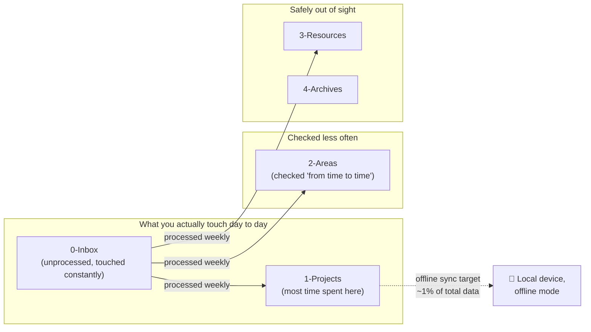

# Chapter 4 — Five Key Tips for Making Organizing Easy

> [!cite] Book reference
> *The PARA Method: Simplify, Organize, and Master Your Digital Life* — Tiago Forte. Chapter 4: "Five Key Tips for Making Organizing Easy." Source: user's uploaded EPUB.

> [!summary] One-line takeaway
> Five small, one-time setup tweaks — an Inbox, numbered folders, a consistent naming convention, offline-mode on Projects only, and real backups — turn PARA from a theoretical structure into something that works under real-world time pressure, and PARA is explicitly designed to "fail gracefully" if you don't follow any of them perfectly.

## Why this chapter matters
Chapter 3 gave you the bare three-step skeleton (archive, Projects folder, folders-as-needed); this chapter adds the finishing details that make that skeleton frictionless day to day. It's also the first chapter to explicitly grant permission to deviate from PARA's exact prescriptions — a theme Chapter 5 continues with its "five minutes a week" maintenance framing.

## Direct quotes from the book
> [!quote] Why an Inbox is necessary
> "In the midst of a hectic week, you won't usually have time to perfectly capture, title, and file away new items as they arrive. Which means you need a separate time and place to 'process' new items."

> [!quote] On numbering, and where your attention should actually go
> "Most of the time, you'll only look in folder #1, Projects. From time to time, you'll open up folder #2, Areas, when you want to think longer term. Folders #3 and #4, Resources and Archives, can remain safely out of sight until you need them."

> [!quote] Why the Projects folder works for offline mode
> "The Projects folder also happens to be the smallest in terms of required disk space—only about 1 percent of all my digital notes, for example, live under 'Projects'—which makes it easy to download them to your local device."

> [!quote] On permission to deviate
> "It doesn't matter that you have exactly four PARA categories... The important principle is to separate out whatever is most actionable and timely and give it the majority of your attention, and there are countless ways to do so. Don't feel the need to follow my prescriptions exactly—I give you permission to customize."

## The chapter in full (so you never need to re-read it)

Forte frames this chapter as a set of simple tips refined over years of real use, each requiring "only a onetime setup and a minute or two to implement."

### Tip #1: Create an Inbox
The rationale: during a hectic week you won't have time to perfectly capture, title, and file items the instant they arrive — so you need a dedicated holding area to defer that decision. The instruction: add a fifth folder, titled simply **"Inbox,"** alongside the four PARA categories, on every major platform you use (Documents folder, cloud storage drive, notetaking app). It's a temporary accumulation zone for new items until you have time to process them — processing itself is covered in the next chapter (Chapter 5).

### Tip #2: Number the Folders
Add numbers 0–4 at the start of each of the five folder titles. "0" for Inbox is deliberate — it signals the contents haven't been processed yet — and the numbering keeps folders sorted, alphabetically, from most to least actionable:
- 0 — Inbox (unprocessed)
- 1 — Projects (most actionable — you'll live here most of the time)
- 2 — Areas (checked "from time to time," for longer-term thinking)
- 3 — Resources (safely out of sight until needed)
- 4 — Archives (safely out of sight until needed)

Forte is explicit that this ordering reflects actual attention allocation: most of your working time is spent in folder #1, occasional visits to #2, and #3/#4 can be effectively ignored day-to-day.

### Tip #3: Use a Naming Convention
The goal: glance at a folder on any platform or device and instantly know which PARA category it belongs to, without needing to open it or rely on its numeric prefix alone. Forte's own informal convention:
- **Projects** → emoji at the start of the title (e.g., "📦 Create sponsorship package," "✍️ Write article on new environmental standards," "✈️ Plan Mexico City vacation" — emoji placement shown in his examples)
- **Areas** → Capitalized Titles (e.g., "Professional Development," "Financial Management," "Travel")
- **Resources** → lowercase, uncapitalized titles (e.g., "piano songs," "slide presentations," "video assets")

He explicitly notes the benefit: this convention uses only the most basic text characters, so it works identically across any platform or app, with no dependency on special folder-coloring or custom metadata features that may not exist everywhere.

### Tip #4: Activate Offline Mode
Forte argues PARA works especially well offline because it concentrates everything you're likely to need on the go into a single place: your Projects folder. Rather than hunting down related documents scattered across a dozen locations, they're already consolidated. He adds a practical data point: the Projects folder is also typically the *smallest* by disk space — about 1 percent of his total digital notes live under Projects — making it cheap and fast to sync locally. His instruction: spend a minute activating offline/local-sync mode specifically for the Projects folder (and its subfolders) on each device you use while traveling, in transit, or when deliberately disconnecting to focus. A footnote clarifies this might mean toggling "Available offline," turning on "Local sync" for all files, or an equivalent feature depending on the specific software.

### Tip #5: Make Backups
Since organizing represents a real investment of time and effort, that organized information becomes correspondingly more valuable — and therefore worth protecting. Forte recommends a reliable backup system for each major platform you use, since each will hold different information. If you're already using a cloud-based platform, this is typically handled automatically. For local computer files, the two options he names are an automatic cloud backup service, or a recurring manual reminder to back up to an external hard drive.

### "Customizing Your PARA System" (closing section)
This closing section is explicitly reassurance-oriented: PARA is designed to "fail gracefully." Forte names two specific ways:

1. **Exact placement doesn't matter much.** If filing items feels mentally taxing or time-consuming, he says not to worry too much — you'll likely retrieve information via search most of the time anyway, making precise subfolder placement a "nice-to-have, not a must-have." He also previews that Chapter 9 covers how items can "flow" between categories later, meaning the initial placement decision is inherently forgiving and reversible.
2. **The four categories themselves are optional.** He's seen people add a fifth category (e.g., "S" for Systems, or "V" for Values), and others collapse everything down to just two: a "Hot" folder for anything currently actionable and a "Cold" folder for everything else. The underlying principle he wants preserved, regardless of exact structure: separate out whatever's most actionable and timely, and give it the majority of your attention. Everything else is implementation detail you're explicitly invited to customize.

## Core concepts (quick-scan version)

| Tip | What to do | Core reason |
|---|---|---|
| #1 Inbox | Add a 5th folder, "Inbox," per platform | Defers filing decisions until you have time to process |
| #2 Numbering | Prefix folders 0–4 (Inbox→Archives) | Alphabetical sort = actionability order; signals priority |
| #3 Naming convention | Emoji (Projects) / Capitalized (Areas) / lowercase (Resources) | Instant category recognition, works cross-platform |
| #4 Offline mode | Sync only Projects folder locally | Smallest folder (~1% of notes), holds what you need on the go |
| #5 Backups | Cloud auto-backup or scheduled external drive backup | Protects the time investment now embedded in your organized data |
| Fail gracefully #1 | Exact filing doesn't matter much | Search retrieval + Chapter 9's "flow between categories" makes placement forgiving |
| Fail gracefully #2 | Four categories are optional | Core principle = separate most-actionable from everything else, however you implement it |

## First-principles breakdown
The chapter's implicit central claim is: **small, one-time environmental/structural tweaks reduce the ongoing cognitive cost of maintaining an organizational system far more than willpower or discipline would.** Decomposing this:

1. **The Inbox and numbering tips both rest on reducing in-the-moment decision cost** — the same decision-fatigue principle underlying Chapter 3's "archive first" advice. Deferring categorization (Inbox) and encoding priority into sort order (numbering) both substitute a one-time structural decision for many repeated micro-decisions. This is well-grounded in general cognitive-load/habit-formation research, even though not cited directly.
2. **The naming convention claim (instant visual recognition) is a real, if modest, perceptual-shortcut effect** — using surface features (case, leading symbol) as a categorical cue is a basic, well-established pattern-recognition strategy (comparable to color-coding or iconography in any filing system). It's genuinely low-cost to implement, which is likely why it persists as advice across many productivity systems beyond PARA specifically.
3. **The offline-mode tip is the most data-driven claim in the chapter** — the "~1% of total notes live in Projects" figure is presented as Forte's own personal statistic, not a general law; it's plausible given Projects are meant to stay lean and finite (per Chapter 2's argument that only concrete sub-efforts belong there) but it's anecdotal, not something that generalizes with any guaranteed ratio to every user's workload.
4. **What's asserted vs. empirically grounded**: the "fail gracefully" claims are the chapter's least falsifiable content — there's no measurement offered for how often misfiled-but-searchable items are actually retrieved successfully, and no data on how many people actually customize categories successfully versus abandon the system when they deviate. These read as experience-based assurances rather than demonstrated outcomes.
5. **A hidden assumption worth flagging**: the entire "search will save you" safety net (Tip's implicit backbone, reinforced in the closing section) assumes your tools have genuinely good, fast full-text search. In a tool without strong search (or with search buried behind paywalls/limits), misfiling becomes much costlier than this chapter implies — a boundary condition the book doesn't name, but one that matters a great deal depending on which "platform" you're applying this to.

Rebuilt in plain language: **reduce the number of times you have to think about where something goes, make the categories visually self-evident at a glance, keep only your smallest/most-essential folder synced locally, back up what you've invested time building, and don't treat any of these five things as rules you can't break.**

## Visual representation

## Worked example — built directly in your vault
Checking your real `SecondBrain/` vault structure against all five tips concretely:

- **Tip #1 (Inbox)**: `00-Inbox/` already exists at the vault root exactly as prescribed — one Inbox folder for this platform (the vault), matching the chapter's instruction precisely.
- **Tip #2 (Numbering)**: Your root folders already use the exact 0–4+ numbering scheme this chapter recommends — `00-Inbox`, `01-Projects`, `02-Areas`, `03-Resources`, `04-Archive`, continuing on to `05-Templates`, `06-Daily-Notes`, `07-Periodic-Notes` for vault-specific extensions beyond the book's core five. This matches the chapter's prescription almost exactly, which is worth noting as a deliberate prior design choice (from the *Obsidian Second Brain* build-out) rather than something to newly implement.
- **Tip #3 (Naming convention)**: This is the one tip **not yet implemented** in your vault. Your subfolder names (`Gloss Local`, `Second Brain Build-Out`, `Knowledge Management`, `Obsidian and PKM`) don't currently follow Forte's emoji/Capitalized/lowercase pattern — they're all Capitalized regardless of category. This is a genuinely actionable gap: adopting even a lightweight version (e.g., a single leading emoji per project folder, since you only have two Projects right now) would cost almost nothing and match the chapter's exact advice.
- **Tip #4 (Offline mode)**: Since this is a local markdown vault (not a cloud app with a toggle), this tip translates most directly into Obsidian Sync/iCloud/Drive sync settings, or simply ensuring `01-Projects/` is always present in local storage on whichever device needs it — worth checking explicitly on the Windows/phone clients once [[Gloss Local]] is further along, since that project is explicitly meant to run across those same devices.
- **Tip #5 (Backups)**: This lines up directly with the existing [[Gloss Local]] project design — it already uses Drive backups as part of its own architecture (per the user's memory file: "Ollama + SQLite + Drive backups"). Worth explicitly confirming the *vault itself* (not just Gloss Local's app data) has an equivalent backup plan — e.g., is `SecondBrain/` itself under Obsidian Sync, iCloud, or a separate backup routine? This chapter's Tip #5 applies to the vault as much as to Gloss Local's internal data.

## What the book doesn't tell you — community perspective
- **The emoji/capitalization naming convention draws mixed reactions.** At least one Goodreads reviewer pushed back that having to remember three different naming rules (emoji vs. Capitalized vs. lowercase) is itself "time consuming" to maintain consistently — a fair critique of a tip billed as effortless ([Thomas Frank's book notes](https://thomasjfrank.com/productivity/books/the-para-method-by-tiago-forte-summary-and-para-method-by-tiago-forte/)).
- **Community guides widely echo the "it doesn't matter where you file it" safety net** as one of PARA's most-cited, most-reassuring claims, specifically because it lowers the stakes of getting Tips #1–#3 wrong — several independent summaries single this reassurance out as the thing that actually got people to start, more than any specific folder-naming mechanic ([8 Beautifully Distilled Learnings From Tiago Forte's "The PARA Method" — Medium](https://medium.com/@sterlinglong/8-beautifully-distilled-learnings-from-tiago-fortes-the-para-method-6d2ac635dfd2)).
- **Real-world walkthroughs of implementing these tips exist per-platform** — Forte Labs itself curates community videos showing PARA (including Inbox/numbering/naming patterns) applied inside Evernote, Apple Notes, Notion, Obsidian, OneNote, WorkFlowy, and Anytype, suggesting the specific mechanics in this chapter (numbering, naming, Inbox) need real per-tool adaptation rather than working identically everywhere ([How to Implement PARA in Your Favorite Notetaking App — Forte Labs](https://fortelabs.com/blog/how-to-implement-para-in-your-favorite-notetaking-app/)).
- **The "Hot/Cold" two-category simplification Forte mentions in passing** is picked up independently by some productivity writers as a legitimate minimalist alternative for people who find even four categories excessive — treated in community discussion as a real, viable variant rather than a lesser version of "real" PARA.

## Deeper commentary — how this applies to your setup specifically
The naming-convention gap identified above (Tip #3) is the most concretely actionable finding from this chapter for your vault specifically — and it's worth deciding deliberately rather than drifting, especially since you're running an AI-agent-assisted vault where frontmatter (not folder-name styling) already carries some of this signal (per the Chapter 2 notes' observation that `tags`/`status` frontmatter functions as a partial "contract" for agent queries). An open question worth sitting with: is Forte's folder-naming convention (emoji/Capitalized/lowercase) redundant with your frontmatter-based signaling, or complementary to it? For a human glancing at a Finder/Obsidian file browser, the emoji convention adds something frontmatter doesn't (visual scanability without opening a file) — but for an agent like this one querying the vault, frontmatter is strictly more reliable. Likely the right answer is "both, for different consumers" rather than choosing one.

Separately, Tip #5 (backups) deserves a direct cross-check against [[Gloss Local]]'s existing architecture: that project already treats Drive backups as core infrastructure for its *own* data (chat history, SQLite db), but this chapter's advice is really about backing up your organizational *system itself* — i.e., does the vault (`SecondBrain/`) have the same backup discipline as the app being built inside one of its project folders? Worth confirming explicitly rather than assuming the app's backup strategy covers the vault that documents it.

## Practical / actionable takeaways
- [ ] Decide on and apply a lightweight naming convention for `01-Projects/` subfolders (e.g., a leading emoji per project) to match Tip #3, since this is the one tip not yet implemented
- [ ] Confirm `SecondBrain/` itself (the vault, not just Gloss Local's app data) has a real backup plan — sync service, periodic export, or external drive — independent of Gloss Local's own Drive-backup design
- [ ] If/when working on [[Gloss Local]] away from the Mac hub, confirm the Windows/phone clients have the equivalent of "offline mode" for whatever they need locally available
- [ ] Reread the "fail gracefully" closing section whenever tempted to over-engineer the vault's folder/naming structure — exact compliance with all five tips is explicitly optional per the book itself

## Questions / things to decide for your own vault
- Is a per-project emoji (Tip #3) worth adding now, while you only have two Projects, or does it only start paying off once there are more folders to visually distinguish at a glance?
- Should the vault formally adopt a "Hot/Cold" simplification anywhere internally (e.g., collapsing Resources/Archive distinctions for a specific sub-area), or does the full four/five-folder scheme already work fine at this vault's current size?

## Video
- [How to Implement PARA in Your Favorite Notetaking App — Forte Labs](https://fortelabs.com/blog/how-to-implement-para-in-your-favorite-notetaking-app/) (blog post curating multiple real walkthrough videos of Inbox/numbering/naming applied across Evernote, Apple Notes, Notion, Obsidian, OneNote, WorkFlowy, and Anytype — most directly relevant to this chapter's specific tips of any source found)

## Sources (external, beyond the book)
- [How to Implement PARA in Your Favorite Notetaking App — Forte Labs](https://fortelabs.com/blog/how-to-implement-para-in-your-favorite-notetaking-app/)
- [8 Beautifully Distilled Learnings From Tiago Forte's "The PARA Method" — Sterling Long, Medium](https://medium.com/@sterlinglong/8-beautifully-distilled-learnings-from-tiago-fortes-the-para-method-6d2ac635dfd2)
- [The PARA Method by Tiago Forte – Summary and Book Notes — Thomas Frank](https://thomasjfrank.com/productivity/books/the-para-method-by-tiago-forte-summary-and-book-notes/)

## Footnotes
[^8]: "In many digital notetaking apps, an inbox (sometimes called a 'daily notes' page) comes as a built-in feature. In others, you'll need to create it yourself." — referenced after "...new items accumulate until you have time to put them in their proper place" in Tip #1.
[^9]: "Depending on which software you're using and your available disk space, this might include turning on a setting called 'Available offline' for the folders you want to download, turning on 'Local sync' for all your files, or another feature." — referenced after "...when you just want to shut off the Wi-Fi and focus" in Tip #4.

## Claude's pick — what I'd flag as most important
1. **The numbering tip (0–4) is the single highest-leverage, lowest-effort idea in the chapter** — it's a one-time action that permanently encodes "where should my attention go" into the file system's own alphabetical sort, and your vault already has it.
2. **The "fail gracefully" closing section is arguably more important than any of the five numbered tips** — it's explicit permission to treat PARA as a flexible tool rather than a rulebook, which matters more than getting the emoji convention exactly right.
3. The disk-space observation behind Tip #4 (Projects ≈ 1% of total notes) is a quietly useful sanity check on its own: if your Projects folder ever starts ballooning toward a large share of total vault content, that's an indirect signal worth cross-referencing against Chapter 2's "Projects should stay lean, concrete, and end-able" argument.

## Related
- Previous: [[Chapter 3 - The Sixty-Second PARA Setup Guide]]
- Next: [[Chapter 5 - How to Maintain Your PARA System]]
- MOC: [[The PARA Method - MOC]]
- Cross-reference (same system, shorter treatment): [[Chapter 2 - PARA Folder System]] (*Obsidian Second Brain*)
- Decision tree: [[Where Does This Go - Quick Reference]]
