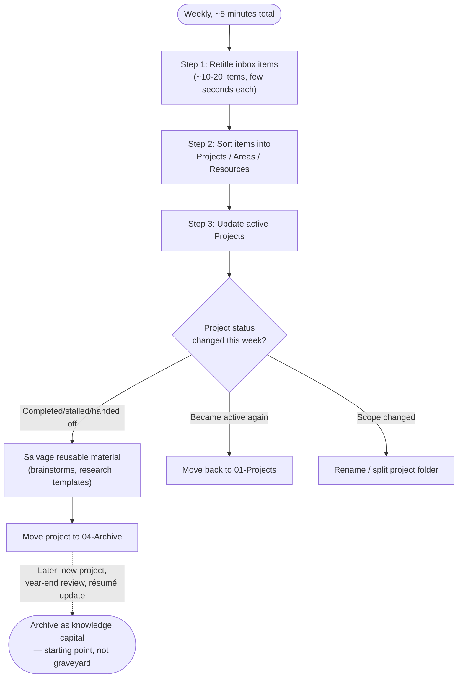

# Chapter 5 — How to Maintain Your PARA System

> [!cite] Book reference
> *The PARA Method: Simplify, Organize, and Master Your Digital Life* — Tiago Forte. Chapter 5: "How to Maintain Your PARA System." Source: user's uploaded EPUB.

> [!summary] One-line takeaway
> PARA doesn't decay from bad initial filing — it decays from skipped maintenance, and Forte's fix is to compress the entire upkeep ritual into roughly five minutes a week across three small steps: retitle, sort, and update your active projects.

## Why this chapter matters
Chapters 3 and 4 built the structure and the setup tips; this chapter is the payoff — the actual habit that keeps the whole system from reverting to the chaos Chapter 3 started by clearing out. It also reframes the Archive (first introduced in Chapter 3 as a place to offload clutter) as something genuinely valuable to revisit, directly setting up later chapters (Forte references Chapter 9's "flow between categories" concept again here) on long-term system evolution.

## Direct quotes from the book
> [!quote] The five-minute promise
> "I recommend you do all the upkeep of your PARA system in just five minutes per week. All you need to do is follow these three easy steps: Retitle new items in your inbox; Sort new items into PARA folders; Update your active projects."

> [!quote] On why retitling matters
> "When they are initially created, these kinds of files normally have a useless title like 'Untitled document' or 'New note.' I find that it aids future retrieval tremendously if I take a few seconds to look at each item I've saved and change its title or name to something more informative and clear."

> [!quote] On low-stakes filing
> "Since I'm most likely to find them again using search, the decision of where to put them is low stakes. I also find that briefly revisiting new information I've captured over the last week serves as a helpful reminder of any follow-up actions I need to take."

> [!quote] The deeper philosophy of updating projects
> "There is tremendous power in changing your organizational system to fit your evolving needs and goals, instead of trying to force your needs and goals to fit your system."

> [!quote] Reframing the Archive
> "Don't think of the Archive as an 'idea graveyard' where information goes to die. Your archives represent the sum total of your life experience, a treasure trove of hard-won lessons and profound insights you've gained from both successes and failures alike."

## The chapter in full (so you never need to re-read it)

Forte opens by acknowledging reality directly: filing documents is a low priority for a busy person, and should be — his own standard is spending the "absolute minimum amount of time possible tweaking and optimizing" the system. His answer is a tight weekly ritual of roughly five minutes, broken into three steps.

### Step #1: Retitle New Items in Your Inbox
In a typical week, Forte accumulates around **ten to twenty** new digital items in his inbox — meeting notes, book highlights, a useful screenshot, a voice memo about a new idea. These items usually arrive with a generic, unhelpful default title ("Untitled document," "New note"). The fix: spend a few seconds per item renaming it to something informative and clear. His own examples:
- Meeting notes with Clara 3/2/23
- Highlights from book *The Oxygen Advantage*
- Useful website on how to do hiring interviews
- Voice memo on new online course idea

He's explicit there's nothing technical or fancy about these titles — sometimes a date is included, sometimes not; the only goal is the shortest, simplest, clearest title you can produce within a few seconds. He also flags a practical complication: you likely have **multiple inboxes** to do this for — one in your Documents folder (per Chapter 4's Tip #1), one for your cloud storage drive, and one inside your notetaking app — each needs this same retitling pass.

### Step #2: Sort New Items into PARA Folders
The second processing step is simply moving retitled items into their appropriate Project, Area, or Resource folder — a few seconds' consideration per item about where it will be most relevant and useful. Done in one batch, Forte says he can process his full ten-to-twenty weekly items in just a few minutes total. He makes two supporting points: first, since you're most likely to rediscover things via search anyway, the exact placement decision is low stakes (directly echoing Chapter 4's "fail gracefully" framing); second, this weekly batch-review of what you've captured doubles as a useful trigger for remembering any follow-up actions those items implied.

### Step #3: Update Your Active Projects
The final step is reviewing your project folders and adjusting them to reflect what's actually happened over the past week. Forte lists four specific kinds of changes this might involve:
- **Renaming** a project to reflect a new scope or direction
- **Splitting** a large project into smaller, more achievable ones
- **Archiving** a project that's been completed, put on hold, canceled, or handed to someone else
- **Unarchiving** a dormant project that's become active again, moving it back to the Projects folder

He adds an important sub-step before archiving anything: scan the project briefly for material that might be useful elsewhere — brainstorms, background research, slides, interview notes — and relocate those pieces to the appropriate place within PARA *before* the project folder disappears into the Archive. His worked example: discovering a new strategic framework during a client engagement, then deciding (once the project wraps) that it's worth reusing with future clients — the fix is moving that documentation into a new Resource folder called "Strategy," so it survives the project's archival and remains available going forward.

He closes this step with a philosophical point that generalizes beyond just project folders: "there is tremendous power in changing your organizational system to fit your evolving needs and goals, instead of trying to force your needs and goals to fit your system." In other words, Step #3 isn't just housekeeping — it's treating the Projects folder as a living reflection of reality rather than a static plan you're obligated to follow.

### "Always Start with the Archives" (closing section)
The chapter's final section directly confronts what Forte calls the biggest misconception about archiving: that archived information is gone for good, never to be revisited. He pushes back hard on the "idea graveyard" framing — the Archive, properly understood, is "the sum total of your life experience, a treasure trove of hard-won lessons and profound insights" drawn from both successes and failures.

He makes a specific, actionable claim: the Archive should be your **starting point**, not an afterthought, whenever you:
- Launch a new project
- Do a personal year-end review
- Update your résumé for a new job

It holds the supporting evidence you'd need to advocate for a raise or promotion, pitch a new client, or propose a new venture. Forte says he's "constantly surprised" how often he finds genuinely useful material from the past in his own archive — notes from a repeat client's earlier call, background research on an industry, inspiration photos for a past design project — all of which he frames as personal **"knowledge capital."** Reusing these assets, he argues, doesn't just save time; it produces a qualitatively different feeling: "like I'm starting a marathon at the halfway point, instead of at the starting line like everyone else."

## Core concepts (quick-scan version)

| Step | Action | Volume / cadence | Core benefit |
|---|---|---|---|
| 1 | Retitle inbox items | ~10–20 items/week, a few seconds each | Future retrieval becomes dramatically easier |
| 2 | Sort items into Project/Area/Resource folders | Same weekly batch, a few seconds each | Low-stakes because search backs it up; surfaces follow-up actions |
| 3 | Update active Projects (rename / split / archive / unarchive) | Weekly scan of `Projects` folder | Keeps the system matched to current reality, not stale plans |
| Pre-archive check | Salvage reusable material before archiving a project | Every time a project closes | Prevents useful "knowledge capital" from being buried |
| Always start with Archives | Treat Archive as a resource, not a graveyard | New projects, year-end reviews, résumé updates | Turns past work into a head start, not dead weight |

> [!tip] The total time budget
> Forte's explicit target for all three steps combined: **about five minutes per week.** This is a deliberately low bar — the chapter's implicit argument is that *any* maintenance habit that costs more than this will eventually get skipped.

## First-principles breakdown
The chapter's central claim is: **a weekly maintenance ritual this small (five minutes, three steps) is what actually determines whether PARA survives contact with a busy life** — not the quality of the initial setup from Chapters 3–4. Decomposed:

1. **Habit formation strongly favors low-friction, short, frequent rituals over elaborate ones.** This tracks well-established behavior-change research (tiny, consistent habits outlasting large, infrequent ones) even though Forte doesn't cite it directly — the five-minute framing is itself a habit-formation design choice, not just a time-management convenience.
2. **The retitling step works because it trades a small cost now for a much larger cost avoided later** — a few seconds spent naming something clearly is cheap insurance against minutes or hours of failed search/recall later. This is a reasonable, low-risk trade, though Forte offers no actual data on how much retrieval time this saves; it's asserted from personal experience, not measured.
3. **The "low stakes because of search" claim (Step #2) is doing a lot of load-bearing work across this entire chapter**, and it rests on an assumption flagged already in the Chapter 3 and 4 notes: it only holds if your tools have genuinely reliable search. The chapter treats this as settled; it isn't universally true across all platforms.
4. **The "Archive as knowledge capital" reframe is the most interesting first-principles claim in the chapter**, and it's a different kind of claim than the others — not about habit mechanics, but about what makes expertise and advantage compound over time. The underlying truth it depends on: most of the value of past work isn't in the outcome itself but in the *reusable intermediate artifacts* (frameworks, research, templates) generated along the way — which is a real and generally under-appreciated insight about knowledge work, independent of PARA branding. Where it's asserted rather than proven: there's no accounting of how *often* archived material actually gets reused versus sitting untouched forever; Forte's examples are vivid but anecdotal.
5. **A hidden assumption/boundary condition**: the whole "five minutes a week" model assumes a roughly steady-state inflow of ten to twenty items. For someone with vastly higher information inflow (a researcher drowning in papers, a manager buried in meeting notes), five minutes would not be remotely sufficient, and the chapter doesn't address scaling the ritual up — it implicitly assumes a volume close to Forte's own.

Rebuilt in plain language: **a system survives not because it was built well once, but because someone keeps touching it on a schedule small enough that skipping it never feels like the easier option — and the payoff compounds, because yesterday's finished project is tomorrow's shortcut, not dead weight.**

## Visual representation

## Worked example — built directly in your vault
Translating this chapter's exact three-step ritual onto your real `SecondBrain/` vault:

- **Step 1 (retitle)** applies directly to `00-Inbox/` — any raw capture sitting there with a generic name should get a few seconds of renaming at the next review, matching Forte's own examples ("Meeting notes with Clara 3/2/23" style: specific, dated, scannable).
- **Step 2 (sort)** is where this very book-notes project lives procedurally: each chapter note produced in this `Claude Notes/Books/` effort is effectively a "sorted inbox item" — it started as raw extracted chapter text (in your outputs folder) and is now filed into its permanent home. The same logic would apply to anything new you capture about Gloss Local or PARA into `00-Inbox/` before it's turned into a proper note.
- **Step 3 (update active projects)** is the most actionable check for your two live Projects right now:
  - **Gloss Local**: still clearly active (per your memory file, still being built toward Mac hub + Windows/phone clients) — no action needed yet, but this chapter's "Step 3" is exactly the right lens to revisit at your next weekly pass: has scope changed? Does it need splitting into sub-projects (echoing Chapter 2's decomposition argument)?
  - **Second Brain Build-Out**: this project (all PARA Method + other book notes + guides) is the one most likely to hit this chapter's "archive it" branch soon — once all chapters and guides are finished, per the plan already flagged in the Chapter 1 notes. This chapter adds a concrete new instruction for *when that happens*: before archiving, scan for reusable material first. Concretely, that likely means: before `Second Brain Build-Out/` moves to `04-Archive/`, check whether anything inside it (e.g., a generalized "book-notes template" structure, or the `Claude Notes/` staging convention itself) deserves to live on in `03-Resources/Obsidian and PKM/` as reusable "knowledge capital" — directly mirroring Forte's own "Strategy" folder example.
- **"Always start with the Archives"** is currently not yet testable in your vault, since `04-Archive/` is still empty — but it's worth pre-committing to the habit now: the first time something lands in `04-Archive/` (most likely Second Brain Build-Out, eventually), make a note of what's salvageable *before* moving it, rather than after.

## What the book doesn't tell you — community perspective
- **The weekly review is widely reported as the single most commonly skipped habit across productivity systems, PARA included** — one analysis bluntly summarizes that most people who try a weekly review abandon the habit within about three weeks, and the most common failure modes are reviews that run too long, feel too vague ("reflect on the week" produces nothing concrete), happen at the wrong time, or produce no clear output ([Calendar.com](https://www.calendar.com/blog/weekly-review-habit-actually-sticks/); [NotesNudge](https://notesnudge.com/revisit/weekly-review/)).
- **A commonly cited "five failure reasons" list for PARA specifically** converges almost exactly with this chapter's own concerns, but from the failure side: too many projects, areas that are secretly projects (Chapter 2's exact warning), a Resources folder that becomes an unsorted junk drawer, no weekly review at all, and an unending "perfect reorganization" that never actually gets used ([iwoszapar.com](https://www.iwoszapar.com/p/para-method)).
- **The recovery-from-lapses advice is more developed in community sources than in the book itself.** Several practitioners who've sustained review habits for years report that feeling guilty and restarting "from scratch" is what actually kills a habit permanently — the better approach is to treat missed weeks as expected and normal, and restart at a deliberately minimal floor (e.g., just Step 1 and 2, skipping Step 3 that week) rather than resolving to "catch up properly" ([Antoine Buteau, "The Weekly Review Is the System"](https://www.antoinebuteau.com/personal-productivity-and-knowledge-management-series-3-the-weekly-review-is-the-system-and-youre-probably-skipping-it/)).
- **The Archive-as-knowledge-capital reframe is echoed, though less dramatically, elsewhere** — several summaries single this specific section out as one of the book's more memorable reframes, precisely because it contradicts most people's instinct that an archive is where things go to be forgotten.

## Deeper commentary — how this applies to your setup specifically
Given this is an AI-agent-assisted vault, Step 2's "low stakes because of search" logic is actually *stronger* for you than for a typical PARA user — an agent like this one can re-scan and re-file misplaced items far more cheaply than a human doing manual search, which arguably lowers the real cost of imperfect weekly sorting even further than Forte's own claim. That's worth factoring into how strict you want to be about the weekly ritual: the five-minute budget might reasonably shrink further for you, or be reallocated toward Step 3 (judgment calls about project status) where human/agent judgment matters more than mechanical sorting.

The bigger open question is about *who* performs this weekly ritual going forward. Right now, this book-notes project is largely populated by Claude-driven writes into `Claude Notes/`, which sits deliberately outside the "real" PARA folders per the Chapter 2 notes' design decision. Once Second Brain Build-Out finishes and this chapter's "scan before archiving" step applies to it, that's the natural moment to also resolve the standing question (flagged in Chapter 2's notes) of whether `Claude Notes/` content migrates into `03-Resources/Obsidian and PKM/` — this chapter gives a concrete trigger for making that call (project archival time) rather than leaving it open indefinitely.

## Practical / actionable takeaways
- [ ] Adopt the three-step weekly ritual explicitly: retitle `00-Inbox/` items → sort them into PARA folders → review `01-Projects/` for status changes
- [ ] At your next review, explicitly check Gloss Local and Second Brain Build-Out against Step 3's four possible actions (rename / split / archive / unarchive)
- [ ] Pre-commit now to a "scan before archive" checklist for whenever Second Brain Build-Out eventually moves to `04-Archive/` — specifically checking whether the book-notes template/approach itself belongs in `03-Resources/Obsidian and PKM/` as reusable knowledge capital
- [ ] When `04-Archive/` eventually gets its first real content, treat it as the first test of "Always start with the Archives" — revisit it at your next project kickoff or vault review rather than letting it sit unused
- [ ] If a weekly review lapses, restart at a minimal floor (Steps 1–2 only) rather than trying to "catch up properly," per the community recovery advice above

## Questions / things to decide for your own vault
- Should the weekly three-step ritual be a literal recurring note/checklist inside `06-Daily-Notes/` or `07-Periodic-Notes/`, so it has a visible home and cadence, rather than being an implicit habit with no artifact?
- Does `Claude Notes/` get resolved into `03-Resources/Obsidian and PKM/` at the moment Second Brain Build-Out archives (per this chapter's "scan before archiving" trigger), or does it stay permanently separate as previously decided?

## Video
No specific Tiago Forte video dedicated to this exact "five-minute weekly maintenance ritual" (as distinct from his general PARA explainer talks) was verified as existing as a standalone resource, so no video link is included here to avoid forcing an imprecise match.

## Sources (external, beyond the book)
- [How to Build a Weekly Review Habit That Actually Sticks — Calendar.com](https://www.calendar.com/blog/weekly-review-habit-actually-sticks/)
- [The Weekly Review Without the Ceremony — NotesNudge](https://notesnudge.com/revisit/weekly-review/)
- [The PARA Method: A Complete Guide (2026) — iwoszapar.com](https://www.iwoszapar.com/p/para-method)
- [Personal Productivity and Knowledge Management Series #3: The Weekly Review Is the System (And You're Probably Skipping It) — Antoine Buteau](https://www.antoinebuteau.com/personal-productivity-and-knowledge-management-series-3-the-weekly-review-is-the-system-and-youre-probably-skipping-it/)

## Footnotes
This chapter has no numbered endnotes in the extracted text — Chapter 5's raw extraction contains no trailing numbered `[li]` footnote items, unlike Chapters 3 and 4.

## Claude's pick — what I'd flag as most important
1. **The three-step, five-minute ritual is the single most important piece of process in the entire book so far** — all the structure from Chapters 2–4 is inert without this habit; this is the chapter that actually keeps PARA alive.
2. **"Scan for reusable material before archiving" is an easy step to skip and a costly one to skip** — it's the specific mechanic that turns the Archive from a graveyard into Forte's "knowledge capital," and it only works if you remember to do it at the exact moment a project closes, not after.
3. The community data point that most people abandon weekly reviews within about three weeks is a useful reality check against Forte's breezy "just five minutes" framing — worth treating the ritual as something that needs its own lightweight scaffolding (a recurring note, a calendar reminder) rather than assuming willpower alone will sustain it.

## Related
- Previous: [[Chapter 4 - Five Key Tips for Making Organizing Easy]]
- Next: [[Chapter 6 - How to Distinguish between Projects and Areas]]
- MOC: [[The PARA Method - MOC]]
- Cross-reference (same system, shorter treatment): [[Chapter 2 - PARA Folder System]] (*Obsidian Second Brain*)
- Decision tree: [[Where Does This Go - Quick Reference]]
