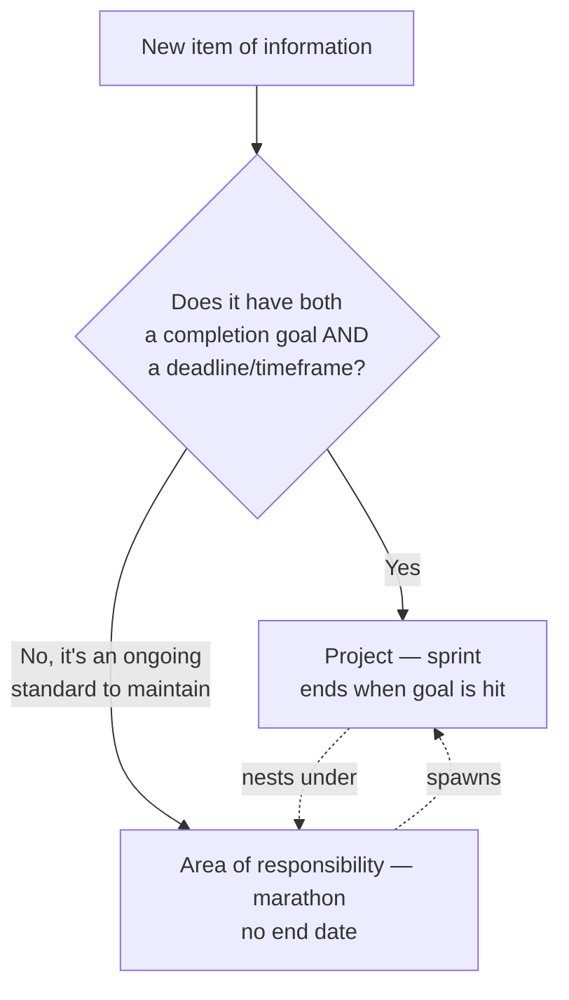
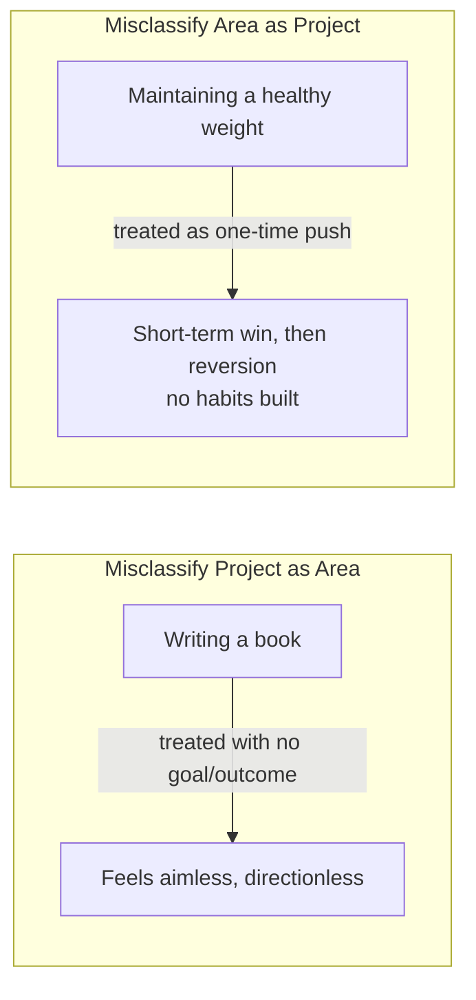

# Chapter 6 — How to Distinguish between Projects and Areas

> [!cite] Book reference
> *The PARA Method: Simplify, Organize, and Master Your Digital Life* — Tiago Forte. Chapter 6: "How to Distinguish between Projects and Areas." Source: user's uploaded EPUB.

> [!summary] One-line takeaway
> A Project is anything with a goal AND a deadline that lets you mark it "complete"; an Area is anything with a standard to maintain and no end date — mixing the two up is, per Forte, a root cause of real frustration, not just a filing nuisance.

## Why this chapter matters
Chapter 1 introduced the four PARA categories at a glance; this chapter is the first of Part II's two "stress test" chapters that dig into the distinctions people actually struggle with — Projects vs. Areas here, Areas vs. Resources next in Chapter 7. Forte traces the Projects/Areas distinction directly back to David Allen's *Getting Things Done* ("areas of responsibility"), crediting it as the most powerful idea he took from that book. Getting this one right unlocks the rest of the system, because — as the next chapter's distinction (Areas vs. Resources) depends on first knowing what counts as an Area at all.

## Direct quotes from the book
> [!quote] Where the idea comes from
> "Of the many definitions and distinctions that Allen introduced me to, perhaps the most powerful is between projects and areas (of responsibility). These are the two most actionable categories of information you encounter each day, and thus the most important to master."

> [!quote] The definition of a Project
> "My definition of a project is any endeavor that has: A goal that will enable you to mark it 'complete' / A deadline or timeframe by which you'd like it done."

> [!quote] The definition of an Area
> "An area of responsibility has: A standard to be maintained / An indefinite end date... Instead of a goal, an area of responsibility has a standard you're trying to maintain."

> [!quote] The core diagnostic
> "To put it simply: projects end, while areas continue indefinitely."

> [!quote] On what happens when you confuse them
> "If you have a project (such as writing a book), but you treat it like an ongoing area, without any particular goal or outcome in mind, it will feel aimless and directionless. Likewise, if you have an area (like maintaining a certain weight), but you treat it like it's just a onetime project, then even if you succeed in losing the extra weight, you'll likely revert right back afterward because you didn't put in place long-term habits."

## The chapter in full (so you never need to re-read it)

### Origin: David Allen and GTD
Forte opens with an origin story: in his mid-twenties, early in his professional career, he read David Allen's *Getting Things Done*. GTD gave him "X-ray glasses" — suddenly information arriving each day sorted itself into clear, actionable categories. Of all of GTD's distinctions, the Projects vs. Areas of Responsibility split struck him as the most powerful, and it's the one he carried forward as the backbone of PARA's first two letters. He notes up front that this is also one of the most confusing distinctions for people encountering PARA for the first time — which is exactly why this chapter exists.

### Projects: a goal with a deadline
Forte's definition of a Project has exactly two required components:
1. **A goal** — "the outcome the project is trying to achieve." Examples given: a successful staff retreat, a website redesign, a kid's birthday party. The test is that there is something you're trying to make happen in the real world that lets you mark the project "complete."
2. **A deadline or timeframe** — a time limit on achieving that goal. The point of the deadline isn't rigidity for its own sake; it's so your effort doesn't linger forever without ever resolving into success or failure. A deadline (strict/external or informal/self-imposed) lets you ask the practical question: "How much can I get done with the time remaining?"

Both components are required — a goal without a deadline, or a deadline without a goal, isn't yet a real Project by this definition.

### Areas of responsibility: a standard to maintain over time
Not everything is a Project. "Areas of responsibility" are the facets of work and life with no clear end goal or deadline. An Area has:
1. **A standard to be maintained** (a quality bar, not a finish line)
2. **An indefinite end date**

Work examples given: job duties such as management, customer service, financial analysis, strategy, coaching, direct reports, advising. Personal examples: health, finances, personal development, relationships — things that "continue in some form for as long as you live." None of these have a completion state: you can't "complete" your health, "finish" strategy once and for all, or permanently "check off" finances.

Instead of a goal, an Area has a **standard** — e.g., for someone responsible for leading product development, the standard (quality bar) might include upgrading speed and performance, fixing bugs quickly, approving new updates. For finances, the standard might be paying bills on time and providing for the family's needs. For parenting, it might be spending quality time with kids every evening and making sure they feel loved and protected.

Forte's framing of what maintaining an Area actually feels like: "An area is not so much a prize to win as a dance to enjoy." It requires ongoing thoughtfulness and self-awareness — sensing what you want and what's missing — and lives in the realm of daily habits, meaningful rituals, and timeless values that transcend any single Project.

### Distinguishing Projects and Areas
The one-line rule: **projects end, areas continue indefinitely.** But Forte adds an important subtlety: every Project typically falls *under* an Area of responsibility. His examples:
- Running a marathon (Project) falls under Health (Area)
- Publishing a book (Project) falls under Writing (Area)
- Saving three months' worth of expenses (Project) falls under Finances (Area)
- Planning an anniversary dinner (Project) falls under Spouse (Area)

Despite this nesting relationship, Forte is emphatic that failing to distinguish the two "is a root cause of so many frustrations and challenges." His illustration of what goes wrong in each direction:
- **Treating a Project like an Area** (e.g. writing a book with no particular goal or outcome in mind) → it feels aimless and directionless.
- **Treating an Area like a Project** (e.g. "maintaining a certain weight" tackled as a one-time push) → even if you succeed short-term, you revert right back afterward, because you never built the long-term habits an Area actually requires.

The takeaway: Projects and Areas "require completely different approaches, mindsets, and tools to be successful." Correct identification has to come first.

### Sprints versus marathons
Forte's central metaphor for this chapter: **Projects are sprints** (race to the finish line as fast as possible); **Areas are marathons** (sustain a consistent level of performance over a long distance). He then describes two personality patterns he's observed:
- **"Project people"** are good at sprints — give them a clear goal and a path, and they'll chase it ferociously. Their weakness: once they reach the goal, they struggle to keep it going. They're prone to starting many things, getting briefly obsessed, then abruptly moving on.
- **"Area people"** excel at marathons — sent on a long journey, they'll doggedly persist for as long as it takes. Their weakness: trouble changing direction. When a situation calls for quick, decisive pivoting, marathoners may stubbornly maintain course even once it no longer makes sense.

Forte's conclusion: most people lean toward one type, but a well-run life needs both — sprints to ramp up something new, marathons to sustain it. Projects supply novelty and excitement; Areas supply the peace of mind and perspective that comes at the end of the day regardless of whether you "won." PARA is explicitly built as a support system for *both* activities — executing Projects and maintaining Areas — which is why Forte puts these two categories "front and center" in how he recommends organizing a digital life.

## Core concepts (quick-scan version)

| | Projects | Areas of responsibility |
|---|---|---|
| Required components | Goal + deadline | Standard + indefinite end date |
| Ends? | Yes — by definition | No — ongoing for as long as relevant |
| Metaphor | Sprint | Marathon |
| Personality strength | Chasing a clear goal ferociously | Sustained, consistent performance |
| Personality weakness | Trouble sustaining after the goal is hit | Trouble changing direction when needed |
| Relationship between them | Every Project typically nests under an Area | An Area can spawn many Projects over time |
| Misclassification symptom (Project → Area) | Feels aimless/directionless | — |
| Misclassification symptom (Area → Project) | — | Short-term success, then reversion (no habits built) |

## First-principles breakdown
Forte's central claim: "Projects end, areas continue indefinitely" — and conflating the two causes real psychological friction, not just filing mess. Decomposed to more basic truths:

1. **Different reward structures require different motivational architecture.** A goal-with-deadline recruits the brain's completion/closure drive (the same mechanism behind the Zeigarnik effect — unfinished tasks nag at attention until resolved). An open-ended standard has no closure point, so it can only be sustained by habit formation and identity ("I am someone who exercises"), not by a completion payoff. Trying to run a habit on goal-motivation (or a goal on habit-motivation) is a category error in how the reward system actually works.
2. **Habits persist through repetition and context-stability, not through intensity.** This is the empirically well-supported half of the claim (behavioral psychology on habit formation, e.g. cue-routine-reward loops) — Forte's "you'll revert right back" claim about one-time weight loss attempts matches the well-documented pattern in the weight-maintenance literature.
3. **"Sprint vs. marathon" personality typing is Forte's own anecdotal framework**, not a validated psychological instrument — treat the "project people / area people" split as a useful metaphor for self-reflection, not a scientifically established taxonomy of personality types.
4. **The nesting claim (Projects live inside Areas) is logically almost tautological** once you accept the definitions: anything with a specific finish line is, almost by construction, a bounded instance of some broader ongoing concern. This is a strength (it explains *why* Projects exist — they're how Areas improve) but also a hidden assumption: it assumes every Project *should* trace back to some Area. A Project with no parent Area (a one-off favor for a stranger, say) still fits the chapter's definition fine, so the nesting claim is a common pattern, not a logical necessity.
5. **Boundary condition**: this whole framework assumes you can cleanly state "the standard" for an Area. For genuinely novel or poorly-understood domains (a brand-new job role, an emerging health condition with no established self-care protocol), there may be no stable standard yet to maintain — in which case the thing might temporarily behave like a Project ("figure out what good performance even looks like here") before it can become a true Area. The book doesn't flag this transitional case explicitly, but it falls directly out of the chapter's own logic.

## Visual representation

## Worked example — built directly in your vault
Applying this chapter's exact two-part test (goal + deadline = Project; standard + no end date = Area) to what's already live in `/Users/kiran4.s/ObsidianVault/SecondBrain/`:

- **Gloss Local** (`01-Projects/Gloss Local`) — clean Project by this chapter's test: goal = "stable no-subscription local fork running across Mac hub + Windows/phone clients," with an implicit deadline/timeframe (get it working, then move on). It nests under what would be an Area like "Home Lab" or "Personal Software" once it's done — exactly the Project → Area transition flagged in the Chapter 1 notes.
- **Second Brain Build-Out** (`01-Projects/Second Brain Build-Out`, this book-notes effort) — also a Project by the same test: goal = all chapters + guides finished; it has a natural stopping point. It nests under an implicit Area like "Knowledge Management," which already exists at `02-Areas/Knowledge Management/`.
- **Knowledge Management** (`02-Areas/Knowledge Management`) — correctly an Area: no finish line, just an ongoing standard ("keep the vault organized and useful"), and it's exactly the kind of Area that the two Projects above should nest under per Forte's own examples ("Running a marathon falls under Health").

This chapter sharpens something the Chapter 1 notes left softer: Gloss Local and Second Brain Build-Out aren't just correctly-placed Projects, they're each missing an *explicit* parent Area in the vault today — `02-Areas/Knowledge Management/` covers Second Brain Build-Out's parent reasonably well, but there's no equivalent Area yet for Gloss Local (something like "Home Lab / Personal Tools"). Per this chapter, that's fine for now — Areas get created when there's a standard worth maintaining, not preemptively — but it's worth watching for when Gloss Local finishes and needs an Area to land in.

## What the book doesn't tell you — community perspective
- The Projects/Areas confusion this chapter addresses is widely confirmed as **the single most common PARA implementation error** across productivity blogs and forums — multiple sources independently describe people listing things like "vacations" or "productivity" as Projects when they're actually open-ended Areas, leading to a Projects list that never shrinks ([alfred_ blog summary](https://get-alfred.ai/blog/para-method); [iwoszapar guide](https://www.iwoszapar.com/p/para-method)).
- A long-running Mac Power Users forum thread, "Those using Forte's PARA Method — what do you put in Areas in your Task Manager?", shows real practitioners struggling specifically with *where Areas belong in a task manager* versus a notes app, since task managers are built around actionable items and Areas are often not directly actionable in the same way Projects are ([MPU Talk](https://talk.macpowerusers.com/t/those-using-fortes-para-method-what-do-you-put-in-areas-in-your-task-manager/32158)).
- Forte's own "sprint vs. marathon" framing has a companion blog post, "Project People vs. Area People," that several readers cite as more useful for self-diagnosis than the book chapter alone — worth reading if the personality-type framing resonated ([Forte Labs](https://fortelabs.com/blog/project-people-vs-area-people-are-you-running-a-sprint-or-a-marathon/)).

## Deeper commentary — how this applies to your setup specifically
Both of your current live Projects — [[Gloss Local]] (a no-subscription local-first reading app: Ollama + SQLite + Drive backups, Mac hub with Windows/phone clients) and this very book-notes project ("Second Brain Build-Out" / "The PARA Method" notes) — pass this chapter's goal+deadline test cleanly today. The open question this chapter surfaces, that wasn't fully resolved in the Chapter 1 notes: what Area does Gloss Local nest under once it's "done"? Forte's own examples (marathon → Health, book → Writing) suggest naming the parent Area *now*, even before the Project finishes, so the transition isn't a judgment call made under time pressure later. A natural fit given your described setup would be something like "Personal Software / Home Lab" as an Area — but that's a genuine open decision for you, not something this note should decide on your behalf.

## Practical / actionable takeaways
- [ ] For every item currently in `01-Projects/`, confirm it has *both* a goal and a deadline/timeframe per this chapter's exact two-part test — not just one or the other
- [ ] Name the parent Area that Gloss Local will nest under once stable (e.g. "Personal Software" or "Home Lab"), even though it doesn't need to be created in `02-Areas/` until there's content to put there
- [ ] At your next weekly review, apply the "sprint vs. marathon" self-check: are you treating any current Area (ongoing responsibility) like a one-time Project, risking the "reversion" pattern the book warns about?

## Questions / things to decide for your own vault
- Should Gloss Local's eventual Area placement be a brand-new `02-Areas/` folder, or does it belong under the existing `Knowledge Management` Area, or a different Area entirely?
- Are you more of a "project person" or "area person" per Forte's framing — and does that explain anything about which of your two current Projects is moving faster?

## Video
> [!info] Video
> "What is P.A.R.A.? An in-depth look at P.A.R.A." — a walkthrough of Projects, Areas of Responsibility, Resources, and Archives, directly relevant to this chapter's Projects/Areas distinction. https://www.youtube.com/watch?v=EZDZEhbhEpo

## Sources (external, beyond the book)
- [Those using Forte's PARA Method — what do you put in Areas in your Task Manager? — Mac Power Users Talk](https://talk.macpowerusers.com/t/those-using-fortes-para-method-what-do-you-put-in-areas-in-your-task-manager/32158)
- [The PARA Method: Tiago Forte's System for Organizing Everything — alfred_](https://get-alfred.ai/blog/para-method)
- [The PARA Method: A Complete Guide (2026) — iwoszapar](https://www.iwoszapar.com/p/para-method)
- [Project People vs. Area People: Are You Running a Sprint Or a Marathon? — Forte Labs](https://fortelabs.com/blog/project-people-vs-area-people-are-you-running-a-sprint-or-a-marathon/)
- [What is P.A.R.A.? An in-depth look at P.A.R.A. — YouTube](https://www.youtube.com/watch?v=EZDZEhbhEpo)

## Footnotes
This chapter's extracted text contains no numbered endnotes (no trailing `[li]` footnote-style items were present in the raw extraction for Chapter 6) — noting this explicitly rather than fabricating a citation.

## Claude's pick — what I'd flag as most important
1. **The two-part test is the whole chapter**: goal + deadline = Project; standard + no end date = Area. If you remember nothing else, remember that both components are required for something to count as a Project.
2. **"Projects end, areas continue indefinitely"** is the single sentence to recall when stuck — paired with the consequence Forte is explicit about: misclassifying in either direction isn't a cosmetic filing error, it produces either aimlessness or reversion.
3. The sprint/marathon personality framing is a genuinely useful self-diagnostic, even though (per the first-principles section above) it's Forte's own anecdotal model rather than an established psychological taxonomy — use it for reflection, not as a rigid label.

## Related
- Previous: [[Chapter 5 - How to Maintain Your PARA System]]
- Next: [[Chapter 7 - How to Distinguish between Areas and Resources]]
- MOC: [[The PARA Method - MOC]]
- Decision tree: [[Where Does This Go - Quick Reference]]
- Cross-reference (shorter treatment of the same system): [[Chapter 2 - PARA Folder System]] (*Obsidian Second Brain*)
