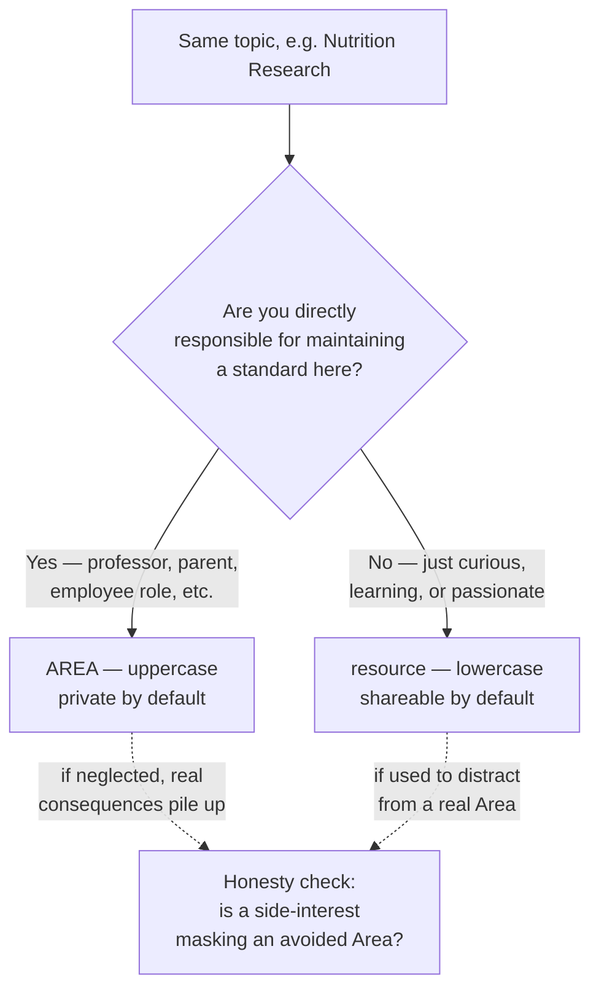

# Chapter 7 — How to Distinguish between Areas and Resources

> [!cite] Book reference
> *The PARA Method: Simplify, Organize, and Master Your Digital Life* — Tiago Forte. Chapter 7: "How to Distinguish between Areas and Resources." Source: user's uploaded EPUB.

> [!summary] One-line takeaway
> The same topic (e.g. "nutrition research") can correctly be either an Area or a Resource — the deciding factor isn't the subject, it's whether you're *directly responsible* for it or merely *interested* in it.

## Why this chapter matters
Chapter 6 resolved Projects vs. Areas (goal+deadline vs. standard+indefinite). This chapter tackles PARA's other classic point of confusion — Areas vs. Resources — which Forte calls "the second-most-important distinction within PARA." Where Chapter 6's test was structural (does it end or not), this chapter's test is personal and relational (are *you* accountable for it, or just curious about it) — which makes it harder to apply mechanically and more dependent on being honest with yourself, a theme the chapter closes on directly.

## Direct quotes from the book
> [!quote] The core test
> "The key here is to realize that there is a big difference between things you are directly responsible for and things you are merely interested in. I use uppercase titles for areas and lowercase titles for resources to constantly remind myself that one is more important than the other."

> [!quote] On Areas
> "Areas are parts of our lives that require ongoing attention to uphold a certain level of quality or performance. It's helpful to think of them as the 'roles you play' or the 'hats you wear' at work and in life."

> [!quote] On why Forte uses the word "resources" rather than "interests"
> "The word 'resources' calls to mind the utility of a piece of information. Instead of asking, 'Is this interesting?' which always results in overcollecting, I ask myself, 'Is this useful?' That's a much higher bar."

> [!quote] On privacy as a tie-breaker
> "Areas of responsibility are inherently private... Resources are quite different, since learning and exploring new things are inherently social activities... I recommend you think of your resource folders as 'shareable by default.'"

> [!quote] The closing challenge
> "The line between areas and resources is an opportunity to be completely honest with yourself: What is inside the circle of your responsibilities, which no one else is going to take care of for you, and what is outside?"

## The chapter in full (so you never need to re-read it)

### The setup: same topic, different person, different category
Forte opens with the example that frames the whole chapter: "Nutrition research" could sit in either Areas or Resources depending entirely on who you are. For a public health professor responsible for lecture classes and publishing research, "Nutrition research" is an Area — an ongoing responsibility. For a student in a different department with nutrition only as a minor side interest, the exact same topic is a Resource. The category isn't a property of the subject matter; it's a property of *your relationship* to it.

### Areas: the roles you play and the hats you wear
Areas require ongoing attention to uphold a certain level of quality or performance. Forte frames them as "roles" or "hats":
- **At work**: official roles you were hired to fulfill (Video Production, Legal Affairs, Customer Service), plus unofficial responsibilities taken on over time (Company Newsletter, Mentoring, Staff Retreats).
- **In personal life**: roles worn throughout a single day — Spouse, Parent, Soccer Coach, Neighbor, Friend. These are more informal but still carry real responsibility.

Concrete examples of what lives inside an Area folder: a "Spouse" folder might hold notes on favorite restaurants, gift ideas, or emergency health information. A "Soccer Coach" folder might hold drills, practice schedules, a team roster with contact info. The test for what belongs: anything you might need to reference or remember *in order to effectively play that role*.

### Resources: interests, curiosities, and passions
Resources cover the vast range of things you're interested in, curious about, or passionate about — new skills being learned (breakdancing, photography, golf), fields or trends you're curious about (parenting, cryptocurrency, AI), hobbies and passions (woodworking, bread baking, piano).

Forte is explicit about *why* he deliberately chose the cold, unglamorous word "resources" rather than something like "interests": he describes himself as a naturally curious person with "dozens, if not hundreds" of subjects he'd like to know more about, and knows his own tendency toward becoming a "digital hoarder." He needs a constraint to decide what's worth saving. "Resources" reframes the question from "Is this interesting?" (a low bar that always leads to overcollecting) to "Is this useful?" (a much higher bar) — forcing him to consider what the information will *let him do* that he couldn't otherwise, what problem it could help solve, or what obstacle it might help overcome.

Resources also include **"assets"**: stock photos, product testimonials, code snippets, typography samples, or a "swipe file" — a practice borrowed from the advertising industry where copywriters keep a folder of examples to draw from in their own work.

### Areas are private whereas Resources are shareable
A second, independent heuristic the chapter offers: the privacy boundary.
- **Areas are inherently private.** "It's no one else's business what material you save related to your Health, Finances, Personal Growth, or Kids." Forte's own Health area folder holds blood panels, doctor's visit notes, medical bills, vaccination records — things relevant only to him. He can always share an individual item if he chooses, but the default is private.
- **Resources are inherently social.** Learning and exploring are social activities — you might want feedback on a draft, to compare notes with a colleague learning the same skill, or to share restaurant recommendations with a visiting friend. Forte recommends treating resource folders as **"shareable by default"** — you can hand over an individual document or an entire folder on the fly, without first combing it for personal details, precisely because nothing private should be living there in the first place.

### An opportunity to be completely honest with yourself
The chapter closes on a more personal, almost confrontational note. In his coaching work, Forte repeatedly sees people pour enormous time and effort into something they call a "side interest" while neglecting genuinely important parts of their life — exercise, diet, relationships, mental health. He names the pattern directly: some area of life feels too complex, uncertain, or confronting, so people throw themselves at something else (an exciting new hobby or research interest) that feels masterable and makes tangible progress — as a distraction. The pattern "always ends the same way": ignored Areas accumulate costs and consequences until "the dam breaks," leaving a painful cleanup that often restarts the whole cycle.

Forte frames the Areas/Resources line as a diagnostic opportunity, not just a filing decision: "What is inside the circle of your responsibilities, which no one else is going to take care of for you, and what is outside?" The practical question to ask yourself: which areas of your life actually need more attention, and does your digital organization honestly reflect that — or is it quietly dressing up a Resource as something more important-feeling (or vice versa, avoiding an uncomfortable Area by relabeling it a casual interest)?

## Core concepts (quick-scan version)

| | Areas of responsibility | Resources |
|---|---|---|
| Core test | Are you directly *responsible* for it? | Are you merely *interested* in it? |
| Title convention (Forte's own habit) | UPPERCASE | lowercase |
| Default privacy | Private by default | Shareable by default |
| Framing | "Roles you play / hats you wear" | "Topics, assets, swipe files" |
| Guiding question when saving something | — | "Is this *useful*?" (not "is this interesting?") |
| Risk of over-indexing | Neglecting it has real consequences (health, finances) | Overcollecting / digital hoarding |
| Emotional honesty check | Is this a responsibility you're avoiding? | Is this a distraction from a responsibility? |

## First-principles breakdown
Forte's central claim: the Areas/Resources boundary tracks *personal accountability*, not subject matter. Decomposed:

1. **Accountability, not topic, is doing the real work.** This matches a basic truth about motivation and follow-through: responsibilities that carry real consequences for neglect (a dependent, a paycheck, a health outcome) recruit loss-aversion and social/role obligation in a way that idle curiosity never does. Two people can hold identical *information* about nutrition, but only one of them faces consequences for letting that information go stale — so only one of them needs the "maintain a standard" machinery of an Area.
2. **The privacy/shareability heuristic is a proxy, not a law.** It's empirically true that responsibility-information (medical, financial) is disproportionately private and interest-information is disproportionately social — but it's a correlation Forte is using as a convenient tie-breaker, not an independent principle. A counterexample the book doesn't address: a private hobby (e.g., a journal about a sensitive personal struggle) can be a Resource by interest-level but still demand Area-level privacy. The heuristic is useful precisely *because* it's usually true, but it will occasionally mislead.
3. **"Is this useful?" as a collecting filter is a real friction mechanism, not just a slogan.** Behaviorally, raising the bar on what gets captured reduces accumulation — this is the same principle behind any effective filter (e.g., inbox-zero rules, minimalism heuristics): a filter only works if it's a real cost to pass, and "is this interesting" costs nothing to answer yes to, while "is this useful" forces a concrete, falsifiable follow-up question (useful *for what*?).
4. **The closing section is genuinely the most psychologically load-bearing idea in the chapter, and it's asserted, not studied.** Forte's claim that over-investment in a "side interest" is often avoidance of a neglected Area is a clinically plausible pattern (it rhymes with well-documented avoidance coping in psychology) but it's presented anecdotally, from his coaching practice, with no citation or study. Treat it as a useful self-interrogation prompt, not a diagnosed mechanism.
5. **Hidden assumption / boundary condition**: this whole framework presumes you can accurately self-assess "am I actually responsible for this." People with anxiety or scrupulosity patterns may *over*-assign Area status to things that are genuinely optional, turning hobbies into obligations and burning out the exact "marathon" capacity Chapter 6 said Areas depend on. The book's honesty challenge cuts both ways, but only explicitly warns against the under-investment direction (treating Areas like side-interests), not the over-investment direction (treating every interest like a duty).

## Visual representation

## Worked example — built directly in your vault
Applying this chapter's accountability test (not the subject-matter) to the vault's existing structure:

- **`02-Areas/Knowledge Management/`** — correctly an Area: you're directly, ongoingly responsible for maintaining the vault's quality and findability. There's no "finish line" and real consequences (a decaying, unusable vault) if it's neglected — exactly the private-by-default, standard-to-maintain shape Forte describes.
- **`03-Resources/Obsidian and PKM/`** — correctly a Resource: it's a topic you're interested in and building expertise in (PKM techniques, Obsidian features), with no one depending on you to maintain a quality bar here. By the "shareable by default" test, this folder is exactly the kind of thing you could hand to someone else learning Obsidian without first scrubbing it for private material — worth actually checking next time you're in there: is anything personal/private accidentally sitting in `03-Resources/` that should really be in `02-Areas/`?
- **Honesty-check application**: this chapter's closing question is worth asking directly about the two book-notes Projects. Is "Second Brain Build-Out" (and now this "PARA Method" notes project) genuinely a bounded Project with a goal — or could it be functioning as an enjoyable, masterable "new thing" that's easier to make visible progress on than some other less-defined Area of life? This isn't something this note can answer for you — per the chapter's own framing, that's a question only you can honestly answer — but it's exactly the kind of self-check this chapter explicitly invites.

## What the book doesn't tell you — community perspective
- Multiple independent sources confirm the Areas/Resources boundary is widely considered **PARA's weakest, most subjective seam** — more than one practitioner guide states plainly that "many people have a hard time differentiating Projects vs. Areas or even Areas vs. Resources," and that the actionability-based separation "feels arbitrary to some" in practice ([PARA Method wiki, Fork My Brain](https://notes.nicolevanderhoeven.com/PARA+Method)).
- At least one critic argues the Areas/Resources split should be abandoned entirely in favor of a simpler "Pillars" model that doesn't try to distinguish responsibility from interest at all — a direct structural alternative worth knowing exists if the distinction keeps causing friction for you specifically ([A No-Nonsense Guide to the PARA Method — Medium](https://medium.com/practice-in-public/mastering-the-para-method-and-how-to-take-it-to-new-heights-d48afa1d13b0)).
- A related structural complaint: Resources can legitimately relate to *multiple* Projects or Areas simultaneously (a "coaching techniques" resource could feed several different management Projects over time), and PARA's one-folder-per-item model doesn't have a clean native way to express that overlap — tags or backlinks (which Obsidian supports natively) are the usual community workaround, not a folder fix ([PARA Method wiki](https://notes.nicolevanderhoeven.com/PARA+Method)).
- Forte's own uppercase/lowercase convention (Areas vs. resources) is noted by at least one commentator as a nice personal habit but one that doesn't map cleanly onto most digital tools, where folder names are often forced into a single case by the platform or team convention — worth knowing it's a personal mnemonic, not a technical requirement, before trying to enforce it system-wide.

## Deeper commentary — how this applies to your setup specifically
Your vault currently has exactly one live Area (`Knowledge Management`) and one live Resource (`Obsidian and PKM`) — a clean, minimal setup that doesn't yet show the ambiguity this chapter warns about, mostly because the vault is still small. The place to watch for friction: if [[Gloss Local]] eventually needs a documentation/reference home (e.g., notes on Ollama configuration, SQLite schema decisions, or sync approaches) that isn't itself the Project work, this chapter's test says to ask "am I *responsible* for maintaining this as a standard" (→ Area, e.g. a "Home Lab" or "Personal Software" Area) versus "am I just interested in learning more about local-first app architecture generally" (→ Resource, e.g. "Local-First Software"). Both could genuinely apply to different subsets of the same material — which is exactly the multi-parent overlap the community research above flags as PARA's structural blind spot, and exactly where Obsidian's tags/backlinks (rather than forcing a single folder choice) would do real work.

## Practical / actionable takeaways
- [ ] Scan `03-Resources/Obsidian and PKM/` once for anything private that accidentally belongs in an Area instead (the "shareable by default" test)
- [ ] When Gloss Local produces reference material (config notes, architecture decisions), apply this chapter's accountability test explicitly before filing it, rather than defaulting to whichever folder already exists
- [ ] At a future weekly review, honestly run the chapter's closing question against your own two live Projects: is either one functioning as a comfortable distraction from a less-defined Area of life?

## Questions / things to decide for your own vault
- If Gloss Local produces both "responsibility" material (ongoing maintenance docs) and "interest" material (general local-first architecture learning), do you want to split those into an Area and a Resource from day one, or let it stay mixed until friction actually appears?
- Do you want to adopt Forte's uppercase/lowercase naming convention for Areas vs. Resources folders, or is that more ceremony than it's worth at your vault's current size?

## Video
> [!info] Video
> "What is P.A.R.A.? An in-depth look at P.A.R.A." covers all four categories including the Areas/Resources split this chapter focuses on. https://www.youtube.com/watch?v=EZDZEhbhEpo

## Sources (external, beyond the book)
- [PARA Method — Fork My Brain (Nicole van der Hoeven)](https://notes.nicolevanderhoeven.com/PARA+Method)
- [A No-Nonsense Guide to the PARA Method — Owen Robert McGregor, Medium](https://medium.com/practice-in-public/mastering-the-para-method-and-how-to-take-it-to-new-heights-d48afa1d13b0)
- [What is P.A.R.A.? An in-depth look at P.A.R.A. — YouTube](https://www.youtube.com/watch?v=EZDZEhbhEpo)

## Footnotes
This chapter's extracted text contains no numbered endnotes (no trailing `[li]` footnote-style items were present in the raw extraction for Chapter 7) — noting this explicitly rather than fabricating a citation.

## Claude's pick — what I'd flag as most important
1. **The test is accountability, not subject matter** — "nutrition research" being an Area for one person and a Resource for another is the whole chapter in one example; memorize that pair.
2. **"Is this useful?" beats "is this interesting?"** as a capture filter — genuinely one of the most practically useful single lines in the whole book for anyone (like you) at risk of over-collecting in a Resources folder.
3. The closing honesty challenge is the sharpest, least "systems-y" idea in the chapter — worth revisiting periodically regardless of how your folders are organized, since the community research above confirms the Areas/Resources *filing* question is genuinely underdetermined, but the *honesty* question underneath it isn't.

## Related
- Previous: [[Chapter 6 - How to Distinguish between Projects and Areas]]
- Next: [[Chapter 8 - Extending PARA across Multiple Platforms]]
- MOC: [[The PARA Method - MOC]]
- Decision tree: [[Where Does This Go - Quick Reference]]
- Cross-reference (shorter treatment of the same system): [[Chapter 2 - PARA Folder System]] (*Obsidian Second Brain*)
