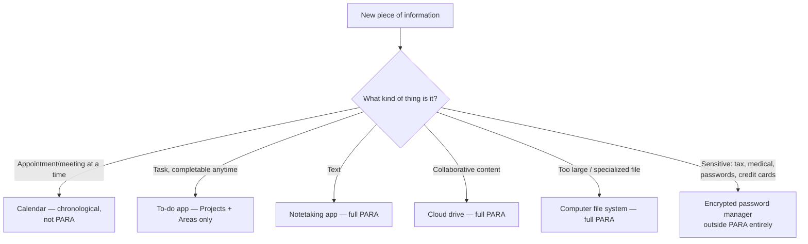
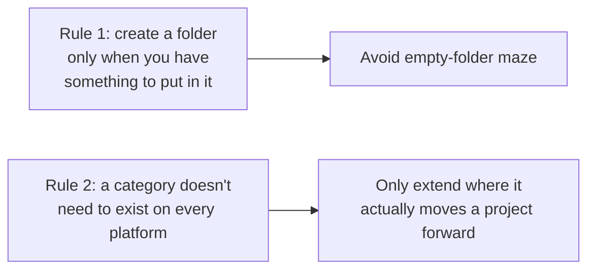

# Chapter 8 — Extending PARA across Multiple Platforms

> [!cite] Book reference
> *The PARA Method: Simplify, Organize, and Master Your Digital Life* — Tiago Forte. Chapter 8: "Extending PARA across Multiple Platforms." Source: user's uploaded EPUB.

> [!summary] One-line takeaway
> PARA is platform-agnostic by design — replicate the same four categories, spelled identically, across every tool you actually use, but only create a folder when you have something to put in it; the payoff is that losing or outgrowing any single app never knocks out your whole organizing system.

## Why this chapter matters
Chapters 6–7 nailed down what counts as a Project, Area, or Resource; this chapter answers the next practical question — *where*, physically, across your to-do list, notes app, cloud drive, and file system, should that classified information actually live? It's the bridge from "the four categories as a concept" to "the four categories as something you touch every day across real tools," and it sets up Chapter 9's point that information needs to keep moving regardless of which platform it's sitting on.

## Direct quotes from the book
> [!quote] The core design claim
> "One of the key features of PARA is that it's universal—it works across every platform where information can be stored, for any kind of information you might want to save, and is accessible on any device."

> [!quote] On the cost of mismatched systems
> "I notice that even the most organized people often make a fatal error—they use a different organizing system in each and every place where they keep information... when combined, they create a crushing mental load that not even the world's smartest people can withstand."

> [!quote] On consistency of naming
> "I recommend doing so down to the exact same spelling, punctuation, and capitalization so that you can mentally transition between platforms as seamlessly as possible."

> [!quote] On not over-building empty structure
> "You should create a folder on any platform only when you have something to put in it. Otherwise, you'll just end up creating a maze of empty folders that clutter your workspace while leading nowhere."

> [!quote] The resilience payoff, from personal experience
> "I was once working on a major consulting project for a large telecommunications company, when without warning the project management platform we were using stopped working... While the rest of my team was in disarray, I was able to pivot to a new platform within minutes because my projects and areas already existed independently of any particular software program."

## The chapter in full (so you never need to re-read it)

### The problem: a different system per tool
Forte opens by naming a failure pattern he sees even in highly organized people: a different organizing scheme in every single place information lives — the to-do list organized one way, the computer another way, cloud storage a third way, the notes app a fourth. Each scheme might make sense in isolation, but every organizational system carries **overhead** (cognitive effort to maintain and use it), and the overhead compounds across tools into "a crushing mental load that not even the world's smartest people can withstand."

### The fix: PARA as platform-agnostic
PARA's answer is to be "platform agnostic" — one system implemented everywhere, including:
- Your to-do list app
- Your computer file system (or Documents folder)
- Your cloud storage drive
- Your digital notetaking app
- Other platforms where information is stored

This lets you "extend" the identical PARA folders across every platform you use. Forte's rationale: you will always need multiple platforms, because most Projects and Areas involve different kinds of content, each best suited to a different tool. His example: publishing a research report might draw on data (spreadsheet app), product photos (photo app), expert-conversation notes (notetaking app), industry PDFs (Documents folder), and a list of next steps (to-do app) — all at once, for the same single Project.

Technology changes too fast for one app to do everything, so Forte's advice is explicitly *not* to chase "one app to rule them all." Instead: use as many apps as you like, but replicate the same structure across all of them — "down to the exact same spelling, punctuation, and capitalization" — so moving between platforms is mentally seamless. The principle he states plainly: don't force your life to fit a tool's opinions; decide how you want to organize your life and work first, then ask how your tools can support that.

### How to know where to put a given item
Forte gives explicit rules of thumb for which platform a piece of information belongs on:
1. **If it's an appointment or meeting at a specific time** → calendar
2. **If it's a task you can complete anytime** → to-do list app
3. **If it's text** → notetaking app (best search function for finding it again)
4. **If it's content you'll collaborate on with others** → cloud storage drive
5. **If it can't go anywhere above** (too large, or a specialized file type) → computer's file system / Documents folder

Of these, four are organized using PARA directly:
- To-do list app — **Projects and Areas only**, since those are the two categories that actually have tasks associated with them
- Notetaking app
- Cloud storage drive
- Computer file system

The **calendar** is the exception — it's organized chronologically by date, not by PARA category, since it's inherently time-based.

**One further exception**: sensitive information (tax documents, credit card details, medical data, passwords) goes in an **encrypted password manager app**, not into the regular PARA structure at all, specifically so no one else can access it.

### The benefits of a cross-platform system
Forte anticipates the obvious objection — "Do I really have to create identical folders on every single platform?" — and answers plainly: **absolutely not.** Two clarifying rules:
1. **Create a folder only when you have something to put in it.** Creating folders preemptively "everywhere" just produces a maze of empty folders that clutter the workspace and lead nowhere. Folder creation takes seconds, so do it only when actually needed.
2. **A given category doesn't need a matching folder on every platform at all.** His example: Zoom call recordings are automatically saved to a resource folder on his computer — there's no reason to also maintain a "Zoom recordings" folder somewhere else. Many categories of information can legitimately exist on only one platform; extend a category across platforms only if doing so is actually needed to move a Project forward.

The payoff for the (admittedly real, if small) extra effort of manually recreating structure across tools: **you're never stuck with any single platform.** Forte illustrates this with a personal story — mid-way through a major consulting project for a large telecom company, the project management platform the team was using was shut down abruptly after an acquisition. While the rest of the team was thrown into disarray, Forte pivoted to a new platform within minutes, because his Projects and Areas existed independently of any particular piece of software.

He generalizes the lesson: productivity software changes constantly — features get cut, pricing and policies shift, companies get acquired or shut down — but your organizing method doesn't have to change with it. With PARA, any single-platform risk stays contained to that one part of your digital life; it doesn't cascade and take down everything else. The reason this works, stated plainly: "PARA is a cross-platform system for one simple reason: your projects are cross-platform." You'll rarely complete a Project using just one app — PARA is the thread that ties together information scattered across multiple places.

### Footnoted details (endnotes 10 and 11)
- **Footnote 10**: If you use a cloud productivity suite (Microsoft 365 or Google Workspace), your cloud storage drive comes bundled with a full suite of apps (word processing, spreadsheets, slides). In most cases, everything you create or upload there can also be organized using PARA inside the cloud suite itself.
- **Footnote 11**: Tasks are usually part of Projects, but sometimes a task "free-floats" inside an Area without belonging to any specific Project — his example: "Correct typo on website" stands alone as part of a "Website" Area, with no Project wrapping it.

## Core concepts (quick-scan version)

| Platform | How it's organized | PARA-native? |
|---|---|---|
| To-do list app | Projects and Areas only (the two categories with tasks) | Yes |
| Notetaking app | Full PARA (text search is its strength) | Yes |
| Cloud storage drive | Full PARA (collaboration content) | Yes |
| Computer file system / Documents | Full PARA (catch-all for large/specialized files) | Yes |
| Calendar | Chronological by date | No — time-based, not PARA |
| Password manager | Encrypted, outside PARA entirely | No — security-based, not PARA |

**Two guardrails against over-building:**
1. Create a folder only when you have content for it.
2. A category doesn't need to exist on every platform — only extend it where it actually helps move a Project forward.

## First-principles breakdown
Forte's central claim: identical structure across tools reduces cognitive load and de-risks platform dependency. Decomposed:

1. **Cognitive load from context-switching is a real, well-established cost.** Human-computer interaction research on task-switching and working memory supports the idea that inconsistent mental models across tools impose a real tax — every new system you touch costs some working-memory overhead to re-orient in. Identical naming reduces that tax to near-zero because you're pattern-matching instead of re-learning. This part of the claim is solidly grounded, not just asserted.
2. **Vendor lock-in risk is real and the book's anecdote is a plausible, if singular, data point.** The telecom project-management-platform shutdown story is an anecdote, not a study — but the underlying risk (SaaS tools get acquired, sunset, or change terms) is a well-documented structural feature of the software industry, independent of this book. The mitigation — keep your organizing scheme portable, independent of any one tool's native structure — is a generally sound risk-management principle (the same logic behind "own your data" advice in any domain).
3. **The "only build what you need" guardrail is a direct application of a more general principle: structure should be pulled into existence by demand, not pushed in by anticipation.** Empty folders cost nothing to create but accrue real cost over time (visual clutter, false signal of "there's something here," maintenance debt when you eventually have to decide whether to delete them). This is the same first principle behind YAGNI in software engineering — don't build for a hypothetical need.
4. **Hidden assumption**: the chapter assumes cross-platform PARA replication is low-friction because each tool is roughly folder/tag-based. Tools with fundamentally different data models (e.g. a kanban board, a calendar, a chat app) can't actually host "a Projects folder" in any meaningful sense — which the chapter itself half-acknowledges by carving the calendar out as an explicit exception. The implicit principle, more honestly stated: *replicate PARA wherever the tool's native structure can bend to accommodate it; don't force it onto tools whose structure is incompatible* (the calendar and password manager are both examples of this carve-out, stated but not generalized explicitly in the text).
5. **Boundary condition**: "exact same spelling, punctuation, capitalization" is good advice until a platform imposes its own naming constraints (character limits, forbidden characters, case-insensitivity) — the book doesn't address what to do when perfect replication isn't technically possible, only that you should aim for it where you can.

## Visual representation

## Worked example — built directly in your vault
Important framing up front: your current setup is a **single-person, single-vault, local Obsidian system** — there's no multi-platform PARA sync currently in scope (no separate to-do app, no cloud drive mirroring the vault, no cross-device PARA replication beyond Obsidian itself). So this chapter's advice applies only partially today; noting explicitly what *would* apply if that changed, rather than inventing a fictional multi-tool scenario:

- **What you already have, mapped to this chapter's platform list**: your Obsidian vault at `/Users/kiran4.s/ObsidianVault/SecondBrain/` is currently serving as *both* the notetaking app and (via its folder tree) a rough stand-in for a file system — `01-Projects/Gloss Local`, `01-Projects/Second Brain Build-Out`, `02-Areas/Knowledge Management`, `03-Resources/Obsidian and PKM`, `04-Archive` already exist, satisfying this chapter's "replicate PARA with exact naming" advice inside the one tool you actually use.
- **What's notably absent on purpose, per Rule 1**: no dedicated to-do app, no separate cloud drive structure, no calendar integration — and per this chapter's own guardrail, that's *correct*, not a gap, since there's nothing today that needs those platforms. Creating empty "01-Projects" folders in Google Drive or a to-do app with nothing in them would be exactly the "maze of empty folders" Forte warns against.
- **Where this chapter's advice *would* kick in**: [[Gloss Local]] is explicitly described as spanning a Mac hub plus Windows and phone clients — if that project ever needs a cross-device task list (e.g. tracking build/sync bugs across machines) or cloud-synced config/backup folders (it already uses Drive for backups per your project description), this chapter says: replicate "Gloss Local" as the exact folder/project name there too, rather than letting the to-do app or Drive invent its own organizational scheme. Today, Drive backups for Gloss Local are presumably just backup files, not yet a parallel PARA structure — worth deciding if/when that becomes worth doing (see open question below).
- **Password-manager carve-out**: if Gloss Local's setup ever involves API keys, device credentials, or similar sensitive config, this chapter's explicit advice is to keep that out of the vault's PARA structure entirely and in a dedicated encrypted password manager — not something to fold into `01-Projects/Gloss Local` even though it's project-related.

## What the book doesn't tell you — community perspective
- Several summaries of this chapter converge on a clarifying nuance the book itself under-emphasizes: **you do not need to perfectly sync folders across all platforms at all times** — fix misalignments opportunistically rather than maintaining a rigid parallel structure everywhere, since some platforms will always end up with empty or partial folders no matter how disciplined you are ([Eric Sandroni's book summary](https://ericsandroni.com/book-summary-the-para-method-by-tiago-forte/)).
- A more critical community take notes the obvious tension the chapter doesn't fully resolve: reproducing structure across apps is itself a form of overhead, and a well-run implementation should map *only the active work that actually crosses platforms*, rather than building parallel folder trees everywhere "just in case" — effectively a sharper version of the book's own "only build what you need" rule ([Thomas Frank's PARA Method summary](https://thomasjfrank.com/productivity/books/the-para-method-by-tiago-forte-summary-and-book-notes/)).
- Forte has also written separately and more pointedly about platform-agnosticism as **protection against a specific category of risk**: a platform going out of business, "turning evil," or selling your data — framing portability less as a convenience and more as a data-ownership/exit-strategy issue, a framing this chapter doesn't spell out as explicitly as his blog content does ([Forte Labs blog, cited in community summaries](https://fortelabs.com/blog/why-para-is-the-key-to-the-ai-era/)).

## Deeper commentary — how this applies to your setup specifically
Because [[Gloss Local]] is deliberately local-first and no-subscription (Ollama + SQLite + Drive backups, rather than a SaaS tool that could vanish or change pricing overnight), it already embodies the *resilience* half of this chapter's argument at the application layer — the whole point of Gloss Local as a project is to not be dependent on a subscription platform. The open question this chapter raises for your *organizational* layer, not the app itself: as Gloss Local grows across Mac/Windows/phone, will you need any cross-device task tracking or shared reference material beyond what a single Obsidian vault on one machine can hold? If yes, this chapter's advice is specific — pick the right tool for that *kind* of content (task → to-do app, bug notes → notetaking app, binaries/backups → file system/Drive), and replicate the "Gloss Local" project name exactly, rather than inventing per-tool naming. If no (if the Mac-hub vault stays the single source of truth), then nothing in this chapter requires action yet, and that's a fine, deliberate state to stay in rather than a gap to fill.

## Practical / actionable takeaways
- [ ] Confirm there's no premature empty-folder structure anywhere outside Obsidian (e.g. in Google Drive, an unused to-do app) that should be deleted per Rule 1
- [ ] If/when Gloss Local needs cross-device task tracking, decide the single to-do tool and name the project folder/list identically to `01-Projects/Gloss Local`
- [ ] Decide whether Gloss Local's existing Drive backups should ever become a lightweight parallel PARA structure, or stay pure backup storage (see open question below)
- [ ] If any sensitive Gloss Local config/credentials exist today, confirm they live in a password manager, not inside the vault's Project folder

## Questions / things to decide for your own vault
- Is a single Obsidian vault on the Mac hub genuinely sufficient as Gloss Local scales across Windows/phone clients, or will a second platform (shared task list, shared docs) eventually be needed?
- Should Gloss Local's Drive backups ever get a lightweight PARA-mirroring folder structure, or is "just backups, no organization" fine indefinitely since nothing is actively being *found* there, only restored?

## Video
> [!info] Video
> No video genuinely dedicated to this specific chapter's cross-platform topic was found and verified — Tiago Forte's dedicated talks tend to cover the four categories broadly (see Chapters 6–7's video) rather than the platform-extension mechanics specifically. Omitting this section's link rather than forcing an unrelated video.

## Sources (external, beyond the book)
- [Book Summary: The PARA Method by Tiago Forte — Eric Sandroni](https://ericsandroni.com/book-summary-the-para-method-by-tiago-forte/)
- [The PARA Method by Tiago Forte — Summary and Book Notes — Thomas Frank](https://thomasjfrank.com/productivity/books/the-para-method-by-tiago-forte-summary-and-book-notes/)
- [Why PARA Is the Key to the AI Era — Forte Labs](https://fortelabs.com/blog/why-para-is-the-key-to-the-ai-era/)

## Footnotes
[^10]: If you use a cloud productivity suite, such as Microsoft 365 (formerly Office 365) or Google Workspace (formerly Google Suite), your cloud storage drive comes integrated with a full suite of productivity apps (word processing, spreadsheets, slides). In most cases, everything you create or upload to such a drive can be organized using PARA in the cloud.
[^11]: Tasks are usually part of Projects, but sometimes a task "free-floats" within an Area without belonging to any particular Project — e.g. "Correct typo on website" stands alone as part of a "Website" Area.

## Claude's pick — what I'd flag as most important
1. **Replicate the organizing scheme, not the folder structure everywhere.** The chapter's real nuance — don't create matching empty folders on every platform — is easy to miss if you only remember "make PARA everywhere."
2. **The resilience argument is the strongest, most underrated point in the chapter.** Keeping your Projects/Areas independent of any single tool's native structure is cheap insurance against acquisition, shutdown, or pricing changes — directly relevant given you're already choosing a no-subscription, local-first path for Gloss Local itself.
3. **The calendar and password-manager carve-outs matter** — PARA is deliberately *not* universal to every kind of information (time-based and security-sensitive data sit outside it on purpose), which is an important corrective if you were tempted to force everything into PARA categories.

## Related
- Previous: [[Chapter 7 - How to Distinguish between Areas and Resources]]
- Next: [[Chapter 9 - Keep Information Flowing]]
- MOC: [[The PARA Method - MOC]]
- Related project: [[Gloss Local]]
