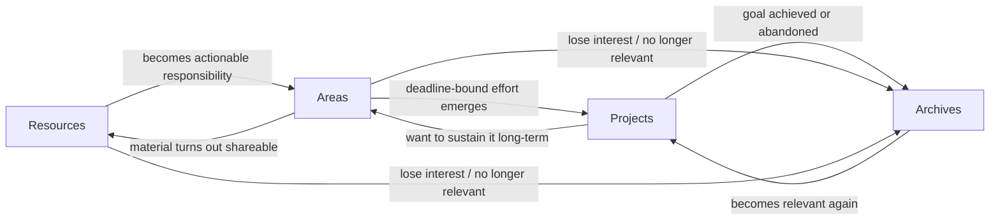
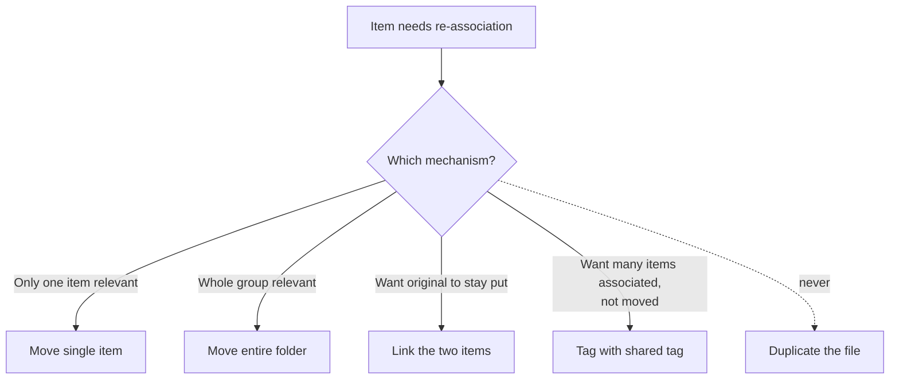

# Chapter 9 — Keep Information Flowing

> [!cite] Book reference
> *The PARA Method: Simplify, Organize, and Master Your Digital Life* — Tiago Forte. Chapter 9: "Keep Information Flowing." Source: user's uploaded EPUB.

> [!summary] One-line takeaway
> PARA isn't a static filing cabinet with one correct address per item — it's a dynamic system where the same piece of information is meant to migrate between Projects, Areas, Resources, and Archives as your relationship to it changes, and that migration *is* the maintenance the system actually requires.

## Why this chapter matters
Chapter 8 established *where* information lives across platforms; this chapter addresses what happens to it *over time*. It directly answers the most common question Forte says people ask once they've adopted PARA — "what do I have to do to keep this system going?" — and the answer reframes PARA from a one-time sorting exercise into an ongoing, organic process, setting up Chapter 10's team version of the same idea (knowledge has to keep moving between people, not just between folders).

## Direct quotes from the book
> [!quote] The reassuring answer to "how do I maintain this?"
> "'What do I have to do to keep this system going?' And this is where PARA truly shines, because the answer is: not much... So what is left for us to do? The answer is that you have to keep the information moving."

> [!quote] The organic-system metaphor
> "PARA isn't a mechanical system like a car engine that needs very precise and regular maintenance. It's more like an organic system such as a pond or a forest. The same way a pond will begin to stagnate and smell if the water isn't flowing, your PARA system will soon go out of date and lose relevance if the knowledge it contains stops flowing."

> [!quote] On there being no "correct" place
> "There is no such 'correct' place. PARA is a dynamic system: any given file or document can go in any number of places—what matters is your relationship to it. And that relationship is changing all the time."

> [!quote] The payoff of having already done the work
> "At that point, we don't have time to 'do more research'—we need to already have done that research through our reading and notetaking."

> [!quote] The one thing to never do
> "The only action I recommend avoiding at all costs is duplication: you never want to have two versions of a file or document, because then you never know which one is the most current."

## The chapter in full (so you never need to re-read it)

### The question everyone asks, and the surprising answer
Forte opens with the question he says people most commonly ask once they start using PARA: "What do I have to do to keep this system going?" His answer: not much, by design. He's explicit that PARA has almost no formatting rules — information can be text, images, PDFs, audio/video, slides, GIFs, or anything else; there are no required naming conventions beyond a straightforward descriptive title; and there are no rules about internal subfolder organization (sorting chronologically is optional and the computer can handle it automatically). The one real job left: **keep the information moving.**

### Static systems vs. a dynamic system
Forte contrasts PARA with traditional organizational approaches, which he calls **static**: they assume a single correct location for every piece of information. His example is the Dewey Decimal System — a library call number that tells you precisely, permanently, where a book belongs on the shelf.

PARA rejects that model entirely for personal digital organization. There is no "correct" place for a file — any given document can legitimately go in multiple possible places, because what determines placement is **your relationship to it**, and that relationship is constantly changing.

### The illustrative career-long example
Forte walks through an extended, multi-year example to make the abstraction concrete:
1. **Resources (early career)**: As an individual contributor, you read an article on coaching techniques one evening and save excerpts to a Resource folder called "coaching" — interesting, not yet actionable, since you have no one to coach.
2. **Resources → Areas (promotion to management)**: A year later you're promoted into a management role with direct reports. The coaching knowledge instantly becomes actionable — you move the notes from the "coaching" Resource folder into a new Area folder, "Direct Reports." That's a deliberate act of "promoting" the knowledge so it gets more frequent attention.
3. **Areas → Projects (promotion to senior executive)**: A couple more years pass; you're promoted again and now have to design management training for all the company's new managers. The contents of "Direct Reports" flow into a new Project folder, "Management training workshop," because the knowledge is now most relevant to a near-term, deadline-bound goal.
4. **Projects → Archives (career change)**: A couple more years pass again; you quit to start your own business and no longer expect to manage employees for a while. The "Management training workshop" material is no longer actionable — not deleted, just moved to Archives, "like a dormant volcano," ready to resurface the moment you start hiring staff again.

Forte's point: a single external life event (a promotion, a career change) can completely reshape what's actionable in your life, and "we don't have time to 'do more research'" at that moment — the value of PARA is that the research is already done and waiting, just needing to be relocated to where it's now relevant.

### Keep the information flowing: the six directional flows
Forte catalogs specific flow patterns between categories, each with a concrete example:

| Flow | Example given |
|---|---|
| **Projects → Areas** | A marathon training plan (Project) becomes something you want as an ongoing routine — move it into a new "Exercise" Area |
| **Areas → Projects** | Deciding to level up organizational operations (a one-time Project) often starts by mining ideas already sitting in an "Operations" Area folder — new Projects often emerge directly out of existing Areas |
| **Areas → Resources** | A list of event venues in a city, initially saved because it was relevant only to you, turns out to be valuable to others too — move it to Resources where it's ready to share |
| **Resources → Areas** | Deciding to cook at home more for health reasons — move a few easy recipes from a "recipes" Resource folder into a "Cooking" Area folder, so you can start immediately instead of "doing more research" |
| **Areas and Resources → Archives** | The same archiving logic that applies to finished Projects applies here: losing interest in bird-watching, chess, jiu-jitsu, or motorcycle repair means moving that material to Archives, not deleting it |
| **Archives → Projects** | Organizing a conference for thought leadership in a new industry — search your Archives for a past professional event you organized, and pull reusable planning materials into a new Project folder |

### Four ways to associate information with a new category
Forte's preferred method is moving items/folders wholesale, but he names four valid mechanisms:
1. **Moving a single item** — when only one item is relevant to a new Project
2. **Moving a folder full of items** — when a whole group is relevant
3. **Linking two items together** — when you want to keep the original item where it is (footnote 12: most notetaking apps and file storage platforms support links, including across different platforms)
4. **Tagging items with the same tag** — to associate many items together without moving any of them

**The one action to avoid at all costs: duplication.** Never keep two versions of the same file or document, because you then lose certainty about which copy is current.

### Why this matters beyond tidiness
Forte closes by connecting the mechanical habit to a bigger payoff: "the purpose of keeping your information moving is to keep yourself moving." When information around you is actively flowing and being re-sorted, it's easier to see problems from a fresh perspective and avoid getting stuck. He adds a specific observation: with information already pre-organized and flowing naturally toward relevance, "you'll even find that projects get going before you even realize you've started them" — the groundwork is already in place by the time a new goal crystallizes.

## Core concepts (quick-scan version)

| Direction | Trigger | Example |
|---|---|---|
| Resource → Area | A topic becomes a real, ongoing responsibility | Coaching article → "Direct Reports" Area after a promotion |
| Area → Project | A deadline-bound effort emerges from an ongoing responsibility | "Direct Reports" → "Management training workshop" Project |
| Project → Archive | The goal is no longer relevant to your current life | Career change away from managing people |
| Project → Area | A one-time effort becomes something you want to sustain | Marathon training plan → "Exercise" Area |
| Area → Project | New one-time initiative mined from an existing responsibility | "Operations" Area → ops-improvement Project |
| Area → Resource | Personal material turns out to be valuable to share | City venue list → shareable Resource |
| Resource → Area | Learning material gets put into immediate practice | Recipes Resource → "Cooking" Area |
| Area/Resource → Archive | Interest or responsibility lapses | Losing interest in a hobby |
| Archive → Project | Dormant material becomes useful again | Past conference materials → new conference Project |

**Four mechanisms for re-association**: move single item · move whole folder · link (keep original in place) · tag (associate without moving). **Avoid**: duplication, always.

## First-principles breakdown
Forte's central claim: a personal organization system should be dynamic (information migrates as your relationship to it changes) rather than static (one permanently correct location per item, à la Dewey Decimal). Decomposed:

1. **The static/dynamic distinction maps onto a real difference in what each system is optimizing for.** A library classification system optimizes for *many different people* finding the *same* book via a shared, objective convention — subject matter is a reasonable proxy because the book's content doesn't change based on who's looking for it. A personal system optimizes for *one person's* changing priorities over time — here subject matter is the wrong proxy, because the same content's *relevance* genuinely does change as that person's life changes. This is a sound, well-reasoned distinction, not just branding.
2. **The career-example is a single illustrative narrative, not evidence of a general rule — but it's structurally sound regardless.** The claim that knowledge migrates in step with role changes is intuitively true and consistent with how expertise and relevance actually work (a fact is "actionable" only relative to a goal you currently hold), but no data is cited; it's presented purely as an illustrative device.
3. **"Keep information moving" implicitly assumes a periodic review habit exists to notice when something *should* move.** Nothing in this chapter forces or triggers re-sorting — it depends entirely on the discipline covered elsewhere in the book (the weekly/periodic review, referenced in Chapter 5). Without that review cadence, the "pond" metaphor breaks: a system can state "keep moving" as a design philosophy while still silently stagnating in practice, because nothing *causes* the movement to happen on its own. This is the chapter's biggest unstated dependency.
4. **The anti-duplication rule rests on a basic information-integrity principle**: a single source of truth is only a source of truth if it's singular. Two copies of "the same" document inevitably diverge (one gets edited, one doesn't), and at that point neither copy is reliably authoritative — this is the same principle underlying version control systems and database normalization, applied informally to personal files.
5. **Tagging vs. moving vs. linking is actually a question about the cost of multi-homing information.** Moving commits to single-location-at-a-time (clean, but loses the old context entirely). Tagging and linking allow a piece of information to be discoverable from multiple paths without duplication — which is strictly more powerful than folders alone, and is precisely the capability Obsidian's wikilinks and tags add on top of a folder-based PARA skeleton (a point the community research below returns to directly).
6. **Boundary condition**: the "no correct place" philosophy assumes a single person maintaining the system with full context on their own changing priorities. In a team setting (preview of Chapter 10), "no correct place" becomes a liability rather than a feature, because other people lack the context to know where something moved to or why — which is exactly why Chapter 10 reintroduces more rigid, documented conventions for shared/team PARA.

## Visual representation

## Worked example — built directly in your vault
This chapter's flow logic maps directly onto plausible future moves in `/Users/kiran4.s/ObsidianVault/SecondBrain/`, even though nothing needs to move today:

- **Resource → Area, hypothetical**: if `03-Resources/Obsidian and PKM/` accumulates notes on, say, local-first sync architecture (read out of general interest), and then [[Gloss Local]]'s actual sync implementation starts depending on those notes, this chapter says: move them (or link them) into a Gloss Local–related Area/Project rather than leaving them stranded in the general Resource — the trigger is "did this just become actionable," not "did the topic change."
- **Project → Area, concrete and foreseeable**: per the Chapter 1 and Chapter 6 notes, once [[Gloss Local]] is "stable and just running" rather than "actively being built," this chapter gives the exact mechanism for that transition — move the folder (or its surviving reference content) from `01-Projects/Gloss Local` into a new Area (e.g. "Personal Software" or "Home Lab"), exactly like the book's "marathon training plan → Exercise Area" example.
- **Project → Archive, concrete and foreseeable**: "Second Brain Build-Out" (this very book-notes project) archives the moment all planned chapters and guides are finished, per the book's own logic — not deleted, just moved to `04-Archive/`, with the durable, still-useful output (the actual chapter notes) staying live in `Claude Notes/Books/` rather than being archived along with the Project wrapper itself. This is worth deciding explicitly: does "archiving the project" mean moving the whole `Claude Notes/Books/The PARA Method/` folder, or just a tracking/status note while the content notes stay put? The chapter's own "don't delete, just relocate" principle applies either way.
- **Anti-duplication check**: worth confirming now, while the vault is still small, that no chapter note or project file exists in two places (e.g. a note drafted once in `00-Inbox/` and never cleaned up after being copied elsewhere) — exactly the failure mode this chapter calls out as the one thing to avoid "at all costs."

## What the book doesn't tell you — community perspective
- Several independent summaries converge on a critique this chapter doesn't raise about itself: **PARA's relevance is increasingly debated against the rise of AI-powered search and embeddings.** The argument is that organizational frameworks like PARA matter less over time as search and AI get better at surfacing the right information regardless of where it's filed — i.e., hierarchical, manually-maintained "flow" between folders may be partially obsoleted by vector-similarity retrieval that doesn't care about folder location at all ([summarized across PARA Method book-summary sites](https://cdn.bookey.app/files/pdf/book/en/the-para-method.pdf)).
- The chapter's "four mechanisms" (move/move folder/link/tag) map directly onto a broader debate in the PKM community about **folders vs. links as the primary organizing primitive** — tools like Obsidian are explicitly built to make linking and tagging cheap and foldering optional, which is a more flexible version of exactly what this chapter recommends as *one of four* options, not the default. Community PKM guides tend to treat linking/tagging as the primary mechanism and physical moving as the exception, inverting the book's implied emphasis on "my preferred method is to move things wholesale."
- A recurring practical point from reader summaries: archived material isn't gone and can be searched back into relevance — reinforcing that the Archive is explicitly described as "cold storage," not deletion, which is worth remembering any time an Archive folder starts to feel like a place things go to disappear.

## Deeper commentary — how this applies to your setup specifically
This chapter's biggest practical implication for your setup is about **tooling fit, not philosophy**: because you're using Obsidian rather than a flat folder-based tool, you have a cheaper option than Forte's book emphasizes — instead of always moving a note between `01-Projects`, `02-Areas`, and `03-Resources` as its relevance shifts, you can often **link or tag** it from its new context while leaving it physically in place, avoiding unnecessary churn. That matters directly for Gloss Local's eventual Project → Area transition and for whatever Second Brain Build-Out's archival plan ends up being — worth deciding, per the open question above, whether "moving" a finished project really means relocating files or just updating status/frontmatter and adding a cross-link from `04-Archive/`. Given this vault already uses frontmatter (`status: done`, `tags`) consistently (per the Chapter 2 *Obsidian Second Brain* notes), a lightweight convention — flip a `status` field and leave the file where it structurally makes sense — may suit your actual workflow better than Forte's literal "move the folder" default, without abandoning the chapter's underlying principle that non-actionable material shouldn't keep cluttering an active Projects list.

## Practical / actionable takeaways
- [ ] Decide, before Gloss Local finishes, whether its "archival"/Area-transition will mean physically moving files, relinking, or a frontmatter status flip — so the mechanism doesn't need to be invented under time pressure later
- [ ] Decide the equivalent plan for Second Brain Build-Out: does the whole `Claude Notes/Books/The PARA Method/` folder move to Archive, or does only a project-tracking note move while the chapter notes stay as durable Resource-like reference material?
- [ ] Do a one-time scan for accidental duplicates (a note copied into two folders) while the vault is still small enough to check by hand
- [ ] At future weekly reviews, apply this chapter's six flow patterns as a literal checklist: has anything in Resources become actionable? Has anything in Areas spun off a Project? Has anything in Projects/Areas/Resources gone stale and earned a trip to Archive?

## Questions / things to decide for your own vault
- Given Obsidian's native linking/tagging, do you want to adopt Forte's literal "move the folder" as your default re-sorting mechanism, or formalize linking/tagging as your primary method and reserve physical moves for genuine category changes?
- Should "archived" in your vault mean "moved to `04-Archive/`" or "tagged/status-flagged but left in place" — and should that answer differ between Projects (temporary, by definition) and Areas/Resources (longer-lived, more likely to resurface)?

## Video
> [!info] Video
> No single video was found that specifically and verifiably covers this chapter's "keep information flowing" theme as its own topic (distinct from the general PARA overview videos already linked in Chapters 6–7) — omitting this section rather than forcing a loosely-related link.

## Sources (external, beyond the book)
- [The PARA Method PDF summary — Bookey](https://cdn.bookey.app/files/pdf/book/en/the-para-method.pdf)

## Footnotes
[^12]: Most digital notetaking apps and file storage platforms offer the ability to create "links." You can use that feature to create links between documents on the same platform, or even between documents located on different platforms.

## Claude's pick — what I'd flag as most important
1. **"There is no correct place" is the single most freeing idea in this chapter** — it directly licenses re-sorting something later instead of agonizing over getting the folder "right" the first time, which should reduce the exact kind of PARA-placement anxiety the Chapter 6/7 community research describes.
2. **The six flow patterns are a genuinely useful literal checklist** for weekly/periodic reviews — more concrete and actionable than "review your vault," because each direction names its own trigger condition.
3. **Never duplicate** is a small rule with outsized importance — it's the one piece of advice in this chapter with zero nuance or exception, worth treating as a hard rule rather than a guideline.

## Related
- Previous: [[Chapter 8 - Extending PARA across Multiple Platforms]]
- Next: [[Chapter 10 - Using PARA with a Team]]
- MOC: [[The PARA Method - MOC]]
- Cross-reference: [[Chapter 5 - How to Maintain Your PARA System]]
