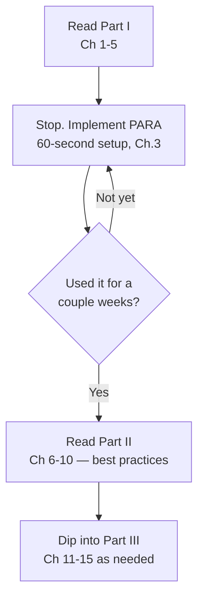

# Introduction — How to Read This Book

> [!cite] Book reference
> *The PARA Method: Simplify, Organize, and Master Your Digital Life* — Tiago Forte. Introduction: "How to Read This Book." Source: your uploaded EPUB.

> [!summary] One-line takeaway
> This isn't a cover-to-cover book — Part I (Chapters 1–5) is the complete, actionable system; Parts II and III are reference material to return to only once PARA is already running in your life.

## Why this chapter matters
Forte front-loads a permission structure most self-help/productivity books don't bother giving: he explicitly tells you where to stop reading. That matters for how the rest of these notes should be used too — Part I is the load-bearing content, Parts II–III are a playbook and deep-dive reference you dip into as specific problems come up, not a continuation you must read in order.

## The chapter in full (so you never need to re-read it)
Forte opens by stating the book's single design goal: "Every word in this book is designed to do one thing: propel you forward into taking action." He asks the reader to highlight anything interesting or relevant while reading, framing those highlights as literally the first items to go into a new PARA system — reading the book is meant to double as the first capture exercise.

He then explains the book's three-part structure explicitly:
- **Part 1** (Chapters 1–5) contains everything needed to get started, including a setup that "takes less than sixty seconds" (Chapter 3). His explicit recommendation: stop after Part 1 and go implement PARA before reading further.
- **Part 2** (Chapters 6–10) is "additional guidelines and best practices gathered from years of coaching people through adopting PARA" — he suggests returning to it after a couple of weeks of real-world use, not before.
- **Part 3** (Chapters 11–15) contains "deep dives" on advanced topics — project lists, habits, focus/creativity/perspective — requested by collaborators, clients, and students, meant to be read on demand "when you find yourself hungry for more guidance," not sequentially.

Forte then shares a personal reading philosophy: he used to insist on reading every book start to finish "without exception," slogged through "countless boring, irrelevant books," and eventually concluded this was counterproductive — "you don't get a prize for starting a book or finishing one. Books are not trophies to collect or evidence you've learned anything." His stated payoff for this book specifically: "The only reward from reading a book like this one comes from putting what you learn into practice, and you can do that after you've read just the first five chapters."

He closes the introduction with five explicit promises for what happens once PARA is adopted:
1. **Stop wasting time looking for information** — know exactly where notes/documents live and find them in seconds.
2. **Gain greater focus on what matters most** — clearer alignment between daily activity and actual interests/goals.
3. **Make things happen** — consistently finish what you start, beat procrastination, reuse past learning to move faster.
4. **Creativity and productivity will soar** — access to "a playground of your own ideas" for creative work that's been "locked up."
5. **Beat information overload and FOMO** — replace fear of missing information with confidence that what's needed is already at hand.

## Core concepts (quick-scan version)
| Part | Chapters | Purpose | When to read |
|---|---|---|---|
| Part I — The Fundamentals | 1–5 | The complete, minimal system; a 60-second setup | Read first, then stop and implement |
| Part II — The Playbook | 6–10 | Best practices from years of coaching adopters | Return after ~2 weeks of real use |
| Part III — Deep Dives | 11–15 | Advanced, on-demand topics (project lists, habits, focus) | Read as needed, not in order |

| # | Promise | What changes |
|---|---|---|
| 1 | Stop wasting time searching | Know where things live, find in seconds |
| 2 | Greater focus | Clarity on what matters, alignment with goals |
| 3 | Make things happen | Finish what you start, beat procrastination |
| 4 | Creativity/productivity soar | Access to your own idea backlog |
| 5 | Beat overload/FOMO | Confidence instead of anxiety about missing info |

## First-principles breakdown
Forte's structural claim — "read five chapters, stop, implement, come back later" — rests on a more basic premise about how skill/habit acquisition actually works: **declarative knowledge (knowing the four categories) and procedural knowledge (having the folders built and the habit running) are different things, and only the second one produces any benefit.** Reading Chapters 6–15 before implementing anything is, by this logic, net-negative: it adds more declarative knowledge on top of a system that doesn't exist yet, without the real-world friction that would make the advanced material meaningful.

This is a reasonable, well-supported claim in general (it matches how most skill-acquisition research treats the gap between knowing-about and knowing-how), but it's worth noting the boundary condition explicitly: it only holds if Part I is genuinely sufficient to start, i.e. if the four categories plus a 60-second setup really do constitute a working system rather than a toy version that breaks under real use. Whether that's true is exactly what Chapters 2–5 need to demonstrate, not something this chapter can establish on its own — it's a promise made before the evidence for it.

The "five promises" are best read as hypotheses to test against your own experience, not guarantees — they're stated with total confidence but are inherently unfalsifiable from the book alone (there's no control group, no measurement plan); treat them as marketing framing for what follows, not as a conclusion already reached.

## Visual representation

## Worked example — built directly in your vault
Nothing to build from the introduction itself — it's a reading-order instruction, not a method. Worth noting as a meta-point for how you (and I) should actually use these notes: per Forte's own advice, there's no requirement to read Chapters 6–15's notes in order once they exist — treat them, like the book, as reference material to open when a specific problem (team use, multiple platforms, habits) comes up.

## What the book doesn't tell you — community perspective
This short framing chapter doesn't carry enough independent claims to warrant dedicated community research of its own — the real substance (and the real scrutiny) starts at Chapter 1's "four categories" claim and Chapter 2 onward. See [[Chapter 1 - Introducing PARA]] for the community pushback on the core system.

## Deeper commentary — how this applies to your setup specifically
This book-notes project itself is a useful test of Forte's own advice: rather than reading (and note-taking) straight through in one pass, it's worth treating Chapters 6–10 and 11–15 the way he suggests the book itself be used — as material to revisit once you've actually lived with PARA for a while, not just absorbed as text. Practically, that means the most valuable thing to do after these notes are built is not more reading, but running your `01-Projects/` / `02-Areas/` review discipline for a couple of weeks and then coming back to the Part II and Part III notes with real friction points in hand.

## Practical / actionable takeaways
- [ ] Treat Chapters 6–10 and 11–15 notes as reference material to search, not a sequence to read straight through
- [ ] Re-read the "five promises" after a few weeks of real PARA use and honestly check which ones actually materialized for you

## Questions / things to decide for your own vault
- Do you want a lightweight log (even just a line per week) tracking whether the five promises are holding up in practice, or is that over-engineering a short intro chapter's framing device?

## Sources (external, beyond the book)
_No external sources were needed for this short framing chapter — see [[Chapter 1 - Introducing PARA]] for sourced community research on the system itself._

## Claude's pick — what I'd flag as most important
1. The permission to stop after Chapter 5 is the most practically useful thing in this introduction — it directly shapes how you should use the rest of these notes (reference, not required reading).
2. The declarative-vs-procedural-knowledge framing (first-principles section above) is worth remembering any time you're tempted to read ahead into Part III before actually running the system for a while.

## Related
- Next: [[Chapter 1 - Introducing PARA]]
- MOC: [[The PARA Method - MOC]]
