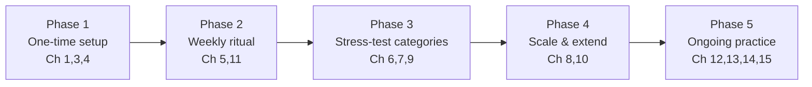

# Practical PARA Action Plan

A standalone, phased action plan consolidating *The PARA Method*'s 15 chapters into something you actually do, in order, without re-reading the chapter notes' explanations — each phase links out to the relevant chapter for depth instead of repeating it. Built after all 16 notes were complete; see [[The PARA Method - MOC]] for the full chapter-by-chapter breakdown this plan draws from.

> [!note] You've already done Phase 1
> This vault's PARA skeleton (`00-Inbox/` through `07-Periodic-Notes/`) was built while working through *Obsidian Second Brain*'s PARA chapter, before this book was processed. Phase 1 below is included for completeness and as a sanity-check against this book's specific version of the setup steps — not because it still needs doing.

## Phase timeline

## Phase 1 — One-time setup (already done in this vault; use as a sanity-check)
From [[Chapter 3 - The Sixty-Second PARA Setup Guide]] and [[Chapter 4 - Five Key Tips for Making Organizing Easy]]:

- [x] Archive everything old in one decisive bulk move, rather than filing it item by item
- [x] Create only the folders you have active content for right now — start with Projects, add Areas/Resources/Archive as needed, not all five up front
- [x] Set up an Inbox as the default capture point (`00-Inbox/`)
- [x] Number folders for logical sort order (`00-`, `01-`, etc.)
- [ ] Confirm a consistent naming convention is actually being followed (Tip #2) — worth a quick audit, not assumed
- [ ] Confirm offline/local-first mode is set correctly for active Project folders specifically (Tip #4) — check this against Gloss Local's own local-first design, not just the vault's sync settings
- [ ] Confirm real backups exist beyond the vault's own sync (Tip #5) — Gloss Local already backs up to Google Drive; confirm the Obsidian vault itself has an equivalent backup path, not just device sync

## Phase 2 — Install the weekly ritual (do this now, ongoing from here on)
From [[Chapter 5 - How to Maintain Your PARA System]] and [[Chapter 11 - Creating a Project List]]:

- [ ] Pick a fixed weekly time slot for the ~5-minute maintenance ritual: retitle anything unclear, sort anything in the Inbox, update the Project List
- [ ] Use the real artifact already built for this: [[01-Projects/Project List]] — fill in "Prioritization for this week" and add a row to the "Review log" table every time you do this
- [ ] Decide (open question from the MOC): does this ritual get a literal template in `07-Periodic-Notes/Weekly/`, or stay an informal habit? Pick one and stop re-deciding it weekly.

## Phase 3 — Stress-test your categories once you have real friction (after ~2-4 weeks of use)
From [[Chapter 6 - How to Distinguish between Projects and Areas]], [[Chapter 7 - How to Distinguish between Areas and Resources]], and [[Chapter 9 - Keep Information Flowing]]:

- [ ] Run every item in `01-Projects/` through the two-part test: does it have both a goal AND a deadline/timeframe? If not, it's probably an Area.
- [ ] For anything ambiguous between Areas and Resources, ask "am I responsible for this, or just interested in it?" — not "what is this about"
- [ ] Watch for items that should migrate between categories as their status changes (e.g. a Resource that becomes an active Project) — this migration is normal, not a sign you filed something wrong originally
- [ ] Name Gloss Local's eventual parent Area now (per Ch.6's worked example), even before it's needed, so the Project→Area transition isn't a decision made under time pressure later

## Phase 4 — Extend only if/when it's actually needed
From [[Chapter 8 - Extending PARA across Multiple Platforms]] and [[Chapter 10 - Using PARA with a Team]]:

- [ ] If Gloss Local's Windows/phone clients ever need their own organizing surface (not just the Mac-hub Obsidian vault), replicate the same four category names exactly — don't invent parallel terminology per platform
- [ ] Only do this if/when a second platform is genuinely in active use for organizing, not preemptively
- [ ] If Gloss Local ever gets a second contributor, revisit [[Chapter 10 - Using PARA with a Team]] before sharing anything — scope what's shared deliberately rather than exposing the whole vault

## Phase 5 — Ongoing practice (no end date — these are habits, not a checklist you finish)
From [[Chapter 12 - The Three Core Habits of Organization]], [[Chapter 13 - Using PARA to Enhance Focus, Creativity, and Perspective]], [[Chapter 14 - When in Doubt, Start Over]], and [[Chapter 15 - Organizing as Personal Growth]]:

- [ ] Keep applying the three durable habits: organize by outcome, organize just in time, keep things informal — these outlast any specific folder structure
- [ ] Use the vault deliberately as a focus tool (secluded workspace) and a creativity tool (curated raw material), not just a filing system
- [ ] Give yourself explicit permission to declare "digital bankruptcy" on a specific folder or the whole vault if it ever starts to feel overwhelming — this is a designed escape hatch, not a failure
- [ ] Periodically (perhaps alongside the monthly review) ask Ch.15's closing question honestly: does this vault reflect the life you actually have, or the one you wish you had?

## What this plan deliberately doesn't repeat
Every phase above links to its source chapter rather than re-explaining the reasoning — read the linked chapter note if a step doesn't make sense in isolation. This guide is a checklist, not a substitute for the "chapter in full" sections already written out in each note.

## Related
- [[The PARA Method - MOC]]
- [[Second Brain Use Cases Guide]] (from *Obsidian Second Brain*) — persona-based adaptations this action plan doesn't duplicate
- [[Where Does This Go - Quick Reference]]
- [[01-Projects/Project List]]
