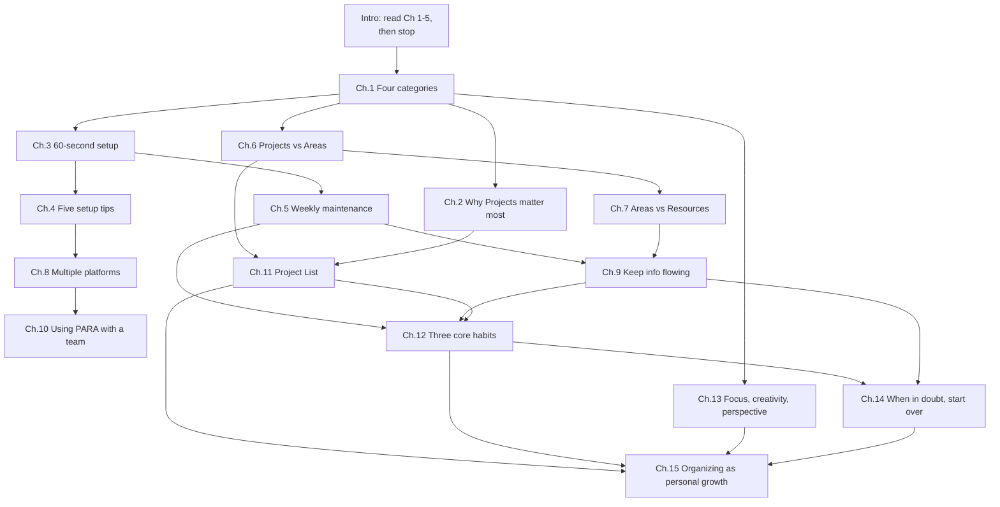

# The PARA Method — Map of Content

Map of Content for *The PARA Method: Simplify, Organize, and Master Your Digital Life* (Tiago Forte, 2023). This is the full-length, standalone treatment of the PARA system Forte first introduced as one chapter inside *[[Building a Second Brain - MOC|Building a Second Brain]]* — all 15 chapters plus the Introduction are processed here, each as an exhaustive "bible" note (quotes, full walkthrough, first-principles breakdown, community research, video, footnotes).

The book's own back matter, "Bonus: PARA Frequently Asked Questions," is just a pointer to `buildingasecondbrain.com/para` (a free online FAQ resource, not content printed in the book) — no local note was built for it; follow the link directly if you want it.

## Chapters

0. [[Introduction - How to Read This Book]] — the book's reading-order instructions and five promises; stop after Ch.5 and implement before reading further
1. [[Chapter 1 - Introducing PARA]] — the four categories (Projects, Areas, Resources, Archives) and "organize for action, not by subject"
2. [[Chapter 2 - The Power of Organizing by Project]] — why Projects specifically (not Areas or Resources) are the most powerful unit of organization
3. [[Chapter 3 - The Sixty-Second PARA Setup Guide]] — archive everything old first, then build only the one folder you need right now
4. [[Chapter 4 - Five Key Tips for Making Organizing Easy]] — Inbox, numbered folders, naming convention, offline Projects, real backups
5. [[Chapter 5 - How to Maintain Your PARA System]] — the ~5-minute weekly ritual: retitle, sort, update active projects
6. [[Chapter 6 - How to Distinguish between Projects and Areas]] — goal+deadline vs. standard+no end date; sprint vs. marathon
7. [[Chapter 7 - How to Distinguish between Areas and Resources]] — responsibility vs. interest is the deciding factor, not the topic
8. [[Chapter 8 - Extending PARA across Multiple Platforms]] — same four categories, spelled identically, across every tool you use
9. [[Chapter 9 - Keep Information Flowing]] — PARA is dynamic; information migrates between categories as your relationship to it changes
10. [[Chapter 10 - Using PARA with a Team]] — bottom-up adoption, a PARA Playbook, real training, scoped sharing
11. [[Chapter 11 - Creating a Project List]] — the five-step exercise; a maintained inventory is what makes the rest of PARA work
12. [[Chapter 12 - The Three Core Habits of Organization]] — organize by outcome, just in time, keep it informal
13. [[Chapter 13 - Using PARA to Enhance Focus, Creativity, and Perspective]] — the four categories as mental tools, not just filing locations
14. [[Chapter 14 - When in Doubt, Start Over]] — "digital bankruptcy" as a legitimate, consequence-free reset
15. [[Chapter 15 - Organizing as Personal Growth]] — the closing argument: organization as a source of real power and radical honesty

## How the chapters actually build on each other (not just a linear list)


*Ch.1 is the only true prerequisite — everything else assumes the four categories. Ch.6/7 (the two "stress test" chapters) and Ch.11 (the Project List) are the load-bearing chapters most of Part III leans on. Ch.15 is the explicit closing synthesis, pulling together Ch.11's honesty, Ch.12's habits, Ch.13's mental-tools framing, and Ch.14's permission to reset.*

## Vault structure this project touched
```
Claude Notes/
  Books/
    The PARA Method/
      Introduction - How to Read This Book.md
      Chapter 1 - Introducing PARA.md
      Chapter 2 - The Power of Organizing by Project.md
      Chapter 3 - The Sixty-Second PARA Setup Guide.md
      Chapter 4 - Five Key Tips for Making Organizing Easy.md
      Chapter 5 - How to Maintain Your PARA System.md
      Chapter 6 - How to Distinguish between Projects and Areas.md
      Chapter 7 - How to Distinguish between Areas and Resources.md
      Chapter 8 - Extending PARA across Multiple Platforms.md
      Chapter 9 - Keep Information Flowing.md
      Chapter 10 - Using PARA with a Team.md
      Chapter 11 - Creating a Project List.md
      Chapter 12 - The Three Core Habits of Organization.md
      Chapter 13 - Using PARA to Enhance Focus, Creativity, and Perspective.md
      Chapter 14 - When in Doubt, Start Over.md
      Chapter 15 - Organizing as Personal Growth.md
      The PARA Method - MOC.md
01-Projects/
  Project List.md                   ← Ch.11, a real, filled-in Project List for your two live Projects
```
No new top-level PARA folders were created — `00-Inbox/` through `07-Periodic-Notes/` already existed in this vault before this book was processed (built while working through *Obsidian Second Brain*'s PARA chapter). Every chapter's "worked example" section sanity-checks this book's specific claims against what's already live, rather than rebuilding structure that already exists.

## Running list of open decisions (collected across all 16 notes)
Grouped by theme rather than by chapter, since several chapters converge on the same underlying questions:

**Project List hygiene**
- Numeric cap on live `01-Projects/` items (Ch.1, Ch.2): hard cap (e.g. 12) vs. a looser "does it still have a visible end date" check
- Is two Projects the right number right now, or is something hiding unexamined in `02-Areas/` or `00-Inbox/` that should actually be a Project (Ch.11)?
- Is "Second Brain Build-Out" at risk of quietly becoming an Area rather than a Project that finishes (Ch.1, Ch.2) — worth revisiting now that all chapters + guides exist

**Gloss Local's eventual Area**
- What Area will Gloss Local nest under once stable — a new "Personal Software / Home Lab" Area, or the existing `Knowledge Management` Area (Ch.6)?
- Does Gloss Local currently have any "just in case" structure built before it was needed, worth revisiting under Ch.12's Habit #2 (just-in-time organizing)?
- Does Gloss Local produce both "responsibility" and "interest" material that should split into separate Area/Resource homes from day one (Ch.7)?

**Vault mechanics and rituals**
- Should the weekly Project List review and the three-step maintenance ritual (Ch.5, Ch.11) get a literal recurring note/template in `06-Daily-Notes/` or `07-Periodic-Notes/`, or stay an implicit habit?
- Does `Claude Notes/` get resolved into `03-Resources/Obsidian and PKM/` once Second Brain Build-Out archives, or stay permanently separate (Ch.5 revisits this open question from the *Obsidian Second Brain* notes)?
- Should `04-Archive/` get a dated-subfolder convention (`Archive 2026-11-18/`) the first time something is actually archived (Ch.3)?
- What's the actual trigger for declaring a full reset/"digital bankruptcy" in this vault — a concrete threshold, or Forte's own "when it feels overwhelming" (Ch.14)?

**Lower-priority / reflective**
- Per-project emoji and Hot/Cold simplification (Ch.4) — worth adopting now at 2 projects, or only once the vault has more folders to visually distinguish?
- Uppercase/lowercase naming convention for Areas vs. Resources (Ch.7) — adopt, or more ceremony than it's worth at this size?
- Whether Obsidian's native linking/tagging should be the default re-sorting mechanism instead of Forte's literal "move the folder" (Ch.9)
- Team-readiness audit: is any part of the current solo vault secretly "written for an audience" already, worth flagging if Gloss Local gets a second contributor (Ch.10)?
- Whether `02-Areas/` and `03-Resources/` content has drifted toward "the life you wish you had" rather than the one you actually have (Ch.15's closing honesty test)
- Whether there's a real "dream" (Ch.11's term) sitting without a Project attached that deserves to become one (Ch.15)

## Known recurring theme across chapters (community research)
The community research converged repeatedly on one specific failure mode, named in different language chapter after chapter: **the Projects/Areas boundary is where PARA breaks in practice.** Chapter 1's community research flagged it first (the "mushy" Projects/Areas line); Chapter 2 found the same thing independently (project lists that never shrink); Chapter 6 found it a third time via the Mac Power Users forum (task-manager practitioners struggling with where Areas belong); and Chapter 11's "10-to-15 rule" research exists specifically as a countermeasure to this same failure. If there's one thing to actively watch for in this vault going forward, per the convergent research across four separate chapters, it's this exact boundary.

## Recurring first-principles insight
Several chapters' first-principles breakdowns converged on the same underlying mechanism from a different angle each time: **Projects run on goal/completion motivation (closure-seeking), while Areas and Resources run on habit/identity motivation (sustained through repetition, not intensity).** Chapter 6 named this explicitly (Zeigarnik-effect-style closure drive vs. habit-formation literature); Chapter 12's "three habits" and Chapter 14's "start over" permission are both, underneath the branding, ways of protecting the habit-motivation side of the system from being treated like a goal-motivation problem (you can't "finish" maintaining a vault, so stop trying to perfect it once and declare victory — just keep the habit cheap enough to repeat).

## Sources
This MOC synthesizes research already cited in full within each chapter note — see the individual chapters' "Sources" and "Footnotes" sections for every external link and book-endnote citation used.

## Related
- [[Books - Index]]
- Cross-reference (origin book, shorter PARA chapter): [[Building a Second Brain - MOC]]
- Cross-reference (Obsidian-specific PARA implementation): [[Obsidian Second Brain - MOC]]
- Decision tree: [[Where Does This Go - Quick Reference]]
- Live artifact: [[01-Projects/Project List]]
